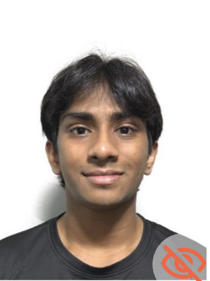
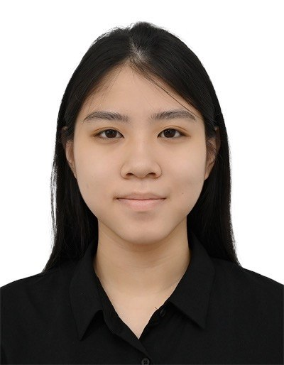
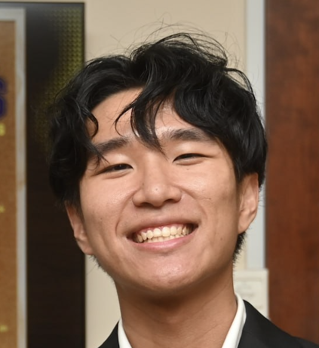

We are a team based in the [School of Computing, National University of Singapore](https://www.comp.nus.edu.sg).

You can reach us through our [team repository issue tracker](https://github.com/AY2627S1-CS2103T-W12-2/tp/issues).

## Project team

### Vishesh Jally

[[github](https://github.com/jvally)]

* Role: Developer
* Responsibilities: Meeting context, contact photos and storage; release preparation and testing

### Lee Jia Jie

[[github](http://github.com/jiewue)]

* Role: Developer
* Responsibilities: Plain and typed search, tag grouping, activity-time sorting, contact-view docs and the list status heading

### Hendrick

[[github](http://github.com/honeycombhen)]

* Role: Developer
* Responsibilities: Tag command, undo and redo, safe data saving, tag colors; Developer Guide use cases and diagrams

### Cheryl

[[github](https://github.com/Atqui-404)]

* Role: Developer
* Responsibilities: UI

### Cysiac

[[github](http://github.com/cysiac)]

* Role: Developer
* Responsibilities: Contact activity times, follow-up dates and the due list; Help and exit behaviour; reviewing pull requests
