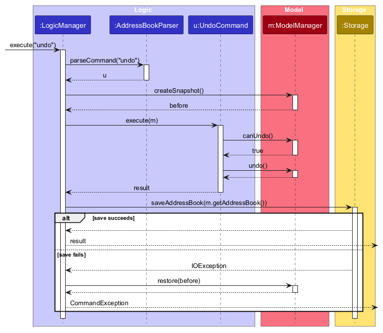
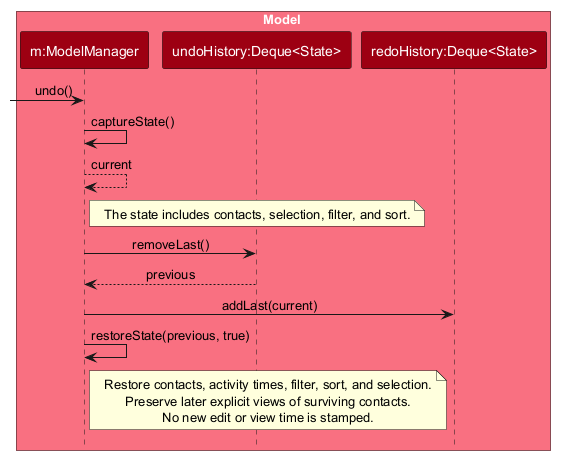

* Table of Contents
{:toc}

--------------------------------------------------------------------------------------------------------------------

## **Acknowledgements**

* _{List the sources of reused or adapted ideas, code, documentation, and third-party libraries here, with links to the originals.}_

--------------------------------------------------------------------------------------------------------------------

## **Setting up, getting started**

Refer to the guide [_Setting up and getting started_](SettingUp.md).

--------------------------------------------------------------------------------------------------------------------

## **Design**

:bulb: **Tip:** The `.puml` files used to create diagrams are in `docs/diagrams`. Refer to the [_PlantUML Tutorial_ at se-edu/guides](https://se-education.org/guides/tutorials/plantUml.html) to learn how to create and edit diagrams.

### Architecture

The ***Architecture Diagram*** given above explains the high-level design of the App.

The following provides a quick overview of the main components and their interactions.

**Main components of the architecture**

**`Main`** (consisting of classes [`Main`](https://github.com/se-edu/addressbook-level3/tree/master/src/main/java/seedu/address/Main.java) and [`MainApp`](https://github.com/se-edu/addressbook-level3/tree/master/src/main/java/seedu/address/MainApp.java)) is in charge of the app launch and shut down.
* At app launch, it initializes the other components in the correct sequence, and connects them up with each other.
* At shut down, it shuts down the other components and invokes cleanup methods where necessary.

The bulk of the app's work is done by the following four components:

* [**`UI`**](#ui-component): The UI of the App.
* [**`Logic`**](#logic-component): The command executor.
* [**`Model`**](#model-component): Holds the data of the App in memory.
* [**`Storage`**](#storage-component): Reads data from, and writes data to, the hard disk.

[**`Commons`**](#common-classes) represents a collection of classes used by multiple other components.

**How the architecture components interact with each other**

The *Sequence Diagram* below shows how the components interact with each other for the scenario where the user issues the command `delete 1`.

Each of the four main components (also shown in the diagram above),

* defines its *API* in an `interface` with the same name as the Component.
* provides its functionality through a concrete `{Component Name}Manager` class that implements the corresponding API interface.

For example, the `Logic` component defines its API in `Logic.java` and implements it in `LogicManager.java`. Other components interact with a component through its interface rather than its concrete class, preventing them from coupling to that component's implementation, as illustrated in the following partial class diagram.

The sections below give more details of each component.

### UI component

The **API** of this component is specified in [`Ui.java`](https://github.com/se-edu/addressbook-level3/tree/master/src/main/java/seedu/address/ui/Ui.java)

The UI consists of a `MainWindow` and its parts, such as `CommandBox`, `ResultDisplay`, `PersonListPanel`, `PersonDetailPanel`, and `StatusBarFooter`. All of these, including `MainWindow`, inherit from the abstract `UiPart` class, which captures common behavior among classes that represent visible GUI parts.

The `UI` component uses the JavaFX UI framework. The layouts of these UI parts are defined in matching `.fxml` files in `src/main/resources/view`. For example, [`MainWindow.fxml`](https://github.com/se-edu/addressbook-level3/tree/master/src/main/resources/view/MainWindow.fxml) specifies the layout of [`MainWindow`](https://github.com/se-edu/addressbook-level3/tree/master/src/main/java/seedu/address/ui/MainWindow.java).

`PersonCard` and `PersonDetailPanel` use `ContactPhoto` to display bounded images from validated
`PhotoStorage` bytes. A single background worker performs file validation and image decoding,
so building a contact list does not block the JavaFX thread on photo reads. A placeholder is shown
until loading finishes. Replaced requests and discarded contact cards cancel queued photo work;
an already-running decode can finish, but its stale result is never displayed.
The detail panel observes
the viewed person and scrolls vertically to keep full meeting and contact details accessible.
Both `PersonCard` and `PersonDetailPanel` show a ★ label in the top right corner of the card or panel of a starred
person; the label is hidden otherwise (and in `PersonCard` it also takes no space).

The `UI` component,

* executes user commands using the `Logic` component.
* listens for changes to `Model` data so that the UI can be updated with the modified data.
* keeps a reference to the `Logic` component, because the `UI` relies on the `Logic` to execute commands.
* depends on some classes in the `Model` component because it displays `Person` objects from the model.

### Logic component

**API** : [`Logic.java`](https://github.com/se-edu/addressbook-level3/tree/master/src/main/java/seedu/address/logic/Logic.java)

Here's a (partial) class diagram of the `Logic` component:

The sequence diagram below illustrates the interactions within the `Logic` component, taking `execute("delete 1")` API call as an example.

:information_source: **Note:** The lifeline for `DeleteCommandParser` should end at the destroy marker (X), but due to a limitation of PlantUML, it continues to the end of the diagram.

How the `Logic` component works:

1. When `Logic` is called upon to execute a command, the command is passed to an `AddressBookParser` object, which in turn creates a parser that matches the command (e.g., `DeleteCommandParser`) and uses it to parse the command.
1. This results in a `Command` object (more precisely, an object of one of its subclasses e.g., `DeleteCommand`) which is executed by the `LogicManager`.
1. The command can communicate with the `Model` when it is executed (e.g. to delete a person). 
   Note that although this is shown as a single step in the diagram above for simplicity, the code can require several interactions between the command object and the `Model` to complete the operation.
1. The result of the command execution is encapsulated as a `CommandResult` object which is returned from `Logic`.

Here are the other classes in `Logic` (omitted from the class diagram above) that are used for parsing a user command:

How the parsing works:

* When called upon to parse a user command, the `AddressBookParser` class creates an `XYZCommandParser` (`XYZ` is a placeholder for the specific command name, e.g., `AddCommandParser`). The parser uses the other classes shown above to parse the user command and create an `XYZCommand` object (e.g., `AddCommand`). The `AddressBookParser` returns that object as a `Command` object.
* All `XYZCommandParser` classes, such as `AddCommandParser` and `DeleteCommandParser`, implement the `Parser` interface so they can be treated similarly where appropriate, for example during testing.

### Model component

**API** : [`Model.java`](https://github.com/se-edu/addressbook-level3/tree/master/src/main/java/seedu/address/model/Model.java)

The `Model` component,

* stores the address book data i.e., all `Person` objects (which are contained in a `UniquePersonList` object).
* stores the `Person` objects selected by the current filter, such as search results, in a separate _filtered_ list. It exposes this list as an unmodifiable `ObservableList<Person>` that the UI can observe and bind to, so the UI updates when the list changes.
* keeps immutable meeting context in each `Person`, using `Meeting.EMPTY` when all event/date/role fields are absent; the complete builder also preserves the optional `photoPath` reference when other fields change.
* stores a `UserPrefs` object that represents the user’s preferences (currently, just the GUI settings). This is exposed to the outside as a `ReadOnlyUserPrefs` object.
* does not depend on any of the other three components (as the `Model` represents data entities of the domain, they should make sense on their own without depending on other components)
* gives every `Person` an immutable `Activity` holding when the person was created, last edited and last viewed. Each time is optional: an unknown time is absent, never invented. `Person#withActivity` copies a person with new activity, and `Person#hasSameDetails` compares two persons while ignoring activity.
* gives every `Person` a `starred` flag, which is false by default. The `star` and `unstar` commands change it through `Person#toBuilder` and `Model#editPerson`, and the `filter starred` command shows the starred persons by passing `Person#isStarred` to `Model#updateFilteredPersonList`.
* gives every `Person` an optional free-form `Note` of at most 1000 characters. An empty `Note` means that the person has no note. The `note` command changes it through `Person#toBuilder` and `Model#editPerson`, so the other fields and the activity times are kept, and the last edited time changes only when the note really changes.

:information_source: **Note:** The alternative, arguably more object-oriented, design below keeps a unique list of tags in `AddressBook`, and each `Person` references tags from that list. This lets `AddressBook` maintain one `Tag` object per unique tag instead of each `Person` holding its own `Tag` objects. 

### Storage component

**API** : [`Storage.java`](https://github.com/se-edu/addressbook-level3/tree/master/src/main/java/seedu/address/storage/Storage.java)

The `Storage` component,

* can save both address book data and user preference data in JSON format, and read them back into corresponding objects.
* keeps photo file access in the separate `PhotoStorage` class. Commands import validated PNG/JPEG files into the application-folder `photos/` directory; `ContactPhoto` reads validated image bytes through the same service. Imported assets are retained for history restoration.
* is implemented by `StorageManager`, which delegates the actual JSON file access to `JsonAddressBookStorage` and `JsonUserPrefsStorage` (one class per data file).
* depends on some classes in the `Model` component (because the `Storage` component's job is to save/retrieve objects that belong to the `Model`)
* saves a person's activity as optional `createdAt`, `lastEditedAt` and `lastViewedAt` fields in `addressbook.json`. Each is a whole-second ISO-8601 UTC timestamp written exactly as `2026-10-17T04:12:33Z`. A missing or `null` field loads as an absent time, so data files from v1.3 still load. A value with a fraction of a second, an offset other than `Z`, surrounding spaces or any other format makes the file fail to load with `Invalid contact data: '<field>' must be an ISO-8601 UTC timestamp.`, naming the field (`createdAt`, `lastEditedAt` or `lastViewedAt`). `JsonAdaptedPerson.INVALID_FIELD_MESSAGE_FORMAT` holds this message pattern so other fields use the same wording.
* saves whether a person is starred as an optional `starred` boolean in `addressbook.json`. A missing or `null` field loads as not starred, so older data files still load. Any other value, such as a string or a number, makes the file fail to load with `Invalid contact data: 'starred' must be true or false.` The field is kept as an `Object` in `JsonAdaptedPerson` so that such a value reaches this message instead of a generic Jackson error.
* saves a person's note as an optional `note` string in `addressbook.json`. A missing or `null` field loads as no note, so older data files still load. A note that is blank, longer than 1000 characters or not a string makes the file fail to load with `Invalid contact data: 'note' must be a string of at most 1000 characters.`

### Common classes

Classes used by multiple components are in the `seedu.address.commons` package.

--------------------------------------------------------------------------------------------------------------------

## **Implementation**

This section describes some noteworthy details on how certain features are implemented.

### Contact activity

Each `Person` carries an `Activity` with its created, last edited and last viewed times (see the [Model component](#model-component) and [Storage component](#storage-component) for the data and file format). The model is the only place that decides when these times change, so every feature records them the same way.

* `ModelManager` holds a `java.time.Clock`. By default it is the system clock in `Model.DISPLAY_ZONE` (Asia/Singapore), which is the zone used to display activity times and to decide what "today" is. Tests inject a fixed clock. `Model#now()` returns the current time in whole seconds.
* **Copying a contact:** `Person` is immutable. To change an existing contact, call `person.toBuilder()`, set the fields to change, and call `build()`. The builder starts with every field, so a field you do not set (including activity times and fields added by later features) is kept. Do not call the `Person` constructors with a partial set of fields. A new `Person` field must also be added to `Person.Builder`. The constructors without an activity argument are for new contacts and tests.
* **Created:** `AddCommand` adds the new person with `created` set to `Model#now()`. A command that fails (for example, a duplicate) records nothing.
* **Last edited:** `Model#editPerson(target, edited)` is the rule that every command changing a contact must use instead of `Model#setPerson`. If `edited.hasSameDetails(target)` it does nothing. Otherwise it stores `edited` with the activity of `target` and `lastEditedAt` set to now. The activity of `edited` is ignored, so a copy built without activity cannot wipe the other times. `EditCommand` and `TagCommand` use it, and new commands (notes, star, follow-up, photo) should too.
* **Last viewed:** `Model#viewPerson(person)` sets `lastViewedAt` to now and makes the stored person the viewed person. `ViewCommand` uses it. Viewing is not part of undo history, so undoing a change does not restore an earlier last-viewed time.
* **A failed save changes nothing.** `LogicManager` takes `Model#createSnapshot()` before it runs a command. If saving the data file then fails, it calls `Model#restore(snapshot)` and shows the error, so the contacts, the viewed contact, the visible-list filter and sort, and the undo and redo stacks are as they were. No created, edited or viewed time is kept. The snapshot is opaque (`Model.Snapshot`) and covers in-memory command changes, not user preferences.
* **Display:** the detail panel shows the three times as `yyyy-MM-dd HH:mm` in `Model.DISPLAY_ZONE` (Asia/Singapore), or an em dash (`—`) when a time is not known. The block sits at the bottom of `PersonDetailPanel.fxml`.

Design considerations:

* **Stamp in the model, not in each command.** Each command would otherwise repeat the "was anything really changed?" check and could drift apart. The trade-off is that `Model` gains two methods.
* **Ignore the edited person's activity.** Commands build the edited `Person` from the old one, and a new field that someone forgets to copy would silently reset the times. Always taking the activity from `target` makes that mistake harmless.

### Activity-time sorting

`SortCommand` passes a `SortCriterion` (`ADDED`, `EDITED`, or `VIEWED`) to `ModelManager`. The model keeps one
`FilteredList` for the current contacts and wraps it in a `SortedList`, which is the list exposed to the UI and every
index-based command. This ensures that the index a user sees is the contact that `view`, `edit`, `delete`, and `tag`
operate on.

The comparator orders known activity times newest first and unknown times last. It then uses the source address-book
order as a deterministic tie-breaker. Changing a filter leaves the active sort intact; `list` and `reset` clear both
the filter and sort. A successful `view` replaces the contact with an updated `lastViewedAt`, which automatically causes the
`SortedList` to reorder when `sort viewed` is active.

Design considerations:

* **One sorted visible list instead of command-specific reordering.** Returning the `SortedList` from the model keeps
  every displayed index aligned with the UI. The alternative—sorting separately in each index-based command—would let
  commands act on a different contact from the one displayed.
* **Use current source positions for equal times.** Contacts can be added or replaced while a sort is active. Looking
  up positions in the current address book keeps ties in original order even after those changes.

### Starring contacts

`StarCommand` serves both `star` and `unstar`: `StarCommandParser` is created with `true` or `false` by `AddressBookParser`, so the two commands share one parser and one command class. `FilterCommand` serves `filter starred` and `filter starred off`.

The sequence diagram below shows what happens when the user executes `star 1`. `unstar 1` takes the same steps with `false` in place of `true`.

* **Changing a star:** `StarCommand` looks up the person at the displayed index and, if the flag really changes, calls `Model#editPerson` with `person.toBuilder().withStarred(...)`. Because it goes through `editPerson`, the change is saved, can be undone, and updates the last edited time. If the person already has the requested state, the command succeeds with a message saying nothing changed and does not touch the model, so no undo step is created.
* **Filtering:** `FilterCommand` replaces the predicate of the filtered list, like `find` and `group`. The three do not combine; combining filters is tracked separately in #128.
* **Logging:** `StarCommand` logs at `INFO` when a star changes and at `FINE` when nothing changes, and `FilterCommand` logs at `INFO` with the number of contacts shown. The logs contain only the displayed index and counts, never a name or any other personal detail.

### Undo history

`ModelManager` keeps up to 50 contact states in a session-only undo stack. Each state copies the address book, the viewed contact, the active visible-list predicate, and the sort criterion. Its `ModelSnapshot` also captures both history stacks so a failed save can restore them. History is not written to JSON; the restored contacts are.

`LogicManager` takes a snapshot before running each command. After the command succeeds, it saves the address book. Only after a successful save does `Model#recordSuccessfulMutation(before)` compare the contact data and add the previous state to history. The comparison ignores `lastViewedAt`, so `view` is not an undoable contact change. Failed commands, failed saves, and changes that leave contacts unchanged add no entry. A new saved mutation clears redo history.

The following sequence shows the `undo` command, including rollback if saving the restored state fails:

`UndoCommand` checks `Model#canUndo()` and reports `Nothing to undo.` when the stack is empty. Otherwise, `ModelManager#undo()` moves the current state to the redo stack and restores the latest undo state. Restoration reinstates contact data, timestamps, the visible-list predicate, sort order, and the detail selection without stamping the current time. A later explicit view of a surviving contact is preserved; a deleted contact comes back with its pre-deletion view time.

The saved state copies the full address book. This keeps undo independent of individual command implementations and lets it restore fields added by later features. The trade-off is memory proportional to the number and size of saved address books, bounded by the 50-entry history limit. `ModelManager` also maintains a redo stack, but the `redo` CLI command is tracked separately in #132.

### Command history

Pressing **Up** or **Down** in the command box brings back commands that were submitted earlier in the session. The logic is split in two classes so that it can be tested without the JavaFX toolkit:

* `CommandHistory` is a plain Java class that holds the remembered commands and the browsing state. `record(commandText)` stores a command (blank text is ignored, a command equal to the newest entry is not stored twice, and the oldest entry is dropped once there are more than `CommandHistory#MAX_ENTRIES`, which is 50). `older(currentText)` and `newer()` move through the entries. When browsing starts, `older` keeps `currentText` as a draft, and `newer` returns that draft after the newest entry so the user gets back what they were typing.
* `CommandBox` owns one `CommandHistory`. It records the text of every submitted command *before* running it, so commands that fail (an unknown command, an invalid index) are remembered too. It also adds a `KEY_PRESSED` event filter to its text field, which reacts only to a plain Up or Down key and consumes only those events. Key presses with Shift, Ctrl, Alt or Meta held down, and key presses in other controls, are left alone, so text selection with Shift+Up still works.

The history lives in memory only and is not saved to the data file, so it starts empty each time the app is launched. `CommandHistory` does not depend on `Model` or `Logic`. Running `list`, `clear` or `undo` does not clear the history; those commands are remembered like any other.

### \[Proposed\] Data archiving

_{Explain here how the data archiving feature will be implemented}_

--------------------------------------------------------------------------------------------------------------------

## **Documentation, logging, testing, dev-ops**

* [Documentation guide](Documentation.md)
* [Testing guide](Testing.md)
* [Logging guide](Logging.md)
* [DevOps guide](DevOps.md)

--------------------------------------------------------------------------------------------------------------------

## **Appendix: Requirements**

### Product scope

**Target user profile**:

* is a university student who attends many hackathons, both to build projects and to meet people
* meets 15 to 30 new people (teammates, mentors, recruiters, fellow participants) at each hackathon
* keeps a laptop open throughout the event, while their phone stays in a pocket or on a table
* finds taking out a phone to save a contact too much effort in the middle of an event, so often does not save the contact at all
* wants to record a contact in a few seconds without breaking the flow of a conversation
* needs to remember *who* each person is, not just their name (e.g. what they are building, what they are good at), as they struggle to recall many of these people a week later
* plans to follow up with some of these people after the event (e.g. to form a team, ask for advice or apply for a role)
* may have an unreliable internet connection at crowded venues
* can type fast and is comfortable with CLI commands (e.g. a computer science student)
* prefers desktop apps over other types of applications

**Value proposition**: LarperBoard helps hackathon participants build a network that they can still use after the event. Using one short typed command on the laptop that is already open, the user records a new contact together with the detail that will jog their memory later, such as what the person is building, their tech stack and where they were met. Contacts can be grouped by hackathon and team, searched by these details, and exported for follow-up. This is faster than saving contacts on a phone in the middle of an event, and more useful afterwards than a generic address book, which records who someone is but not how or where they were met. All data is stored locally, so LarperBoard works without an internet connection.

### User stories

Priorities: Must-have, Nice-to-have, Unlikely-to-have

| Priority | As a …​ | I want to …​ | So that I can…​ |
| -------- | ------ | ---------- | ------------- |
| Must-have | user | add a contact | add people quickly |
| Must-have | user | delete unnecessary people | remove people who are no longer relevant to me |
| Nice-to-have | user | edit people's information | correct a mistake without having to delete and re-add the contact |
| Nice-to-have | user | undo my last destructive CLI action | avoid losing important contact information because of a fast typo |
| Nice-to-have | hackathon participant | clear all data or reset my board | start fresh for a brand new hackathon event |
| Nice-to-have | user | group people together | organize everyone I met at a specific track or workshop |
| Unlikely-to-have | forgetful participant | search contacts using partial text or fuzzy matching | find a person even if I only remember part of their name or handle |
| Nice-to-have | user | sort people by keywords | easily find people using keywords |
| Unlikely-to-have | power user | filter contacts | execute complex queries on my network |
| Must-have | hackathon participant | attach project tags or stack keywords | remember what tech stack or project a participant is cracked at |
| Nice-to-have | forgetful participant | add rapid freeform notes (e.g., "Met at booth 4") | remember the context when following up after the event |
| Nice-to-have | hackathon participant | mark high-priority contacts with a "starred" flag | easily filter and focus on standout individuals |
| Nice-to-have | hackathon participant | attach the hackathon name/date as a tag (auto or manual) | look back and remember which event I met each person at |
| Nice-to-have | hackathon participant | tag a contact with their hackathon role (Frontend, Pitcher, Designer) | easily assemble balanced teams for future hackathons |
| Nice-to-have | user | view a list of all saved contacts sorted by recency | quickly recall the last few people I spoke with |
| Must-have | user | display a detailed view of a single contact card | read all notes, links, and tags in one clean view |
| Nice-to-have | user | view images | remember the projects people have created |
| Nice-to-have | CLI user | view contact summaries in a clean, formatted ASCII table | browse my address book without messy text wrapping |
| Nice-to-have | visual learner | distinguish categories with colour codes | visually scan and distinguish categories at a glance |
| Nice-to-have | user | run a stats/summary command (counts by tech stack or event) | get a high-level snapshot of my networking efforts |
| Nice-to-have | power user | have fast keyboard navigation | navigate and manipulate data at maximum keyboard speed |
| Nice-to-have | user | set up CLI auto-completion for commands and contact names | run commands faster with Tab completion |
| Nice-to-have | first-time user | run a help/tutorial command with interactive examples | learn key commands within 30 seconds of installing the app |
| Nice-to-have | hackathon participant | save social profiles (GitHub, LinkedIn, X, Telegram) under dedicated flags | have direct links to reach out to a person on their preferred platform |
| Nice-to-have | user | copy a contact's email/social handle to the clipboard from the CLI | quickly paste it into a browser or messaging app |
| Nice-to-have | hackathon participant | import contact details via a short encoded CLI string or QR token | exchange contact information instantly without manual typing |
| Nice-to-have | power user | export my contact list to JSON, CSV, or Markdown | import it into my personal CRM, Notion, or address book |
| Must-have | offline user | have all data stored locally | use the app without an internet connection at crowded venues |
| Nice-to-have | hackathon participant | archive or hide contacts I don't need anymore | avoid being distracted by people I no longer need to see in my active list |
| Nice-to-have | hackathon participant | be flagged when I try to add someone who is already in my list | avoid accidentally creating two separate entries for the same person met at different events |

### Use cases

(For all use cases below, the **System** is the `LarperBoard` and the **Actor** is the `user`, unless specified otherwise)

**Use case: Add a person**

**MSS**

1. User requests to add a person and provides the contact details.
2. LarperBoard adds the person.
3. LarperBoard displays a confirmation message.

   Use case ends.

**Extensions**

* 1a. The user omits a required field or enters an invalid value.
  * 1a1. LarperBoard displays an error message.
  * 1a2. Use case resumes at step 1.
* 2a. The person already exists in the address book.
  * 2a1. LarperBoard displays a duplicate-person error message.

    Use case ends.

**Use case: Add project tags or stack keywords to a person**

**MSS**

1. User requests to list persons.
2. LarperBoard shows a list of persons.
3. User requests to update the selected person's project tags or stack keywords.
4. LarperBoard replaces the selected person's existing tags with the supplied tags.
5. LarperBoard displays the updated person details.

   Use case ends.

**Extensions**

* 2a. The list is empty.

  Use case ends.

* 3a. The selected person cannot be identified.
  * 3a1. LarperBoard shows an error message.

    Use case resumes at step 2.

* 3b. The user does not provide any tags or keywords.
  * 3b1. LarperBoard shows an error message.

    Use case resumes at step 3.

* 4a. One or more tags or keywords contain invalid characters.
  * 4a1. LarperBoard shows an error message.

    Use case resumes at step 3.

**Use case: Find a person by name**

**MSS**

1. User requests to find persons using one or more name keywords.
2. LarperBoard searches for persons whose names contain at least one of the keywords, ignoring letter case.
3. LarperBoard displays the matching persons.

   Use case ends.

**Extensions**

* 1a. The user does not provide any name keywords.
  * 1a1. LarperBoard displays an error message.

    Use case resumes at step 1.

* 2a. No persons match the provided keywords.
  * 2a1. LarperBoard informs the user that no matching persons were found.

    Use case ends.

**Use case: Group contacts by tag**

The user enters `group t/TAG` to display contacts with a selected tag.

**MSS**

1. User requests to group contacts by one tag.
2. LarperBoard filters the displayed contact list to contacts with the specified tag, ignoring tag letter case.
3. LarperBoard displays the selected tag and the number of matching contacts.
4. User enters `list` to return to the full contact list.

   Use case ends.

**Extensions**

* 1a. The user omits the tag or provides an invalid tag.
  * 1a1. LarperBoard displays an error message.

    Use case resumes at step 1.

* 2a. No contacts have the specified tag.
  * 2a1. LarperBoard displays the selected tag and a result count of zero.

    Use case ends.

**Implementation note:** Grouping updates the existing filtered person list. Tags stored on each contact remain the source of truth; no separate group data is stored. Index-based commands continue to use the displayed list.

**Use case: Edit a person's details**

**MSS**

1. User requests to edit a person.
2. User provides one or more replacement details for the person.
3. LarperBoard updates the specified details and retains the unspecified details.
4. LarperBoard displays the updated person details.

   Use case ends.

**Extensions**

* 1a. The selected person cannot be identified.
  * 1a1. LarperBoard displays an error message.

    Use case resumes at step 1.

* 2a. The user does not provide any details to edit.
  * 2a1. LarperBoard displays an error message.

    Use case resumes at step 2.

* 2b. One or more replacement details are invalid.
  * 2b1. LarperBoard displays an error message.

    Use case resumes at step 2.

* 3a. The edited person would duplicate another person in the address book.
  * 3a1. LarperBoard displays a duplicate-person error message.

    Use case ends.

**Use case: List all persons**

**MSS**

1. User requests to list all persons.
2. LarperBoard displays all persons and their contact details.

   Use case ends.

**Extensions**

* 2a. The address book contains no persons.
  * 2a1. LarperBoard displays an empty list.

    Use case ends.

**Use case: View usage instructions**

**MSS**

1. User requests usage instructions.
2. LarperBoard displays instructions for the available commands.

   Use case ends.

**Use case: Clear all persons**

**MSS**

1. User requests to clear the address book.
2. LarperBoard removes all persons from the address book.
3. LarperBoard displays a confirmation message.

   Use case ends.

**Extensions**

* 2a. The address book contains no persons.
  * 2a1. LarperBoard displays the confirmation message.

    Use case ends.

**Use case: Load saved contacts on application startup**

**MSS**

1. User launches the application.
2. LarperBoard loads the saved persons from the data file.
3. LarperBoard displays the loaded persons.

   Use case ends.

**Extensions**

* 2a. No saved address book exists.
  * 2a1. LarperBoard initializes a new address book with the default sample persons.
  * 2a2. LarperBoard displays the sample persons.

    Use case ends.

* 2b. The saved address book cannot be loaded because the data is corrupted or invalid.
  * 2b1. LarperBoard starts with an empty address book.
  * 2b2. LarperBoard displays the empty address book.

    Use case ends.

**Use case: Delete a person**

**MSS**

1. User requests to list persons.
2. LarperBoard shows a list of persons.
3. User requests to delete a specific person in the list.
4. LarperBoard deletes the person.

   Use case ends.

**Extensions**

* 2a. The list is empty.

  Use case ends.

* 3a. The given index is invalid (e.g., non-numeric, 0, negative, or exceeds list size).
  * 3a1. LarperBoard shows an invalid index error message.

    Use case resumes at step 2.

* 3b. Extraneous parameters are provided.
  * 3b1. LarperBoard shows an invalid command format message.

    Use case resumes at step 2.

**Use case: Display detailed view of a single contact card (Advanced)**

**MSS**

1. User requests to list persons.
2. LarperBoard shows a list of persons.
3. User requests to view the full details of a specific person by index.
4. LarperBoard opens and updates the detailed view panel showing all stored attributes (full name, phone, email, LinkedIn handle, and categorised tag chips with colour codes) of the selected person.

   Use case ends.

**Extensions**

* 2a. The list is empty.
  * 2a1. LarperBoard displays a message indicating that the list is empty.

    Use case ends.

* 3a. The given index is invalid (e.g., out of range, negative, or non-numeric).
  * 3a1. LarperBoard displays an invalid index error message.

    Use case resumes at step 2.

* 3b. Extraneous parameters are provided (e.g., multiple indices or unexpected prefixes).
  * 3b1. LarperBoard displays an invalid command format message.

    Use case resumes at step 2.

* 3c. The given index causes integer overflow.
  * 3c1. LarperBoard displays a message stating the provided index is too large.

    Use case resumes at step 2.

### Non-functional requirements

1. **Environment**: Should work on any _mainstream OS_ as long as it has Java `25` or above installed.
2. **Environment**: Should work without an installer, and should be packaged as a single JAR file no larger than 100 MB.
3. **Performance**: Should respond to any command within 1 second while holding up to 1000 contacts.
4. **Performance**: Should be ready to accept commands within 3 seconds of launch while holding up to 1000 contacts.
5. **Capacity**: Should be able to hold up to 1000 contacts, which is more than 30 hackathons' worth at 30 new contacts per event, without noticeable sluggishness in performance for typical usage.
6. **Usability**: A user with above average typing speed for regular English text (i.e. not code, not system admin commands) should be able to accomplish most of the tasks faster using commands than using the mouse.
7. **Usability**: All features should be usable with the keyboard alone, so that the user does not need to reach for the mouse in the middle of a conversation.
8. **Usability**: A new contact should be recordable with a single command, without the user having to respond to follow-up prompts.
9. **Usability**: When a command is rejected, the error message should state what was wrong and show the correct command format.
10. **Offline use**: Should not require an internet connection for any feature.
11. **Privacy**: Should store contact data only on the user's computer, and should not send it to any remote server.
12. **Data**: Should save changes automatically after every command that modifies data, without requiring a separate save command.
13. **Data**: The _data file_ should be a human-editable text file, so that advanced users can view and edit their contacts without using LarperBoard.
14. **Reliability**: A missing or corrupted _data file_ should not cause LarperBoard to crash or fail to start.
15. **Display**: Should be usable at screen resolutions of 1280x720 and higher, at screen scales of 100% and 125%.
16. **Scope**: Should be designed for a single user, and is not expected to support multiple users sharing one _data file_.
17. **Scope**: Should not depend on a database management system or on a remote server.
18. **Maintainability**: The code should follow the project's Java coding standard, as enforced by Checkstyle in the build.
19. **Maintainability**: New features should fit into the existing `UI`, `Logic`, `Model` and `Storage` components without changing how the components depend on one another.

### Glossary

* **Archive**: Hiding a contact from the active list without deleting it, so that it can be brought back later
* **CLI (Command Line Interface)**: A way of using an application by typing text commands instead of clicking buttons
* **Command**: A line of text typed into the command box that tells LarperBoard to do something, e.g. adding or deleting a contact
* **Contact**: A person whose details are saved in LarperBoard, such as a teammate, mentor, recruiter or fellow participant met at a hackathon
* **Cracked**: Slang for being highly skilled, used to describe the participants a user wants to remember and keep in touch with
* **Data file**: The file on the user's computer where LarperBoard saves all contacts, stored in JSON format
* **Duplicate contact**: A contact that LarperBoard considers to be the same person as a contact already saved, in which case LarperBoard rejects it
* **Export**: Saving the user's contacts into a file in another format (e.g. JSON, CSV or Markdown) so that they can be used in other tools
* **Hackathon**: A time-limited event where participants form teams to build projects, and where the users of LarperBoard meet most of their contacts
* **Hackathon role**: The part a contact plays in a team, e.g. Frontend, Pitcher or Designer
* **Index**: The position number of a contact in the list currently shown, starting from 1, used to refer to that contact in a command
* **Mainstream OS**: Windows, Linux, Unix, or macOS
* **MSS (Main Success Scenario)**: The steps of a use case in which everything goes as expected, as opposed to its extensions, which cover failures and alternative paths
* **Note**: Free-form text attached to a contact to record the context in which they were met, e.g. "Met at booth 4"
* **Starred contact**: A contact that the user has marked as high priority so that they stand out from the rest
* **Tag**: A short keyword attached to a contact, such as a project or tech stack keyword, used to remember and find them later
* **Tech stack**: The set of technologies, such as programming languages and frameworks, that a contact works with or used in their project

--------------------------------------------------------------------------------------------------------------------

## **Appendix: Instructions for manual testing**

Given below are instructions to test the app manually.

:information_source: **Note:** These instructions only provide a starting point for testers to work on; testers are expected to do more *exploratory* testing.

### Launch and shutdown

1. Initial launch

   1. Download the JAR file and copy it into an empty folder.

   1. Double-click the JAR file. 
      Expected: The GUI opens with a set of sample contacts. The window size may not be optimal.

1. Saving window preferences

   1. Resize the window to an optimal size. Move the window to a different location. Close the window.

   1. Relaunch the app by double-clicking the JAR file. 
      Expected: The most recent window size and location are retained.

1. _{ more test cases …​ }_

### Activity-time sorting

1. Add three contacts, then run `sort added`. 
   Expected: Contacts are newest first; equal creation times retain their original order.

1. Run `sort viewed`, then `view 2`. 
   Expected: The viewed contact moves to the top and remains selected in the detail panel.

1. Run `find NAME`, followed by `sort edited`, then `list` and `reset`. 
   Expected: Filtering keeps the active sort; `list` and `reset` restore the full original-order list.

### Deleting a person

1. Deleting a person while all persons are being shown

   1. Prerequisites: List all persons using the `list` command, with multiple persons in the list.

   1. Test case: `delete 1` 
      Expected: The first contact is deleted from the list. The status message shows the deleted contact's details.

   1. Test case: `delete 0` 
      Expected: No person is deleted. The status message shows error details.

   1. Other incorrect delete commands to try: `delete`, `delete x`, `...` (where x is larger than the list size) 
      Expected: Similar to previous.

1. _{ more test cases …​ }_

### Saving data

1. Dealing with missing/corrupted data files

   1. _{Explain how to simulate missing or corrupted data files and state the expected behavior.}_

1. _{ more test cases …​ }_

### Meeting context implementation

The sequence below shows a partial meeting update, the no-op path, and rollback when saving fails.
The `createSnapshot`, `restore`, and `recordSuccessfulMutation` calls show shared existing
snapshot/history behavior from #108 and #131/#132, rather than functionality implemented by #130.

`Meeting` is an immutable optional value held by `Person` and copied by `Person.toBuilder()`.
`MeetingCommandParser` validates the displayed index, duplicate prefixes, strict real dates, nonblank
text bounds, and explicit clear grammar. `MeetingCommand` merges only supplied fields, then calls
`Model.editPerson` using a complete copy. Same-value updates return without mutation. Logic saves
before recording history, restoring its snapshot on failed saves. Existing snapshots therefore retain
meeting fields without a separate history mechanism. History integration remains owned by #131/#132.

`JsonAdaptedPerson` accepts absent/null meeting fields for older data, validates present JSON types
without coercion, and reports the exact offending meeting field. Empty context is omitted on save.
`EventContainsTermsPredicate` supplies case-insensitive partial OR matching to #127/#128; the base
parser exposes event-only `find ev/TERM` without implementing other owners' search features.
The card bounds its event cue to 32 displayed characters, and the detail panel scrolls vertically.

Tests cover strict/leap dates, 80/81-character bounds, partial updates and individual/all clears,
old/malformed JSON and round trips, filtered targeting, no-ops, event search, UI, and rollback/undo.

### Follow-up date implementation

`Person` holds an optional `LocalDate followUpDate`, exposed as `Optional<LocalDate> getFollowUpDate()` and
copied by `Person.toBuilder()` (`withFollowUpDate(null)` removes it). It takes part in `equals`, `hashCode` and
`toString`. `isFollowUpDueOn(today)` (on or before today) and `isFollowUpOverdueOn(today)` (strictly before
today) are the single definition of the boundary, so the card cue and the later `due` command cannot disagree.

`FollowUpCommandParser` checks the displayed index, duplicate `d/`, and either `clear` or a date, then reuses
`Meeting.parseDate`, so follow-up dates follow the same strict rules and message as `md/`. `FollowUpCommand`
compares the new value with the current one. If they are equal it returns `Follow-up date unchanged.` without
touching the model. Otherwise it calls `Model.editPerson` with `target.toBuilder().withFollowUpDate(date).build()`,
which stamps last-edited time and keeps the viewed contact in step, as `MeetingCommand` does. `LogicManager` then
saves and records the undo entry, and restores its snapshot if saving fails, so no separate history code exists.

`JsonAdaptedPerson` writes `followUpDate` as an ISO string or null. It reads the field as an `Object` so that a
non-string value reaches `parseFollowUpDate` and gets the field-specific error rather than a Jackson error.
`PersonCard` takes `today` as a parameter in a package-private constructor, so tests do not depend on the real
date; the public constructor uses `LocalDate.now(Model.DISPLAY_ZONE)`.

The `due` command (#126, second part) will reuse `isFollowUpDueOn` and the shared sort pipeline owned by #128.
The sequence diagram below shows `followup 1 d/2026-10-25`, including the no-op and failed-save paths.

Tests cover leap and invalid dates, set, replace, clear and no-op paths, out-of-range indexes, field
preservation, old and malformed JSON with round trips, the due and overdue boundaries, and the card and detail UI.

### Contact photo implementation

The sequence below shows photo validation/import, the identical-image no-op, and model rollback when saving fails.

`Person.photoPath` is an optional relative reference; complete builder copies, equality and detail
comparison preserve it. `PhotoCommandParser` validates syntax; `PhotoCommand` validates the displayed
index before any import, retains all fields via `toBuilder()`, and delegates real changes to
`Model.editPerson`. Existing LogicManager save/snapshot handling supplies rollback and history.
#131/#132 own shared undo/redo integration; imported assets remain available for restoration.

`PhotoStorage` derives its root from the running JAR's code location (working folder during Gradle
development); tests inject a temporary root. It rejects absolute paths, parent components and real-path
symlink escapes; reads at most 5 MiB plus one byte; checks image type and dimensions before bounded
decoding; and copies into a confined `photos/` directory with collision-safe generated names.
No user path or stored URI is passed directly to JavaFX. UI rendering uses validated bytes and a
placeholder with logging on failure. Missing/malformed optional references do not block contact loading.
Assets are deliberately retained after mutation or failed saves to avoid breaking history.

Tests cover traversal and symlink escapes (including the managed directory), corrupt/type/size/dimension
cases, copies and no-ops, filtered indexes, JSON compatibility/round trips, rollback and undo restoration.
Verify the packaged JAR at 1280×720/150% with attach/replace/clear, reload and retained assets.
