* Table of Contents
{:toc}

--------------------------------------------------------------------------------------------------------------------

## **Acknowledgements**

* _{List the sources of reused or adapted ideas, code, documentation, and third-party libraries here, with links to the originals.}_

--------------------------------------------------------------------------------------------------------------------

## **Setting up, getting started**

Refer to the guide [_Setting up and getting started_](SettingUp.md).

--------------------------------------------------------------------------------------------------------------------

## **Design**

:bulb: **Tip:** The `.puml` files used to create diagrams are in `docs/diagrams`. Refer to the
[_PlantUML Tutorial_ at se-edu/guides](https://se-education.org/guides/tutorials/plantUml.html) to learn how to create
and edit diagrams.

### Architecture

The ***Architecture Diagram*** given above explains the high-level design of the App.

The following provides a quick overview of the main components and their interactions.

**Main components of the architecture**

**`Main`** (consisting of classes [`Main`](https://github.com/se-edu/addressbook-level3/tree/master/src/main/java/seedu/address/Main.java) and [`MainApp`](https://github.com/se-edu/addressbook-level3/tree/master/src/main/java/seedu/address/MainApp.java)) is in charge of the app launch and shut down.
* At app launch, it initializes the other components in the correct sequence, and connects them up with each other.
* At shut down, it shuts down the other components and invokes cleanup methods where necessary.

The bulk of the app's work is done by the following four components:

* [**`UI`**](#ui-component): The UI of the App.
* [**`Logic`**](#logic-component): The command executor.
* [**`Model`**](#model-component): Holds the data of the App in memory.
* [**`Storage`**](#storage-component): Reads data from, and writes data to, the hard disk.

[**`Commons`**](#common-classes) represents a collection of classes used by multiple other components.

**How the architecture components interact with each other**

The *Sequence Diagram* below shows how the components interact with each other for the scenario where the user issues the command `delete 1`.

Each of the four main components (also shown in the diagram above),

* defines its *API* in an `interface` with the same name as the Component.
* provides its functionality through a concrete `{Component Name}Manager` class that implements the corresponding API interface.

For example, the `Logic` component defines its API in `Logic.java` and implements it in `LogicManager.java`. Other components interact with a component through its interface rather than its concrete class, preventing them from coupling to that component's implementation, as illustrated in the following partial class diagram.

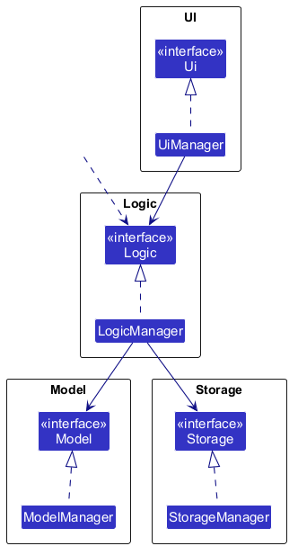

The sections below give more details of each component.

### UI component

The **API** of this component is specified in [`Ui.java`](https://github.com/se-edu/addressbook-level3/tree/master/src/main/java/seedu/address/ui/Ui.java)

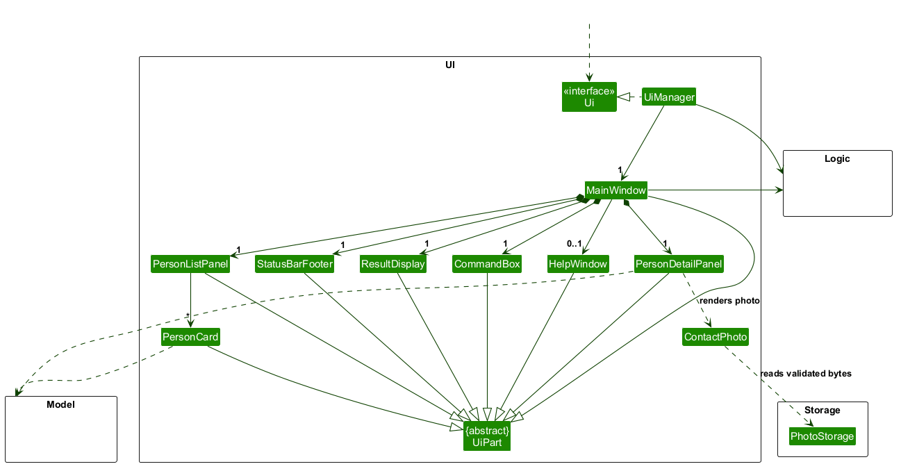

The UI consists of a `MainWindow` and its parts, such as `CommandBox`, `ResultDisplay`, `PersonListPanel`, `PersonDetailPanel`, and `StatusBarFooter`. All of these, including `MainWindow`, inherit from the abstract `UiPart` class, which captures common behavior among classes that represent visible GUI parts.

The `UI` component uses the JavaFX UI framework. The layouts of these UI parts are defined in matching `.fxml` files in `src/main/resources/view`. For example, [`MainWindow.fxml`](https://github.com/se-edu/addressbook-level3/tree/master/src/main/resources/view/MainWindow.fxml) specifies the layout of [`MainWindow`](https://github.com/se-edu/addressbook-level3/tree/master/src/main/java/seedu/address/ui/MainWindow.java).

`PersonDetailPanel` uses `ContactPhoto` to display a bounded image from validated `PhotoStorage` bytes. The photo
is shown only in the detail panel, to the right of the name, in a fixed 160×120 frame (`#photoFrame` in
`PersonDetailPanel.fxml`); the image is scaled to fit inside it, and the "No photo" placeholder fills the same
frame, so the layout does not change with the shape of the photo. The name and the frame are in a `GridPane`
(`#header`); when the header is narrower than 400 pixels (`PersonDetailPanel#isNarrowHeader`), the panel moves
the frame below the name so that a long name is not squeezed into a narrow column. `PersonCard` shows no photo. A single
background worker performs file validation and image decoding, so showing a contact does not block the JavaFX
thread on photo reads. A placeholder is shown until loading finishes. Replaced requests cancel queued photo work;
an already-running decode can finish, but its stale result is never displayed.
The detail panel observes
the viewed person and scrolls vertically to keep full meeting and contact details accessible.
Both `PersonCard` and `PersonDetailPanel` show a ★ label in the top right corner of the card or panel of a starred
person; the label is hidden otherwise (and in `PersonCard` it also takes no space).
`PersonCard` shows tags on one non-wrapping row through `TagRow`. `TagRow` measures each tag label (rounded to whole
pixels, as the row lays them out), uses the pure `TagRow#visibleTagCount` to decide how many tags fit (leaving room
for the `+N` label, measured for the actual number of hidden tags), and refits whenever
the row's width changes. Hidden tags stay in the row as unmanaged labels so they keep their styling and can be measured
again. `PersonDetailPanel` is unchanged and wraps all tags.

`CommandBox` also lets the user bring back earlier commands with the Up and Down arrow keys (see [Command
history](#command-history)). `HelpWindow` does not explain the commands. It shows the address of the online User Guide
(`HelpWindow#USERGUIDE_URL`) with a button to copy it, and `MainWindow#handleHelp` opens it, or brings it to the front
if it is already open; the `help` command, the **Help** menu and the F1 accelerator all lead to `handleHelp`. For the
`exit` command, `MainWindow#handleExitAfterDelay` waits one second (`EXIT_DELAY`) so that the user can read the result
message and then closes the window, and the command box ignores input during the wait. The **Exit** menu item and the
close button call `handleExit` directly and close at once.

The `UI` component,

* executes user commands using the `Logic` component.
* listens for changes to `Model` data so that the UI can be updated with the modified data.
* keeps a reference to the `Logic` component, because the `UI` relies on the `Logic` to execute commands.
* depends on some classes in the `Model` component because it displays `Person` objects from the model.

### Logic component

**API** : [`Logic.java`](https://github.com/se-edu/addressbook-level3/tree/master/src/main/java/seedu/address/logic/Logic.java)

Here's a (partial) class diagram of the `Logic` component:

The sequence diagram below illustrates the interactions within the `Logic` component, taking `execute("delete 1")` API call as an example.

:information_source: **Note:** The lifeline for `DeleteCommandParser` should end at the destroy marker (X), but due to a limitation of PlantUML, it continues to the end of the diagram.

How the `Logic` component works:

1. When `Logic` is called upon to execute a command, the command is passed to an `AddressBookParser` object, which in turn creates a parser that matches the command (e.g., `DeleteCommandParser`) and uses it to parse the command.
1. This results in a `Command` object (more precisely, an object of one of its subclasses e.g., `DeleteCommand`) which is executed by the `LogicManager`.
1. The command can communicate with the `Model` when it is executed (e.g. to delete a person). 
   Note that although this is shown as a single step in the diagram above for simplicity, the code can require several interactions between the command object and the `Model` to complete the operation.
1. The result of the command execution is encapsulated as a `CommandResult` object which is returned from `Logic`.

Here are the other classes in `Logic` (omitted from the class diagram above) that are used for parsing a user command:

How the parsing works:

* When called upon to parse a user command, the `AddressBookParser` class creates an `XYZCommandParser` (`XYZ` is a placeholder for the specific command name, e.g., `AddCommandParser`). The parser uses the other classes shown above to parse the user command and create an `XYZCommand` object (e.g., `AddCommand`). The `AddressBookParser` returns that object as a `Command` object.
* All `XYZCommandParser` classes, such as `AddCommandParser` and `DeleteCommandParser`, implement the `Parser` interface so they can be treated similarly where appropriate, for example during testing.
* `AddressBookParser#COMMAND_WORDS` is the alphabetical list of every command word that `parseCommand` accepts, and it is what the `Unknown command.` message lists. The list is written out next to the `switch` in `parseCommand`, so a new command word must be added to both. `AddressBookParserTest` scans the command classes for `*COMMAND_WORD` constants and fails if one is missing from the list, and it also checks that every listed word is recognised by the parser. `parseCommand` lower-cases the command word with `Locale.ROOT` before the `switch`, so command words are case-insensitive regardless of the system locale; prefixes such as `n/` are not. `LogRedactor` also compares command words without regard to case, so `NOTE`, `MEETING` and `FIND` are kept out of the log like their lower-case forms.

### Model component

**API** : [`Model.java`](https://github.com/se-edu/addressbook-level3/tree/master/src/main/java/seedu/address/model/Model.java)

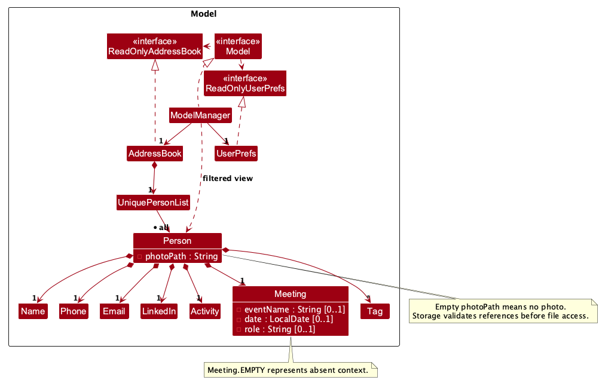

The `Model` component,

* stores the address book data i.e., all `Person` objects (which are contained in a `UniquePersonList` object).
* stores the `Person` objects selected by the current filter, such as search results, in a separate _filtered_ list. It exposes this list as an unmodifiable `ObservableList<Person>` that the UI can observe and bind to, so the UI updates when the list changes.
* keeps immutable meeting context in each `Person`, using `Meeting.EMPTY` when all event/date/role fields are absent; the complete builder also preserves the optional `photoPath` reference when other fields change.
* stores a `UserPrefs` object that represents the user’s preferences (currently, just the GUI settings). This is exposed to the outside as a `ReadOnlyUserPrefs` object.
* does not depend on any of the other three components (as the `Model` represents data entities of the domain, they should make sense on their own without depending on other components)
* gives every `Person` an immutable `Activity` holding when the person was created, last edited and last viewed. Each time is optional: an unknown time is absent, never invented. `Person#withActivity` copies a person with new activity, and `Person#hasSameDetails` compares two persons while ignoring activity.
* gives every `Person` an optional follow-up date (`Optional<LocalDate> getFollowUpDate()`). The `followup` command changes it through `Person#toBuilder` and `Model#editPerson`, and the `due` command shows the persons for whom `Person#isFollowUpDueOn` is true. See [Follow-up dates and the due list](#follow-up-dates-and-the-due-list).
* gives every `Person` a `starred` flag, which is false by default. The `star` and `unstar` commands change it through `Person#toBuilder` and `Model#editPerson`, and the `filter starred` command shows the starred persons by passing `Person#isStarred` to `Model#updateFilteredPersonList`.
* gives every `Person` an optional free-form `Note` of at most 1000 characters, counted by `Note#countCharacters` as Unicode code points, so an emoji that Java stores as two `char`s counts as one (the command, the parser and the storage all use this one count). An empty `Note` means that the person has no note. The `note` command changes it through `Person#toBuilder` and `Model#editPerson`, so the other fields and the activity times are kept, and the last edited time changes only when the note really changes.

:information_source: **Note:** The alternative, arguably more object-oriented, design below keeps a unique list of tags in `AddressBook`, and each `Person` references tags from that list. This lets `AddressBook` maintain one `Tag` object per unique tag instead of each `Person` holding its own `Tag` objects. 

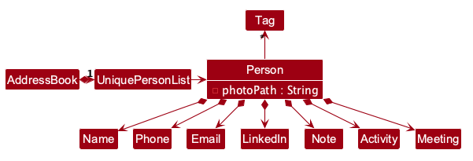

### Storage component

**API** : [`Storage.java`](https://github.com/se-edu/addressbook-level3/tree/master/src/main/java/seedu/address/storage/Storage.java)

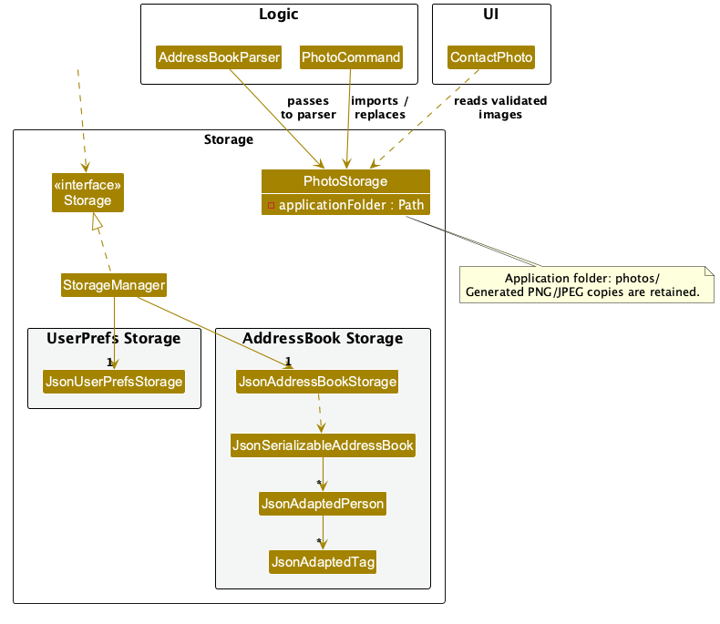

The `Storage` component,

* can save both address book data and user preference data in JSON format, and read them back into corresponding objects.
* keeps photo file access in the separate `PhotoStorage` class. Commands import validated PNG/JPEG files into the application-folder `photos/` directory; `ContactPhoto` reads validated image bytes through the same service. Imported assets are retained for history restoration.
* is implemented by `StorageManager`, which delegates the actual JSON file access to `JsonAddressBookStorage` and `JsonUserPrefsStorage` (one class per data file).
* depends on some classes in the `Model` component (because the `Storage` component's job is to save/retrieve objects that belong to the `Model`)
* saves a person's activity as optional `createdAt`, `lastEditedAt` and `lastViewedAt` fields in `addressbook.json`. Each is a whole-second ISO-8601 UTC timestamp written exactly as `2026-10-17T04:12:33Z`. A missing or `null` field loads as an absent time, so data files from v1.3 still load. A value with a fraction of a second, an offset other than `Z`, surrounding spaces or any other format makes the file fail to load with `Invalid contact data: '<field>' must be an ISO-8601 UTC timestamp.`, naming the field (`createdAt`, `lastEditedAt` or `lastViewedAt`). `JsonAdaptedPerson.INVALID_FIELD_MESSAGE_FORMAT` holds this message pattern so other fields use the same wording.
* saves a person's follow-up date as an optional `followUpDate` string in `addressbook.json`, written as `2026-10-25`. A missing or `null` field loads as no follow-up date, so older data files still load. A value that is not a real `YYYY-MM-DD` date, including a non-string value, makes the file fail to load with `Invalid contact data: 'followUpDate' must be a real date in YYYY-MM-DD format.`
* saves whether a person is starred as an optional `starred` boolean in `addressbook.json`. A missing or `null` field loads as not starred, so older data files still load. Any other value, such as a string or a number, makes the file fail to load with `Invalid contact data: 'starred' must be true or false.` The field is kept as an `Object` in `JsonAdaptedPerson` so that such a value reaches this message instead of a generic Jackson error.
* saves a person's note as an optional `note` string in `addressbook.json`. A missing or `null` field loads as no note, so older data files still load. A note that is blank, longer than 1000 characters or not a string makes the file fail to load with `Invalid contact data: 'note' must be a string of at most 1000 characters.`

### Common classes

Classes used by multiple components are in the `seedu.address.commons` package.

--------------------------------------------------------------------------------------------------------------------

## **Implementation**

This section describes some noteworthy details on how certain features are implemented.

### Find input validation

`FindCommandParser` rejects other commands' reserved fields (`e/`, `p/`, `l/`, `d/`, `md/`, `r/`, `f/`)
at argument/whitespace boundaries before tokenizing supported search fields. Its pattern is built from
the existing `CliSyntax` and `PhotoCommandParser.PREFIX_FILE` constants, quoting each prefix as literal text.
This prevents an unsupported field from being absorbed into a preceding term and producing a misleading
zero-match result. The error is the standard invalid format with find usage; parsing fails before execution,
so the visible list, selection, saved contacts and undo/redo history remain unchanged.
Literal slash text such as `c/o`, `ai/ml` and URLs is still accepted within typed terms, but reserved prefixes
are rejected even when intended as note or event text (for example, `find nt/likes r/java`).

### Search and list command feedback

`FindCommand`, `SortCommand`, `GroupCommand`, and `ViewCommand` provide short `MESSAGE_USAGE` hints
instead of repeating feature descriptions on invalid syntax. Parsers retain the shared
`Messages.MESSAGE_INVALID_COMMAND_FORMAT` wrapper. Find's hint lists the supported fields and requires
a non-empty term; mixed plain/typed input gets two concrete alternative commands, without echoing user input.
Validation order, supported inputs, displayed-index targeting, and selection behavior are unchanged.

Group tag limits still come from `Tag.MESSAGE_CONSTRAINTS`, and duplicate fields use the shared message.
View still uses `ParserUtil.parseDisplayedIndex` and the common invalid-index, multiple-index, and empty-list
messages. These command-specific hints reuse the shared wording in `Messages` rather than redefining it.
`list` has no argument-validation error: it continues to ignore extra text, clears the filter/sort, and keeps
command-text history.

### Meeting context implementation

The sequence below shows a partial meeting update, the no-op path, and rollback when saving fails.
The `createSnapshot`, `restore`, and `recordSuccessfulMutation` calls show shared existing
snapshot/history behavior from #108 and #131/#132, rather than functionality implemented by #130.

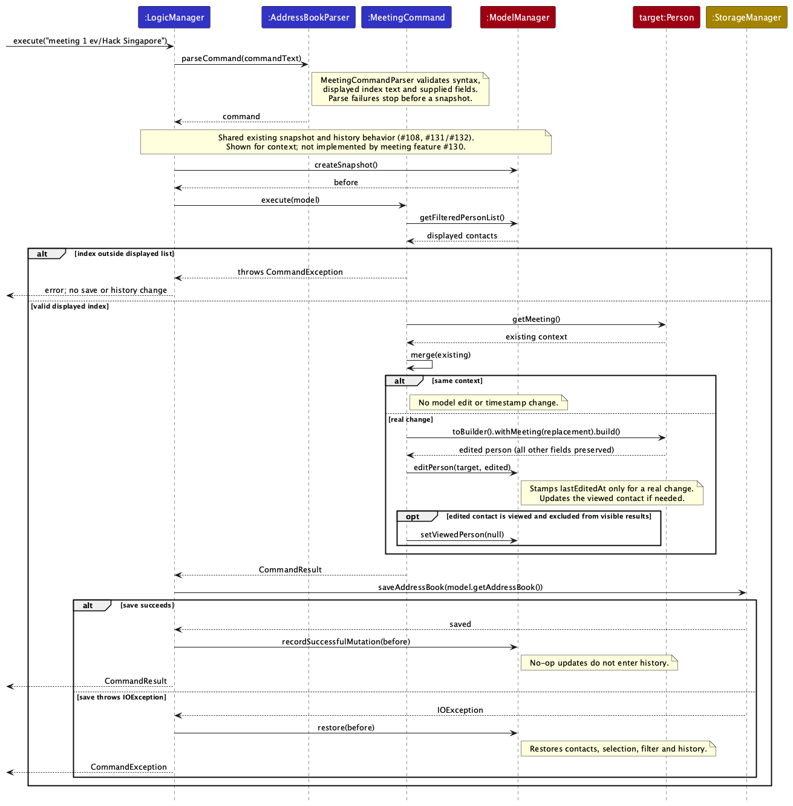

`Meeting` is an immutable optional value held by `Person` and copied by `Person.toBuilder()`.
`MeetingCommandParser` validates the displayed index, duplicate prefixes, strict real dates, nonblank
text bounds, and explicit clear grammar. In v1.4.1, event/role bounds count UTF-16 code units
with `String.length()`; supplementary characters count twice. `MeetingCommand` merges only supplied fields, then calls
`Model.editPerson` using a complete copy. Same-value updates return without mutation. Logic saves
before recording history, restoring its snapshot on failed saves. Existing snapshots therefore retain
meeting fields without a separate history mechanism. Setting, replacing, and clearing individual or
all meeting fields each create one undo step when they change the contact.

`JsonAdaptedPerson` accepts absent/null meeting fields for older data, validates present JSON types
without coercion, and reports the exact offending meeting field. Empty context is omitted on save.
`FindCommandParser` creates a `TypedSearchPredicate` for `n/`, `t/`, `nt/` and `ev/` terms.
It matches partial event names without case sensitivity, using OR within one field and AND across
different fields. An absent event matches only when no event terms were supplied.
The card bounds its event cue to 32 UTF-16 code units, and the detail panel scrolls vertically.
A pending Unicode fix in #181 is not part of v1.4.1.

Tests cover strict/leap dates, 80/81-character bounds, partial updates and individual/all clears,
old/malformed JSON and round trips, filtered targeting, no-ops, event search, UI, and rollback/undo.

### Contact photo implementation

The sequence below shows photo validation/import, the identical-image no-op, and model rollback when saving fails.

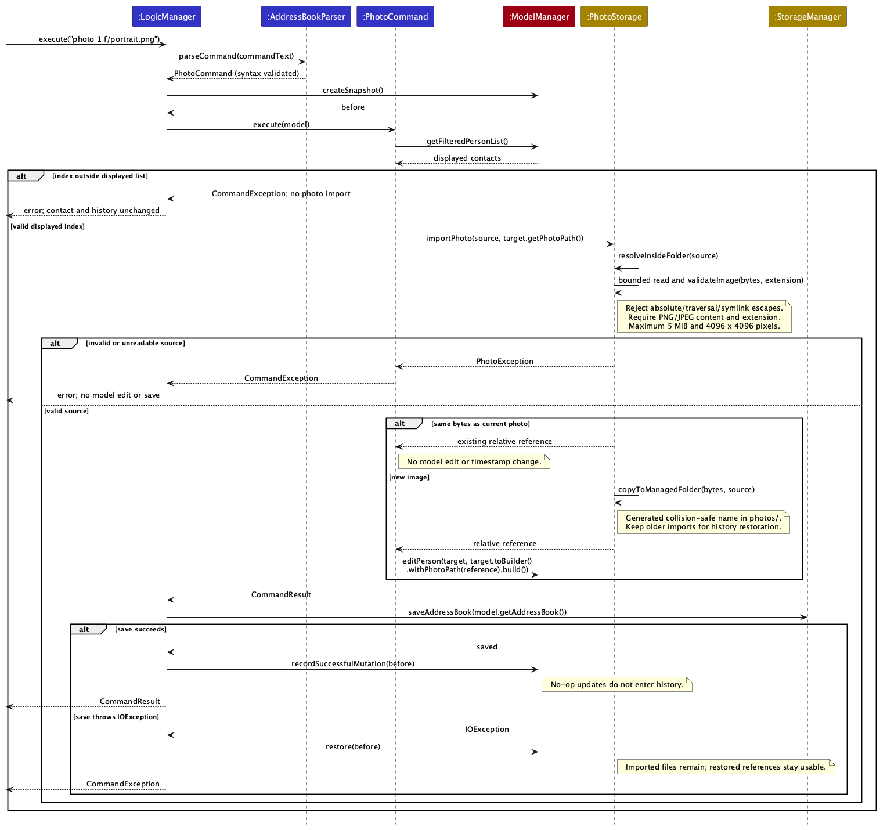

`Person.photoPath` is an optional relative reference; complete builder copies, equality and detail
comparison preserve it. `PhotoCommandParser` validates syntax; `PhotoCommand` validates the displayed
index before any import, retains all fields via `toBuilder()`, and delegates real changes to
`Model.editPerson`. Existing LogicManager save/snapshot handling supplies rollback and history.
Each successful attach, replace, or clear creates one undo step. Imported assets remain available
for restoration; undo and redo change references without recreating or deleting image files.

`PhotoStorage` derives its root from the running JAR's code location (working folder during Gradle
development); tests inject a temporary root. It rejects absolute paths, parent components and real-path
symlink escapes; reads at most 5 MiB plus one byte; checks image type and dimensions before bounded
decoding; and copies into a confined `photos/` directory with collision-safe generated names.
No user path or stored URI is passed directly to JavaFX. UI rendering uses validated bytes and a
placeholder with logging on failure. Missing/malformed optional references do not block contact loading.
Assets are deliberately retained after mutation or failed saves to avoid breaking history.

Tests cover traversal and symlink escapes (including the managed directory), corrupt/type/size/dimension
cases, copies and no-ops, filtered indexes, JSON compatibility/round trips, rollback and undo restoration.
Verify the packaged JAR at 1280×720/150% with attach/replace/clear, reload and retained assets.

### Contact activity

Each `Person` carries an `Activity` with its created, last edited and last viewed times (see the [Model component](#model-component) and [Storage component](#storage-component) for the data and file format). The model is the only place that decides when these times change, so every feature records them the same way.

* `ModelManager` holds a `java.time.Clock`. By default it is the system clock in `Model.DISPLAY_ZONE` (Asia/Singapore), which is the zone used to display activity times and to decide what "today" is. Tests inject a fixed clock. `Model#now()` returns the current time in whole seconds.
* **Copying a contact:** `Person` is immutable. To change an existing contact, call `person.toBuilder()`, set the fields to change, and call `build()`. The builder starts with every field, so a field you do not set (including activity times and fields added by later features) is kept. Do not call the `Person` constructors with a partial set of fields. A new `Person` field must also be added to `Person.Builder`. The constructors without an activity argument are for new contacts and tests.
* **Created:** `AddCommand` adds the new person with `created` set to `Model#now()`. A command that fails (for example, a duplicate) records nothing.
* **Last edited:** `Model#editPerson(target, edited)` is the rule that every command changing a contact must use instead of `Model#setPerson`. If `edited.hasSameDetails(target)` it does nothing. Otherwise it stores `edited` with the activity of `target` and `lastEditedAt` set to now. The activity of `edited` is ignored, so a copy built without activity cannot wipe the other times. `EditCommand`, `TagCommand`, `NoteCommand`, `StarCommand`, `MeetingCommand`, `PhotoCommand` and `FollowUpCommand` use it, and new commands that change a contact should too.
* **Last viewed:** `Model#viewPerson(person)` sets `lastViewedAt` to now and makes the stored person the viewed person. `ViewCommand` uses it. Viewing is not part of undo history, so undoing a change does not restore an earlier last-viewed time.
* **A failed save changes nothing.** `LogicManager` takes `Model#createSnapshot()` before it runs a command. If saving the data file then fails, it calls `Model#restore(snapshot)` and shows the error, so the contacts, the viewed contact, the visible-list filter and sort, and the undo and redo stacks are as they were. No created, edited or viewed time is kept. The snapshot is opaque (`Model.Snapshot`) and covers in-memory command changes, not user preferences. `JsonAddressBookStorage` serializes to a temporary file beside the data file, then uses an atomic replacement. It rejects an existing read-only data file and preserves existing POSIX permissions. A failed write or replacement leaves the previous JSON file intact and removes the temporary file.
  User-facing save errors give a short recovery instruction and confirm that nothing changed; the cause is
  retained on `CommandException` and logged, rather than appended to the displayed message. If the process exits during a save, a stray `addressBook-*.tmp` file may remain beside the data file; it can be deleted safely. If the file system cannot perform an atomic move, saving fails without falling back to an in-place write. An existing symbolic link at the data-file path is replaced by a regular file, leaving its former target unchanged.
* **Display:** the detail panel shows the three times as `yyyy-MM-dd HH:mm` in `Model.DISPLAY_ZONE` (Asia/Singapore), or an em dash (`—`) when a time is not known. The block sits at the bottom of `PersonDetailPanel.fxml`.

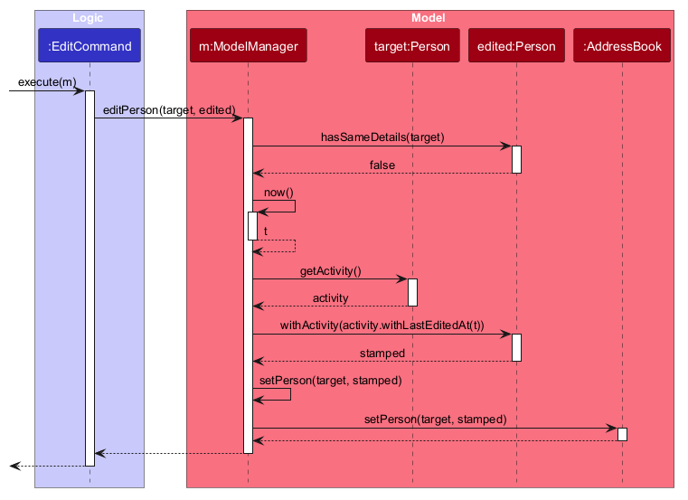

Design considerations:

* **Stamp in the model, not in each command.** Each command would otherwise repeat the "was anything really changed?" check and could drift apart. The trade-off is that `Model` gains two methods.
* **Ignore the edited person's activity.** Commands build the edited `Person` from the old one, and a new field that someone forgets to copy would silently reset the times. Always taking the activity from `target` makes that mistake harmless.

### Follow-up dates and the due list

`Person` holds an optional `LocalDate followUpDate`, exposed as `Optional<LocalDate> getFollowUpDate()` and
copied by `Person.toBuilder()` (`withFollowUpDate(null)` removes it). It takes part in `equals`, `hashCode` and
`toString`. `isFollowUpDueOn(today)` (on or before today) and `isFollowUpOverdueOn(today)` (strictly before
today) are the single definition of the boundary, so the card cue and the `due` command cannot disagree.

`FollowUpCommandParser` checks the displayed index, duplicate `d/`, and either `clear` or a date, then reuses
`Meeting.parseDate`, so follow-up dates follow the same strict rules as `md/` but report their own
message (`FollowUpCommand.MESSAGE_INVALID_DATE`). `FollowUpCommand` compares the new value with the current
one. If they are equal it returns `NAME already has follow-up date DATE. Nothing was changed.` (or `NAME has no
follow-up date to clear. Nothing was changed.` when clearing) without touching the model. Otherwise it calls `Model.editPerson` with `target.toBuilder().withFollowUpDate(date).build()`,
which stamps last-edited time and keeps the viewed contact in step, as `MeetingCommand` does. `LogicManager` then
saves and records the undo entry, and restores its snapshot if saving fails, so no separate history code exists.
If the edited contact is the viewed one and no longer passes the visible-list filter (for example, clearing its date
or setting one after today while the `due` list is shown), `FollowUpCommand` clears the viewed contact, so the
detail panel shows `No contact selected`.

`JsonAdaptedPerson` writes `followUpDate` as an ISO string or null. It reads the field as an `Object` so that a
non-string value reaches `parseFollowUpDate` and gets the field-specific error rather than a Jackson error.
`PersonCard` takes `today` as a parameter in a package-private constructor, so tests do not depend on the real
date; the public constructor uses `LocalDate.now(Model.DISPLAY_ZONE)`.

The sequence diagram below shows `followup 1 d/2026-10-25`, including the no-op and failed-save paths.

`DueCommand` uses the existing visible-list pipeline and adds no second list. When it runs it reads today from
`Model.getClock()` (Asia/Singapore), calls `updateFilteredPersonList(new FollowUpDuePredicate(today))`, then
`sortFilteredPersonList(SortCriterion.DUE)`. It sets the sort after the filter so `due` wins over any sort that
was active. It does not touch `Model#getViewedPerson()`, so the detail panel keeps a viewed contact that is not due.
`FollowUpDuePredicate` calls `Person.isFollowUpDueOn`, the same rule as the overdue cue. `SortCriterion`
now holds a comparator per constant: `DUE` orders by follow-up date, earliest first with no date last, and
`ModelManager.setSortCriterion` adds original-list order as the tie-breaker. `SortCommandParser` has no `due` case,
so `sort due` is rejected. The predicate keeps the date it was built with, so the list does not change at midnight
until `due` is run again.

Tests cover leap and invalid dates, set, replace, clear and no-op paths, out-of-range indexes, field
preservation, old and malformed JSON with round trips, the due and overdue boundaries, and the card and detail UI.

Design considerations:

* **One definition of "due".** `Person#isFollowUpDueOn` and `isFollowUpOverdueOn` hold the boundary, and both the
  card cue and `FollowUpDuePredicate` call them. A separate check in each place could disagree on whether today is
  due. The trade-off is that `Person` knows about "today", so callers pass it in and tests inject the date.
* **`due` is a filter plus a sort on the existing visible list.** It adds no second list, so displayed indexes stay
  correct for every index command and the list follows the one pipeline that `find`, `group` and `sort` use. The
  trade-off is that the due-date sort stays active after `due`, so later `find`, `group` and `filter` results keep
  that order until `sort` or `list`.
* **The predicate keeps the date it was built with.** `due` reads today once, which keeps the result stable while you
  work and easy to test. The trade-off is that the list does not refresh at midnight; run `due` again.

### Activity-time sorting

`SortCommandParser` trims the argument and normalizes it with `Locale.ROOT` before matching `added`, `edited`,
or `viewed`. Sort keywords are case-insensitive regardless of the system locale; unsupported keywords (such as `name` or `due`), missing arguments, and extra
arguments still produce the invalid-format error with the short sort hint.

`SortCommand` passes a `SortCriterion` (`ADDED`, `EDITED`, or `VIEWED`) to `ModelManager`. The model keeps one
`FilteredList` for the current contacts and wraps it in a `SortedList`, which is the list exposed to the UI and every
index-based command. This ensures that the index a user sees is the contact that `view`, `edit`, `delete`, and `tag`
operate on.

The comparator orders known activity times newest first and unknown times last. It then uses the source address-book
order as a deterministic tie-breaker. Changing a filter leaves the active sort intact; `list` clears both
the filter and sort. A successful `view` replaces the contact with an updated `lastViewedAt`, which automatically causes the
`SortedList` to reorder when `sort viewed` is active.

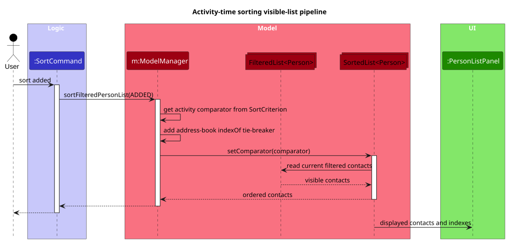

Design considerations:

* **One sorted visible list instead of command-specific reordering.** Returning the `SortedList` from the model keeps
  every displayed index aligned with the UI. The alternative—sorting separately in each index-based command—would let
  commands act on a different contact from the one displayed.
* **Use current source positions for equal times.** Contacts can be added or replaced while a sort is active. Looking
  up positions in the current address book keeps ties in original order even after those changes.

### Active filter label

`ModelManager` keeps a display description alongside the active filter predicate. Commands use
`updateFilteredPersonList(predicate, description)` to replace them together without changing the sort.
`find` supplies `Find results`, `group` supplies the normalized tag, `filter starred` supplies `Starred only`,
and `due` supplies its captured cutoff date. The one-argument overload clears the description for
`PREDICATE_SHOW_ALL_PERSONS` and uses `Filtered contacts` for other predicates, avoiding a stale label.

The read-only `personListStatus` property combines this description with the sort and live result count.
`PersonListPanel` binds its wrapping heading to that property, so subsequent command feedback does not hide
the active filter. Filter descriptions are session-only, not JSON fields. `State` includes the description
alongside the predicate and sort so undo, redo, and failed-save rollback restore consistent feedback.
This does not change selection rules or implement combined filters from #128.

Only `find`, `group`, `filter`, `due` and `list` change the filter, and only `sort`, `due` and `list` change the
sort. `Model#addPerson` touches neither, so adding a contact while a filter is active keeps the filter and updates
the count; the new contact is listed only if it matches. This is the same as for `edit`, `tag` and the other
commands that change a contact. Because the filter is part of the saved `State`, `undo` and `redo` of an add
restore the contact list, the filter label and the count together.

### Viewed contact selection

The `find`, `group`, `filter`, `due`, `sort`, and `list` commands only update the visible-list predicate or sort;
they do not clear `Model#getViewedPerson()` when a contact is filtered out.
The detail selection is independent of list membership, including for zero results.
A subsequent `view` selects by displayed index, while deleting the viewed contact
or clearing the address book clears the detail selection. When the viewed contact is edited by `FollowUpCommand`, `MeetingCommand`, `StarCommand`, or `EditCommand` so that it leaves the visible list, the command clears the viewed contact (leaving a hidden viewed contact when editing a different contact is tracked in #227).

### Starring contacts

`StarCommand` serves both `star` and `unstar`: `StarCommandParser` is created with `true` or `false` by `AddressBookParser`, so the two commands share one parser and one command class. `FilterCommand` serves `filter starred` and `filter starred off`.

The sequence diagram below shows what happens when the user executes `star 1`. `unstar 1` takes the same steps with `false` in place of `true`.

* **Changing a star:** `StarCommand` looks up the person at the displayed index and, if the flag really changes, calls `Model#editPerson` with `person.toBuilder().withStarred(...)`. Because it goes through `editPerson`, the change is saved, can be undone, and updates the last edited time. If the person already has the requested state, the command succeeds with a message saying nothing changed and does not touch the model, so no undo step is created.
* **Filtering:** `FilterCommand` replaces the predicate of the filtered list, like `find` and `group`. The three do not combine; combining filters is tracked separately in #128.
* **Logging:** `StarCommand` logs at `INFO` when a star changes and at `FINE` when nothing changes, and `FilterCommand` logs at `INFO` with the number of contacts shown. The logs contain only the displayed index and counts, never a name or any other personal detail.

### Undo history

`ModelManager` keeps up to 50 contact states in a session-only undo stack. Each state copies the address book, the viewed contact, the active visible-list predicate, and the sort criterion. Its `ModelSnapshot` also captures both history stacks so a failed save can restore them. History is not written to JSON; the restored contacts are.

`LogicManager` takes a snapshot before running each command. After the command succeeds, it saves the address book, except for `help` and `exit`, which return before the save. Only after a successful save does `Model#recordSuccessfulMutation(before)` compare the contact data and add the previous state to history. The comparison ignores `lastViewedAt`, so `view` is not an undoable contact change. Failed commands, failed saves, and changes that leave contacts unchanged add no entry. A new saved mutation clears redo history. The same path covers add, edit, tag, delete, clear, note, star, follow-up, meeting, and photo mutations; these commands do not maintain separate history entries.

The following sequence shows the `undo` command, including rollback if saving the restored state fails:

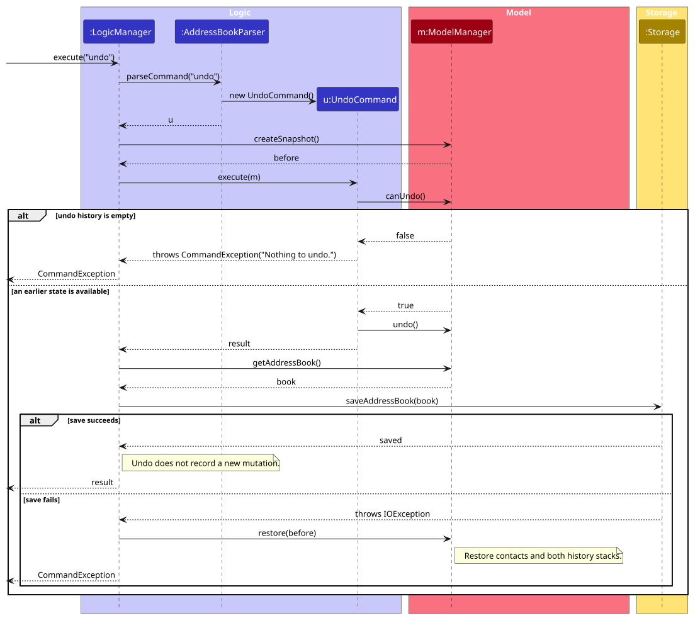

[Undo sequence PlantUML source](diagrams/UndoSequenceDiagram-Logic.puml)

The corresponding redo sequence shows the empty-history response and how a failed save restores the contact data and
both history stacks:

[Redo sequence PlantUML source](diagrams/RedoSequenceDiagram-Logic.puml)

`UndoCommand` checks `Model#canUndo()` and reports `Nothing to undo.` when the stack is empty. Otherwise, `ModelManager#undo()` moves the current state to the redo stack and restores the latest undo state. `RedoCommand` checks `Model#canRedo()` and reports `Nothing to redo.` when its stack is empty. Otherwise, `ModelManager#redo()` moves the current state to the undo stack and restores the latest redo state. Neither command records a new mutation; each restored state is saved by `LogicManager`. A failed save restores both stacks and the contact data from the pre-command snapshot.

Restoration reinstates contact data, timestamps, the visible-list predicate, sort order, and the detail selection without stamping the current time. A later explicit view of a surviving contact is preserved; a deleted contact comes back with its pre-deletion view time. A new successfully saved real contact mutation clears redo, while failed, read-only, and no-op commands do not.

The following sequence shows how the two history stacks change during undo:

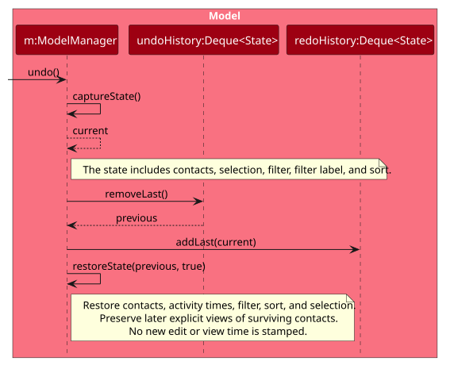

[Undo model sequence PlantUML source](diagrams/UndoSequenceDiagram-Model.puml)

The following state diagram shows how undo, redo, and a new saved mutation move the current contact state between the
two history stacks. Read-only and no-op commands leave redo available:

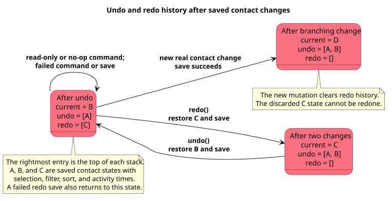

[Undo and redo state PlantUML source](diagrams/UndoRedoHistoryStateDiagram.puml)

The saved state copies the full address book, including note text, star flags, follow-up dates, meeting context, photo references, and activity timestamps. This keeps undo and redo independent of individual command implementations and lets them restore fields added by later features. The trade-off is memory proportional to the number and size of saved address books, bounded by the 50-entry history limit. Photo binaries are not copied into history: imported files are retained under `photos/` after replacement, clearing, deletion, and failed saves. Undo and redo restore their references; if a file is missing or invalid, the UI displays a placeholder and the rest of the address book remains usable.

### Command history

Pressing **Up** or **Down** in the command box brings back commands that were submitted earlier in the session. The logic is split in two classes so that it can be tested without the JavaFX toolkit:

* `CommandHistory` is a plain Java class that holds the remembered commands and the browsing state. `record(commandText)` stores a command (blank text is ignored, a command equal to the newest entry is not stored twice, and the oldest entry is dropped once there are more than `CommandHistory#MAX_ENTRIES`, which is 50). `older(currentText)` and `newer()` move through the entries. When browsing starts, `older` keeps `currentText` as a draft, and `newer` returns that draft after the newest entry so the user gets back what they were typing.
* `CommandBox` owns one `CommandHistory`. It records the text of every submitted command *before* running it, so commands that fail (an unknown command, an invalid index) are remembered too. It also adds a `KEY_PRESSED` event filter to its text field, which reacts only to a plain Up or Down key and consumes only those events. Key presses with Shift, Ctrl, Alt or Meta held down, and key presses in other controls, are left alone, so text selection with Shift+Up still works.

The history lives in memory only and is not saved to the data file, so it starts empty each time the app is launched. `CommandHistory` does not depend on `Model` or `Logic`. Running `list`, `clear` or `undo` does not clear the history; those commands are remembered like any other.

### \[Proposed\] Data archiving

Data archiving is deferred. It is not available in LarperBoard and not planned for v1.5, and no archive command exists. A possible design is an `archived` flag on `Person`, saved in `addressbook.json` and hidden by the default list predicate, with commands to archive and restore a contact and a way to list archived contacts.

--------------------------------------------------------------------------------------------------------------------

## **Documentation, logging, testing, dev-ops**

* [Documentation guide](Documentation.md)
* [Testing guide](Testing.md)
* [Logging guide](Logging.md)
* [DevOps guide](DevOps.md)

--------------------------------------------------------------------------------------------------------------------

## **Appendix: Requirements**

### Product scope

**Target user profile**:

* is a university student who attends many hackathons, both to build projects and to meet people
* meets 15 to 30 new people (teammates, mentors, recruiters, fellow participants) at each hackathon
* keeps a laptop open throughout the event, while their phone stays in a pocket or on a table
* finds taking out a phone to save a contact too much effort in the middle of an event, so often does not save the contact at all
* wants to record a contact in a few seconds without breaking the flow of a conversation
* needs to remember *who* each person is, not just their name (e.g. what they are building, what they are good at), as they struggle to recall many of these people a week later
* plans to follow up with some of these people after the event (e.g. to form a team, ask for advice or apply for a role)
* may have an unreliable internet connection at crowded venues
* can type fast and is comfortable with CLI commands (e.g. a computer science student)
* prefers desktop apps over other types of applications

**Value proposition**: LarperBoard helps hackathon participants build a network that they can still use after the event. Using one short typed command on the laptop that is already open, the user records a new contact together with the detail that will jog their memory later, such as what the person is building, their tech stack and where they were met. Contacts can be grouped by hackathon and team, searched by these details, and exported for follow-up. This is faster than saving contacts on a phone in the middle of an event, and more useful afterwards than a generic address book, which records who someone is but not how or where they were met. All data is stored locally, so LarperBoard works without an internet connection.

### User stories

Priorities: Must-have, Nice-to-have, Unlikely-to-have. Status is separate from priority and says what LarperBoard does now:

* `Shipped`: available in LarperBoard now.
* `Partial`: part of the story is available; the Status cell says what is available.
* `Deferred`: not available in LarperBoard and not planned for v1.5.

| Priority | Status | As a …​ | I want to …​ | So that I can…​ |
| -------- | ------ | ------ | ---------- | ------------- |
| Must-have | Shipped | user | add a contact | add people quickly |
| Must-have | Shipped | user | delete unnecessary people | remove people who are no longer relevant to me |
| Nice-to-have | Shipped | user | edit people's information | correct a mistake without having to delete and re-add the contact |
| Nice-to-have | Shipped (up to 50 saved contact changes per session) | user | undo my last contact change | avoid losing important contact information because of a fast typo |
| Nice-to-have | Shipped (until a new contact change or app restart) | user | redo an undone contact change | recover a change I still want to keep |
| Nice-to-have | Shipped | hackathon participant | clear all data or reset my board | start fresh for a brand new hackathon event |
| Nice-to-have | Shipped | user | group people together | organize everyone I met at a specific track or workshop |
| Unlikely-to-have | Partial (typed `find` matches part of a name, tag, note or event; plain `find` matches whole name words; no fuzzy or LinkedIn-handle search) | forgetful participant | search contacts using partial text or fuzzy matching | find a person even if I only remember part of their name or handle |
| Nice-to-have | Partial (sort by added, edited or viewed time only; no arbitrary keyword sort) | user | sort people by keywords | easily find people using keywords |
| Unlikely-to-have | Partial (`filter starred`, `group`, `due`, and typed `find` with AND across fields; filters replace one another; no saved or arbitrary queries) | power user | filter contacts | execute complex queries on my network |
| Must-have | Shipped | hackathon participant | attach project tags or stack keywords | remember what tech stack or project a participant is cracked at |
| Nice-to-have | Shipped | forgetful participant | add rapid freeform notes (e.g., "Met at booth 4") | remember the context when following up after the event |
| Nice-to-have | Shipped | hackathon participant | mark high-priority contacts with a "starred" flag | easily filter and focus on standout individuals |
| Nice-to-have | Partial (`meeting ev/ md/` records event and date manually; nothing is added automatically) | hackathon participant | attach the hackathon name/date as a tag (auto or manual) | look back and remember which event I met each person at |
| Nice-to-have | Shipped | hackathon participant | tag a contact with their hackathon role (Frontend, Pitcher, Designer) | easily assemble balanced teams for future hackathons |
| Nice-to-have | Shipped | user | view a list of all saved contacts sorted by recency | quickly recall the last few people I spoke with |
| Nice-to-have | Shipped | user | see when a contact was added, last edited and last viewed | judge how up to date my information about them is |
| Nice-to-have | Shipped | hackathon participant | set a follow-up date on a contact | remember by when I wanted to get back to them |
| Nice-to-have | Shipped | hackathon participant | list the contacts whose follow-up date has arrived, earliest first | see who I should contact today without scanning my whole list |
| Must-have | Shipped | user | display a detailed view of a single contact card | read all notes, links, and tags in one clean view |
| Nice-to-have | Shipped | user | view images | remember the projects people have created |
| Nice-to-have | Deferred | CLI user | view contact summaries in a clean, formatted ASCII table | browse my address book without messy text wrapping |
| Nice-to-have | Shipped | visual learner | distinguish categories with colour codes | visually scan and distinguish categories at a glance |
| Nice-to-have | Deferred | user | run a stats/summary command (counts by tech stack or event) | get a high-level snapshot of my networking efforts |
| Nice-to-have | Partial (Up/Down command recall only) | power user | have fast keyboard navigation | navigate and manipulate data at maximum keyboard speed |
| Nice-to-have | Shipped | power user | bring back a command I typed earlier with the Up and Down arrow keys | fix a typo or repeat a command without typing it all again |
| Nice-to-have | Deferred | user | set up CLI auto-completion for commands and contact names | run commands faster with Tab completion |
| Nice-to-have | Partial (`help` shows the User Guide URL with a copy button; no interactive tutorial) | first-time user | run a help/tutorial command with interactive examples | learn key commands within 30 seconds of installing the app |
| Nice-to-have | Shipped | hackathon participant | save a LinkedIn handle on a contact | reach out to a person through their LinkedIn profile |
| Nice-to-have | Deferred | hackathon participant | save GitHub, X, or Telegram handles under dedicated fields | reach out to a person on their preferred platform |
| Nice-to-have | Deferred | user | copy a contact's email/social handle to the clipboard from the CLI | quickly paste it into a browser or messaging app |
| Nice-to-have | Deferred | hackathon participant | import contact details via a short encoded CLI string or QR token | exchange contact information instantly without manual typing |
| Nice-to-have | Deferred | power user | export my contact list to JSON, CSV, or Markdown | import it into my personal CRM, Notion, or address book |
| Must-have | Shipped | offline user | have all data stored locally | use the app without an internet connection at crowded venues |
| Nice-to-have | Deferred | hackathon participant | archive or hide contacts I don't need anymore | avoid being distracted by people I no longer need to see in my active list |
| Nice-to-have | Shipped (same name and phone) | hackathon participant | be flagged when I try to add someone who is already in my list | avoid accidentally creating two separate entries for the same person met at different events |

### Use cases

(For all use cases below, the **System** is the `LarperBoard` and the **Actor** is the `user`, unless specified otherwise)

**Use case: Add a person**

**MSS**

1. User requests to add a person and provides the contact details.
2. LarperBoard adds the person.
3. LarperBoard displays a confirmation message.

   Use case ends.

**Extensions**

* 1a. The user omits a required field or enters an invalid value.
  * 1a1. LarperBoard displays an error message.
  * 1a2. Use case resumes at step 1.
* 2a. The person already exists in the address book.
  * 2a1. LarperBoard displays a duplicate-person error message.

    Use case ends.

**Use case: Add project tags or stack keywords to a person**

**MSS**

1. User requests to list persons.
2. LarperBoard shows a list of persons.
3. User enters `tag INDEX t/TAG [t/TAG]…` for the selected person.
4. LarperBoard adds the supplied tags to the person's existing tags, storing one lowercase copy of each.
5. LarperBoard displays the updated person details.

   Use case ends.

**Extensions**

* 2a. The list is empty.

  Use case ends.

* 3a. The selected person cannot be identified.
  * 3a1. LarperBoard shows an error message.

    Use case resumes at step 2.

* 3b. The user does not provide any tags or keywords.
  * 3b1. LarperBoard shows an error message.

    Use case resumes at step 3.

* 4a. One or more tags or keywords contain invalid characters.
  * 4a1. LarperBoard shows an error message.

    Use case resumes at step 3.

* 4b. All supplied tags are already present, ignoring letter case.
  * 4b1. LarperBoard reports success without changing the contact, its last-edited time, or undo history.

    Use case ends.

**Implementation note:** `tag` adds tags; `edit INDEX t/TAG` replaces all existing tags with the supplied set.
`edit INDEX t/` removes every tag. Repeated tags in one command are stored once.

**Use case: Find contacts**

**MSS**

1. User requests to find contacts using plain name keywords or typed search terms.
2. LarperBoard performs a case-insensitive search and replaces the active filter while preserving any active sort and the viewed contact. Plain name keywords match whole words using OR; typed `n/`, `t/`, `nt/`, and `ev/` terms match partial text using OR within one field and AND across fields.
3. LarperBoard displays the matching contacts and reports `N contact(s) listed!`, where `N` is the number of matches.

   Use case ends.

**Extensions**

* 1a. The user does not provide any search terms, mixes plain and typed input, supplies a malformed prefix,
  or uses a field that find does not support (such as `e/` or `p/`).
  * 1a1. LarperBoard displays an error message.

    Use case resumes at step 1.

* 2a. No contacts match the provided terms.
  * 2a1. LarperBoard shows an empty valid result list and reports `0 contact(s) listed!`.

    Use case ends.

**Use case: Group contacts by tag**

The user enters `group t/TAG` to display contacts with a selected tag.

**MSS**

1. User requests to group contacts by one tag.
2. LarperBoard replaces the active filter with contacts having the specified tag (ignoring tag letter case), while preserving any active sort and the viewed contact.
3. LarperBoard displays the selected tag and the number of matching contacts.
4. User enters `list` to return to the full contact list.

   Use case ends.

**Extensions**

* 1a. The user omits `t/TAG`, includes extra text before `t/`, provides an invalid tag, or supplies multiple `t/` fields.
  * 1a1. LarperBoard displays an error message.

    Use case resumes at step 1.

* 2a. No contacts have the specified tag.
  * 2a1. LarperBoard displays the selected tag and a result count of zero.

    Use case ends.

**Implementation note:** Grouping updates the existing filtered person list. Tags stored on each contact remain the source of truth; no separate group data is stored. Index-based commands continue to use the displayed list.

**Use case: Edit a person's details**

**MSS**

1. User requests to edit a person.
2. User provides one or more replacement details for the person.
3. LarperBoard updates the specified details and retains the unspecified details.
4. LarperBoard displays the updated person details.

   Use case ends.

**Extensions**

* 1a. The selected person cannot be identified.
  * 1a1. LarperBoard displays an error message.

    Use case resumes at step 1.

* 2a. The user does not provide any details to edit.
  * 2a1. LarperBoard displays an error message.

    Use case resumes at step 2.

* 2b. One or more replacement details are invalid.
  * 2b1. LarperBoard displays an error message.

    Use case resumes at step 2.

* 3a. The edited person would duplicate another person in the address book.
  * 3a1. LarperBoard displays a duplicate-person error message.

    Use case ends.

**Use case: List all persons**

**MSS**

1. User requests to list all persons.
2. LarperBoard clears the active filter and sort, and displays all persons in their original order while retaining the viewed contact.

   Use case ends.

**Extensions**

* 2a. The address book contains no persons.
  * 2a1. LarperBoard displays an empty list.

    Use case ends.

**Use case: View usage instructions**

**MSS**

1. User requests help (by the `help` command, the **Help** menu or the F1 key).
2. LarperBoard opens the help window, which shows the address of the online User Guide and a button to copy it.
3. User copies the address and reads the User Guide in a web browser.

   Use case ends.

**Extensions**

* 1a. The help window is already open.
  * 1a1. LarperBoard brings the open help window to the front instead of opening a second one.

    Use case ends.

* 1b. The user types extra text after `help`, e.g. `help 123`.
  * 1b1. LarperBoard ignores the extra text and continues from step 2.

**Use case: Clear all persons**

**MSS**

1. User requests to clear the address book.
2. LarperBoard removes all persons from the address book.
3. LarperBoard displays a confirmation message.

   Use case ends.

**Extensions**

* 2a. The address book contains no persons.
  * 2a1. LarperBoard reports `No contacts to clear.`

    Use case ends.

**Use case: Undo a saved contact change**

**MSS**

1. User enters `undo` during the same app session as a saved contact change.
2. LarperBoard restores the preceding contact state, including the displayed list and viewed contact, and saves it.
3. LarperBoard confirms the undo.

   Use case ends.

**Extensions**

* 1a. No undo step is available.
  * 1a1. LarperBoard reports `Nothing to undo.` without changing contacts.

    Use case ends.

* 2a. Saving the restored state fails.
  * 2a1. LarperBoard restores the pre-command contacts and both history stacks and reports the save error.

    Use case ends.

**Use case: Redo an undone contact change**

**MSS**

1. User enters `redo` while a redo step remains in the current app session.
2. LarperBoard reapplies the undone contact state, including the displayed list and viewed contact, and saves it.
3. LarperBoard confirms the redo.

   Use case ends.

**Extensions**

* 1a. No redo step is available, including after a new saved contact change or app restart.
  * 1a1. LarperBoard reports `Nothing to redo.` without changing contacts.

    Use case ends.

* 2a. Saving the restored state fails.
  * 2a1. LarperBoard restores the pre-command contacts and both history stacks and reports the save error.

    Use case ends.

**Use case: Load saved contacts on application startup**

**MSS**

1. User launches the application.
2. LarperBoard loads the saved persons from the data file.
3. LarperBoard displays the loaded persons.

   Use case ends.

**Extensions**

* 2a. No saved address book exists.
  * 2a1. LarperBoard initializes a new address book with the default sample persons.
  * 2a2. LarperBoard displays the sample persons.

    Use case ends.

* 2b. The saved address book cannot be loaded because the data is corrupted or invalid.
  * 2b1. LarperBoard starts with an empty address book.
  * 2b2. LarperBoard displays the empty address book.

    Use case ends.

**Use case: Delete a person**

**MSS**

1. User requests to list persons.
2. LarperBoard shows a list of persons.
3. User requests to delete a specific person in the list.
4. LarperBoard deletes the person.

   Use case ends.

**Extensions**

* 2a. The list is empty.

  Use case ends.

* 3a. The given index is invalid (e.g., non-numeric, 0, negative, or exceeds list size).
  * 3a1. LarperBoard shows an invalid index error message.

    Use case resumes at step 2.

* 3b. Extraneous parameters are provided.
  * 3b1. LarperBoard shows an invalid command format message.

    Use case resumes at step 2.

**Use case: Display detailed view of a single contact card (Advanced)**

**MSS**

1. User requests to list persons.
2. LarperBoard shows a list of persons.
3. User requests to view the full details of a specific person by index.
4. LarperBoard updates the contact's last-viewed time, saves the address book, and shows the selected person's full details in the detail panel (name, ★ when starred, photo or placeholder, phone, email, LinkedIn handle, sorted colour-coded tags, note, meeting event/date/role, follow-up date, and created/last-edited/last-viewed times in Singapore time, using `-` for absent fields and `—` for unknown times).

   Use case ends.

**Extensions**

* 2a. The list is empty.
  * 2a1. LarperBoard displays a message indicating that the list is empty.

    Use case ends.

* 3a. The given index is invalid (e.g., out of range, negative, or non-numeric).
  * 3a1. LarperBoard displays an invalid index error message.

    Use case resumes at step 2.

* 3b. Extraneous parameters are provided (e.g., multiple indices or unexpected prefixes).
  * 3b1. LarperBoard displays an invalid command format message.

    Use case resumes at step 2.

* 3c. The given index causes integer overflow.
  * 3c1. LarperBoard displays `The person index provided is invalid.`, as for other invalid displayed indexes.

    Use case resumes at step 2.

**Use case: Set or clear a follow-up date**

**MSS**

1. User requests to list persons.
2. LarperBoard shows a list of persons.
3. User requests to set a follow-up date for a specific person in the list by index and gives a date.
4. LarperBoard saves the date on the person and displays a confirmation message.

   Use case ends.

**Extensions**

* 2a. The list is empty.

  Use case ends.

* 3a. The given index is invalid (e.g., non-numeric, 0, negative, or exceeds list size).
  * 3a1. LarperBoard shows an invalid index error message.

    Use case resumes at step 2.

* 3b. The date is not a real calendar date in `YYYY-MM-DD` format (e.g., `2027-02-29`).
  * 3b1. LarperBoard shows an invalid date error message.

    Use case resumes at step 3.

* 3c. The date is missing, `d/` is given more than once, or extraneous parameters are provided.
  * 3c1. LarperBoard shows an error message.

    Use case resumes at step 3.

* 3d. The user asks to clear the date instead of giving one.
  * 3d1. LarperBoard removes the date from the person and displays a confirmation message.

    Use case ends.

* 3e. The person already has the given date (or has no date, when clearing).
  * 3e1. LarperBoard displays a message that the date is unchanged. Nothing is changed and no undo step is added.

    Use case ends.

* 4a. LarperBoard cannot save the data file.
  * 4a1. LarperBoard displays an error message and leaves the person as it was.

    Use case ends.

**Use case: List contacts due for follow-up**

**MSS**

1. User requests to list the contacts that are due for follow-up.
2. LarperBoard shows the persons whose follow-up date is today or earlier (Singapore date), earliest date first.

   Use case ends.

**Extensions**

* 2a. No person is due.
  * 2a1. LarperBoard shows an empty list and a message that 0 contacts are listed.

    Use case ends.

**Use case: Set or clear a note**

**MSS**

1. User requests to set a note on a person in the displayed list, giving the person's index and the note text.
2. LarperBoard saves the note, replacing any earlier note, and shows a message that the note was saved.

   Use case ends.

**Extensions**

* 1a. The user asks to clear the note instead, with `note INDEX clear`.
  * 1a1. LarperBoard removes the note and shows a message that the note was cleared.

    Use case ends.

* 1b. The index is invalid, or the note is blank, too long, or the command is malformed.
  * 1b1. LarperBoard shows an error message that names the one thing to correct and leaves the person as it was.

    Use case ends.

* 2a. The new note is the same as the old one, or there is no note to clear.
  * 2a1. LarperBoard shows a message that nothing was changed.

    Use case ends.

**Use case: Star or unstar a person**

**MSS**

1. User requests to star a person in the displayed list, giving the person's index.
2. LarperBoard marks the person as starred, shows a ★ on their card and detail panel, and shows a message that the person was starred.

   Use case ends.

**Extensions**

* 1a. The user asks to remove the star instead, with `unstar INDEX`.
  * 1a1. LarperBoard removes the star and shows a message that the star was removed.

    Use case ends.

* 1b. The index is missing, extra or invalid.
  * 1b1. LarperBoard shows an error message that names the one thing to correct.

    Use case ends.

* 2a. The person is already starred (or, for `unstar`, is not starred).
  * 2a1. LarperBoard shows a message that nothing was changed.

    Use case ends.

**Use case: Show only starred persons**

**MSS**

1. User requests to show only starred persons with `filter starred`.
2. LarperBoard shows the starred persons, labels the list `Starred only`, and shows how many persons are listed.
3. User requests to show all persons again with `filter starred off` (or `list`).
4. LarperBoard shows all persons.

   Use case ends.

**Extensions**

* 1a. The keyword is missing or is not `starred`, or there is extra text.
  * 1a1. LarperBoard shows an error message that gives the two valid forms and does not change the list.

    Use case ends.

* 2a. No person is starred.
  * 2a1. LarperBoard shows an empty list and a message that 0 contacts are listed.

    Use case resumes at step 3.

**Use case: Recall a previous command**

**MSS**

1. User selects the command box and presses the Up arrow key.
2. LarperBoard puts the previous command into the command box.
3. User edits the command if needed and submits it.

   Use case ends.

**Extensions**

* 1a. No command has been submitted in this session.
  * 1a1. LarperBoard leaves the command box as it is.

    Use case ends.

* 2a. The user presses the Up or Down arrow key again.
  * 2a1. LarperBoard shows the next older or newer command, up to the 50 most recent. After the newest, it shows the text the user had typed before browsing.

    Use case resumes at step 3.

**Use case: Exit the application**

**MSS**

1. User requests to exit, with the `exit` command.
2. LarperBoard shows a message that it is exiting, then closes its window after about one second. The contacts are already saved.

   Use case ends.

**Extensions**

* 1a. The user chooses **Exit** from the **File** menu or closes the window with its close button.
  * 1a1. LarperBoard closes at once, without the one-second pause.

    Use case ends.

### Non-functional requirements

1. **Environment**: Should work on any _mainstream OS_ as long as it has Java `25` or above installed.
2. **Environment**: Should work without an installer, and should be packaged as a single JAR file no larger than 100 MB.
3. **Performance**: Should respond to any command within 1 second while holding up to 1000 contacts.
4. **Performance**: Should be ready to accept commands within 3 seconds of launch while holding up to 1000 contacts.
5. **Capacity**: Should be able to hold up to 1000 contacts, which is more than 30 hackathons' worth at 30 new contacts per event, without noticeable sluggishness in performance for typical usage.
6. **Usability**: A user with above average typing speed for regular English text (i.e. not code, not system admin commands) should be able to accomplish most of the tasks faster using commands than using the mouse.
7. **Usability**: All features should be usable with the keyboard alone, so that the user does not need to reach for the mouse in the middle of a conversation.
8. **Usability**: A new contact should be recordable with a single command, without the user having to respond to follow-up prompts.
9. **Usability**: When a command is rejected, the error message should state what was wrong and show the correct command format.
10. **Offline use**: Should not require an internet connection for any feature of the application. Only reading the online User Guide, whose address the help window shows, needs one.
11. **Privacy**: Should store contact data only on the user's computer, and should not send it to any remote server.
12. **Data**: Should save changes automatically after every command that modifies data, without requiring a separate save command.
13. **Data**: The _data file_ should be a human-editable text file, so that advanced users can view and edit their contacts without using LarperBoard.
14. **Reliability**: A missing or corrupted _data file_ should not cause LarperBoard to crash or fail to start.
15. **Display**: Should be usable at screen resolutions of 1280x720 and higher, at screen scales of 100% and 125%.
16. **Scope**: Should be designed for a single user, and is not expected to support multiple users sharing one _data file_.
17. **Scope**: Should not depend on a database management system or on a remote server.
18. **Maintainability**: The code should follow the project's Java coding standard, as enforced by Checkstyle in the build.
19. **Maintainability**: New features should fit into the existing `UI`, `Logic`, `Model` and `Storage` components without changing how the components depend on one another.

### Glossary

* **Activity times**: The three times LarperBoard records for each contact: when it was created, last edited and last viewed. A time is shown as `—` when it is not known
* **Archive**: Hiding a contact from the active list without deleting it, so that it can be brought back later. Not available in LarperBoard and not planned for v1.5
* **CLI (Command Line Interface)**: A way of using an application by typing text commands instead of clicking buttons
* **Command**: A line of text typed into the command box that tells LarperBoard to do something, e.g. adding or deleting a contact
* **Command history**: The latest 50 commands submitted in the current session, which the user can bring back with the Up and Down arrow keys. It is kept in memory only and is not saved in the _data file_. This is not Tab completion, which LarperBoard does not have
* **Contact**: A person whose details are saved in LarperBoard, such as a teammate, mentor, recruiter or fellow participant met at a hackathon
* **Cracked**: Slang for being highly skilled, used to describe the participants a user wants to remember and keep in touch with
* **Data file**: The file on the user's computer where LarperBoard saves all contacts, stored in JSON format
* **Due contact**: A contact whose follow-up date is today or earlier, in Singapore time. The `due` command lists these contacts
* **Duplicate contact**: A contact that LarperBoard considers to be the same person as a contact already saved, in which case LarperBoard rejects it
* **Export**: Saving the user's contacts into a file in another format (e.g. JSON, CSV or Markdown) so that they can be used in other tools
* **Follow-up date**: An optional date on a contact, in `YYYY-MM-DD` format, by which the user wants to get back to that contact. It is overdue once it is before today
* **Hackathon**: A time-limited event where participants form teams to build projects, and where the users of LarperBoard meet most of their contacts
* **Hackathon role**: The part a contact plays in a team, e.g. Frontend, Pitcher or Designer
* **Index**: The position number of a contact in the list currently shown, starting from 1, used to refer to that contact in a command
* **Mainstream OS**: Windows, Linux, Unix, or macOS
* **MSS (Main Success Scenario)**: The steps of a use case in which everything goes as expected, as opposed to its extensions, which cover failures and alternative paths
* **Note**: Free-form text of up to 1000 characters attached to a contact to record the context in which they were met, e.g. "Met at booth 4". It is set or cleared with the `note` command and shown in the detail panel
* **Starred contact**: A contact that the user has marked as important with the `star` command, shown with a ★. The `filter starred` command lists only these contacts
* **Tag**: A short keyword attached to a contact, such as a project or tech stack keyword, used to remember and find them later
* **Tech stack**: The set of technologies, such as programming languages and frameworks, that a contact works with or used in their project

--------------------------------------------------------------------------------------------------------------------

## **Appendix: Instructions for manual testing**

Given below are instructions to test the app manually.

:information_source: **Note:** These instructions only provide a starting point for testers to work on; testers are expected to do more *exploratory* testing.

### Launch and shutdown

1. Initial launch

   1. Download the JAR file and copy it into an empty folder.

   1. Double-click the JAR file. 
      Expected: The GUI opens with a set of sample contacts. The window size may not be optimal.

1. Saving window preferences

   1. Resize the window to an optimal size. Move the window to a different location. Close the window.

   1. Relaunch the app by double-clicking the JAR file. 
      Expected: The most recent window size and location are retained.

1. Exiting while the Help window is open

   1. Run `help` so that the Help window opens.

   1. Close the main window with its title-bar close button. 
      Expected: Both windows close and LarperBoard exits.

   1. Repeat the first two steps, but exit with File > Exit, and then with the `exit` command. 
      Expected: Both windows close and LarperBoard exits each time.

   These steps check the user-facing exits. Hiding the main window without a close request, such as from code, cannot
   be done by hand; `MainWindowTest` covers it.

1. _{ more test cases …​ }_

### Search, grouping, and contact view

1. Prerequisites: Start with the sample contacts (`Aisha Rahman` is the 1st contact and has `l/aisha-rahman` and tags `react`, `frontend`). Run `list`, then `note 1 nt/Met at c/o booth`, `meeting 1 ev/AI/ML Hackathon`, and `view 1`.

1. Test case: `find Aisha`, then `find Aish` 
   Expected: `find Aisha` lists Aisha (`1 contact(s) listed!`, and the line above the list says `Find results - Original order - 1 contact(s)`). `find Aish` shows an empty list (`0 contact(s) listed!`), and the detail panel still shows Aisha.

1. Test case: `find n/Aish t/react nt/c/o ev/ai/ml` 
   Expected: `1 contact(s) listed!` Typed `find` matches part of each field and accepts `/` in `c/o` and `ai/ml`.

1. Test case: `find n/Aisha e/aisha@example.com` 
   Expected: `Invalid command format!` followed by the `find` usage. The list, the line above the list, and the detail panel do not change. Other commands to try: `find n/Aisha l/aisha-rahman`, `find nt/likes r/java`, `find n/`. 
   Expected: The same message.

1. Test case: `find Aisha n/Aisha` 
   Expected: `Use either plain keywords or field prefixes in one find command.` followed by `Example: find Alex or find n/Alex t/react.` The list and the detail panel do not change.

1. Test case: `group t/REACT`, then `group t/nonexistent` 
   Expected: `group t/REACT` shows `Group: [react]` followed by a new line and `1 contact(s) listed!`, and the line above the list says `Group: react - Original order - 1 contact(s)`. `group t/nonexistent` shows an empty list and `0 contact(s) listed!`, and the detail panel still shows Aisha.

1. Test case: `group react`, `group t/react!`, and `group t/react t/frontend` 
   Expected: Each command is rejected (`Invalid command format!` with usage, the tag constraint message, and `Multiple values specified for the following single-valued field(s): t/`). The list and the detail panel do not change.

1. Test case: while `group t/nonexistent` shows 0 contacts, run `view 1`, then `list`, then `view 2147483648` and `view 1 2` 
   Expected: `view 1` on the empty list gives `The person list is empty.` `list` shows all contacts again (`Listed all contacts.`, and the line above the list says `Original order - 6 contact(s)`). `view 2147483648` gives `The person index provided is invalid.` `view 1 2` gives `Invalid command format!`, `Only one index parameter is accepted.`, and the `view` usage.

### Search and list error feedback

Start with saved contacts, run `view 1`, then `find n/zzzz` to hide the viewed contact.
For each invalid command below, verify that the list, heading, viewed contact and saved data stay unchanged.

| Command | Expected feedback / recovery |
| --- | --- |
| `find n/` or `find n/Aisha e/private@example.com` | `Invalid command format!`, then the two-line supported find syntax and non-empty-term hint shown in the UG. No private input is echoed. |
| `find Alex n/Sam` | `Use either plain keywords or field prefixes in one find command.` followed by `Example: find Alex or find n/Alex t/react.` |
| `sort name` or `sort added extra` | `Invalid command format!` followed by `Use sort added, sort edited, or sort viewed (case-insensitive).` |
| `group react` | `Invalid command format!` followed by `Use group t/TAG with one tag, e.g. group t/react.` |
| `group t/react!` | `Tags should contain only letters, digits, hyphens, and plus signs, and be 1 to 20 characters long` |
| `group t/react t/java` | `Multiple values specified for the following single-valued field(s): t/` |
| `view` | `Invalid command format!` followed by `Use view INDEX with one positive displayed index, e.g. view 1.` |
| `view 1 2` | The format wrapper, `Only one index parameter is accepted.`, then the short view hint. |
| `view 2147483648` | `The person index provided is invalid.` |
| `view 1` on the empty results | `The person list is empty.`; the hidden viewed contact and its activity stay unchanged. |

Run `list extra`: it still succeeds like `list`, reporting `Listed all contacts.` and restoring the original order.
Run a valid `find n/zzzz` or `group t/nonexist`: zero results remain a successful outcome, not a validation error.

### Activity-time sorting

1. Add three contacts, then run `sort added`. 
   Expected: Contacts are newest first; equal creation times retain their original order.

1. Run `sort Added`, `sort ADDED`, `sort EdItEd`, and `sort VIEWED`. 
   Expected: Each succeeds with the same order as its lowercase form. `sort ADDED extra` still shows the usage error.

1. Run `sort viewed`, then `view 2`. 
   Expected: The viewed contact moves to the top and remains selected in the detail panel.

1. Run `find NAME`, followed by `sort edited`, then `list`. 
   Expected: Filtering keeps the active sort; `find` reports `N contact(s) listed!`, and `list` reports
   `Listed all contacts.` while restoring the full original-order list.

### Contact activity times

1. Created, edited and viewed times

   1. Prerequisites: Start with the sample data. The detail panel of a sample contact shows `—` for all three times.

   1. Test case: `add n/Activity Test`, then `find Activity`, then `view 1` 
      Expected: The detail panel shows `CREATED` as the current Singapore time in `yyyy-MM-dd HH:mm` format, `LAST EDITED` as `—`, and `LAST VIEWED` as the current time.

   1. Test case: `edit 1 p/91234567`, then `view 1` 
      Expected: The status message of `edit` starts with `Edited contact:`. The detail panel now shows `LAST EDITED` as the current time. `CREATED` is unchanged.

   1. Test case: `list`, then `view 2` where the 2nd contact is a sample contact 
      Expected: The status message starts with `Now viewing:`. `LAST VIEWED` shows the current time. `CREATED` and `LAST EDITED` stay `—`.

1. Commands that change nothing do not change any time

   1. Prerequisites: Complete the test cases above. Run `find Activity`, then `view 1`, and note the three times. Wait at least one minute.

   1. Test case: `edit 1 p/91234567` (the phone number the contact already has) 
      Expected: The status message starts with `Person unchanged:`. Run `view 1`: `CREATED` and `LAST EDITED` are the same as before. Only `LAST VIEWED` moves, because of the `view`.

   1. Test case: `edit 1` 
      Expected: `At least one field to edit must be provided.` No time changes.

   1. Test case: `add n/Activity Test p/91234567` (the same name and phone as the existing contact) 
      Expected: `A contact with this name and phone number already exists. Edit that contact instead.` No contact is added and no time changes.

   1. Test case: `view 99` (larger than the list size) 
      Expected: `The person index provided is invalid.` The `LAST VIEWED` time of every contact is unchanged.

1. Old data file with no time fields

   1. Prerequisites: Close the app and back up `data/addressbook.json`. Open it and delete every `createdAt`, `lastEditedAt` and `lastViewedAt` line (a file from before the activity feature has none of them). Start the app.

   1. Test case: `view 1` 
      Expected: The contact loads without any error. `CREATED` and `LAST EDITED` show `—`. `LAST VIEWED` shows the current time.

   1. Test case: `sort added`, then `sort viewed` 
      Expected: Contacts with an unknown time are listed after contacts with a known time, in their original order.

1. A save that fails changes no time

   1. Prerequisites: Close the app and back up `data/addressbook.json`. Start the app. Make the data file read-only: `chmod u-w data/addressbook.json` on macOS or Linux, or `attrib +R data\addressbook.json` in PowerShell.

   1. Test case: `view 1` 
      Expected: `Could not save contacts. Nothing changed. Allow file/folder writes.` The detail panel does not show a new `LAST VIEWED` time.

   1. Test case: `edit 1 p/90000000` 
      Expected: The same error message. The phone number and the times of the contact are unchanged.

   1. Restore the file with `chmod u+w data/addressbook.json` or `attrib -R data\addressbook.json`.

### Testing follow-up dates and the due list

1. Setting, replacing and clearing a follow-up date

   1. Prerequisites: Run `list`, with multiple contacts in the list. None of them has a follow-up date.

   1. Test case: `followup 1 d/2099-12-31` 
      Expected: `Follow-up date for NAME set to 2099-12-31.` where `NAME` is the name of the 1st contact. The card shows `Follow up: 2099-12-31` with no `(Overdue)`. `view 1` shows the date under `FOLLOW UP` and a new `LAST EDITED` time.

   1. Test case: `followup 1 d/2020-01-01` 
      Expected: `Follow-up date for NAME set to 2020-01-01.` The card shows `Follow up: 2020-01-01 (Overdue)`, with the whole follow-up line in red.

   1. Test case: `followup 1 d/2020-01-01` again 
      Expected: `NAME already has follow-up date 2020-01-01. Nothing was changed.` The `LAST EDITED` time does not change and no undo step is added.

   1. Test case: `followup 1 clear` 
      Expected: `Follow-up date cleared for NAME.` The card no longer shows a follow-up line.

   1. Test case: `followup 1 clear` again 
      Expected: `NAME has no follow-up date to clear. Nothing was changed.`

   1. Test case: `followup 1 d/2020-01-01`, then `undo` 
      Expected: `Undid the last contact change.` The follow-up date is gone again.

1. Invalid follow-up commands

   1. Prerequisites: Run `list`, with multiple contacts in the list.

   1. Test case: `followup 1 d/2026-02-30` 
      Expected: `Enter a real follow-up date as YYYY-MM-DD, e.g. 2026-10-25.` No contact is changed. Other dates to try: `d/2027-02-29`, `d/2026-1-5`, `d/26-01-05`, `d/` (empty). 
      Expected: The same message.

   1. Test case: `followup 1 d/2028-02-29` 
      Expected: The date is accepted (2028 is a leap year).

   1. Test case: `followup 0 d/2099-12-31` 
      Expected: `The person index provided is invalid.` Other invalid indexes to try: `followup 99 d/2099-12-31` (larger than the list size), `followup abc d/2099-12-31`, `followup -1 clear`. 
      Expected: The same message.

   1. Test case: `followup 1` 
      Expected: `Invalid command format!` followed by the usage on separate lines: `followup INDEX d/YYYY-MM-DD`, `followup INDEX clear` and `Example: followup 1 d/2026-10-25`. Other commands to try: `followup`, `followup 1 clear d/2099-12-31`, `followup 1 2 d/2099-12-31`. 
      Expected: The same message.

   1. Test case: `followup 1 d/2099-12-31 d/2099-12-30` 
      Expected: `Multiple values specified for the following single-valued field(s): d/`

1. Listing contacts that are due

   1. Prerequisites: Run `list`. Using `followup`, give the 1st, 2nd and 3rd contacts the dates `2020-03-01`, `2020-01-01` and `2099-12-31` in that order. Leave the other contacts without a date.

   1. Test case: `due` 
      Expected: The status message is `Due for follow-up on or before TODAY.` followed by a new line and `2 contact(s) listed!`, where `TODAY` is today's Singapore date in `YYYY-MM-DD` format. The contact dated `2020-01-01` is first and the one dated `2020-03-01` is second. The contact dated `2099-12-31` and the contacts without a date are not shown. The line above the list says `Due on/before TODAY - Sorted by due - 2 contact(s)`.

   1. Test case: `list`, then `followup 4 d/TODAY` (replace `TODAY` with today's date), then `due` 
      Expected: `3 contact(s) listed!` The contact dated `TODAY` is last in the list, and its card shows `Follow up: TODAY` without `(Overdue)`. A date that is today counts as due but not as overdue.

   1. Test case: `sort edited`, then `due` 
      Expected: The list is ordered by follow-up date again, not by edited time. `sort due` is rejected with `Invalid command format!` followed by the `sort` usage.

   1. Test case: `due`, then `followup 1 clear` 
      Expected: The contact disappears from the due list. `list` shows all contacts again in their original order.

   1. Test case: `list`, `view 5` (a sample contact that never gets a date), then `due` 
      Expected: The detail panel still shows the 5th contact although it is not in the due list. Then run `view 1` and `followup 1 clear`: the contact leaves the due list and the detail panel shows `No contact selected`.

   1. Test case: `list`, then `followup N clear` for every contact that still has a date (replace `N` with its index), then `due` 
      Expected: The list is empty and the status message ends with `0 contact(s) listed!`. No error is shown.

### Malformed activity and follow-up data

1. A malformed `followUpDate` or time in the data file

   1. Prerequisites: Close the app and back up `data/addressbook.json`. Run the app from a terminal so that the log is printed, or open `addressbook.log` in the folder you ran it from afterwards.

   1. Test case: add `"followUpDate" : "2026-02-30"` to a contact and start the app 
      Expected: The app starts with an empty contact list. The log has the line `Illegal values found in ` followed by the file path and `: Invalid contact data: 'followUpDate' must be a real date in YYYY-MM-DD format.` The data file on disk is not changed by `help` or `exit`. A successful command other than these (even `list`) saves the empty list over it.

   1. Test case: change the value to `2026-1-5`, `""` or `20261005`, or to a non-string such as `5`, `true` or `{}`, and start the app 
      Expected: The same behaviour and the same log message.

   1. Test case: change the value to `null`, or remove the field, and start the app 
      Expected: The app starts normally. The contact has no follow-up date.

   1. Test case: add `"createdAt" : "2026-10-17T04:12:33.5Z"` to a contact and start the app 
      Expected: The app starts with an empty contact list. The log has the line `Illegal values found in ` followed by the file path and `: Invalid contact data: 'createdAt' must be an ISO-8601 UTC timestamp.` Other values to try: `2026-10-17T12:12:33+08:00`, `" 2026-10-17T04:12:33Z"`, `2026-10-17`, `2026-02-30T04:12:33Z`, `1760674353`. 
      Expected: The same behaviour. The field name in the message is `lastEditedAt` or `lastViewedAt` when that field is the bad one.

   1. Test case: use `"createdAt" : "2026-10-17T04:12:33Z"` and start the app 
      Expected: The app starts normally. `view` shows `CREATED` as `2026-10-17 12:12` (Singapore time is 8 hours ahead of UTC).

   1. Restore the backup of the data file.

### Deleting a person

1. Deleting a person while all persons are being shown

   1. Prerequisites: List all persons using the `list` command, with multiple persons in the list.

   1. Test case: `delete 1` 
      Expected: The first contact is deleted from the list. The status message shows the deleted contact's details.

   1. Test case: `delete 0` 
      Expected: No person is deleted. The status message shows error details.

   1. Other incorrect delete commands to try: `delete`, `delete x`, `...` (where x is larger than the list size) 
      Expected: Similar to previous.

1. _{ more test cases …​ }_

### Notes

1. Setting, replacing and clearing a note

   1. Prerequisites: List all persons using the `list` command, with at least two persons in the list.

   1. Test case: `note 1 nt/Met at the AI track` 
      Expected: The result box shows `Saved the note for NAME.` The note is not on the contact card, but `view 1` shows it in the detail panel. Repeating the same command shows `The note for NAME is already that text. Nothing was changed.`

   1. Test case: `note 1 CLEAR` 
      Expected: The result box shows `Cleared the note for NAME.` Repeating it shows `NAME has no note to clear. Nothing was changed.`

   1. Test cases: `note 1 nt/` followed by 1000 characters, then by 1001 characters, then by only spaces 
      Expected: The first is saved. The others show `Note must be at most 1000 characters.` and `Note cannot be blank. Use 'note INDEX clear' to remove it.`

   1. Incorrect commands to try: `note`, `note 1`, `note 1 some text`, `note 1 2 nt/hi`, `note 1 clear nt/hi`, `note 0 nt/hi` 
      Expected: No note is changed. The result box shows `Invalid command format!` with one hint that fits the mistake, or `The person index provided is invalid.` for `note 0 nt/hi`, as listed in the User Guide.

### Starring and showing only starred contacts

1. Starring, unstarring and filtering

   1. Prerequisites: List all persons using the `list` command, with at least three persons in the list and none starred.

   1. Test case: `star 1` 
      Expected: The result box shows `Starred NAME.` and a ★ appears on the first card. Repeating it shows `NAME is already starred. Nothing was changed.`

   1. Test case: `unstar 1` 
      Expected: The result box shows `Removed the star from NAME.` and the ★ disappears. Repeating it shows `NAME is not starred. Nothing was changed.`

   1. Test case: star the 1st and 3rd persons, then `filter starred` 
      Expected: The result box shows `Showing only starred contacts.` and `2 contact(s) listed!`. Only those two persons are listed and the list heading shows `Starred only`. `unstar 1` now removes the star from the first listed person.

   1. Test case: `filter Starred OFF` 
      Expected: The result box shows `Showing all contacts.` and every person is listed again.

   1. Incorrect commands to try: `star`, `star 1 2`, `star 0`, `filter`, `filter foo`, `filter starred extra` 
      Expected: Nothing changes. The result box shows `Invalid command format!` with one hint, or `The person index provided is invalid.` for `star 0`, as listed in the User Guide.

### Recalling previous commands

1. Browsing the command history

   1. Prerequisites: Launch the app so that the history is empty, and click in the command box.

   1. Test case: press **Up** 
      Expected: Nothing happens.

   1. Test case: submit `list`, `find Aisha` and `foo` (an unknown command), then press **Up** three times 
      Expected: The command box shows `foo`, `find Aisha`, then `list`. A command that failed is remembered too.

   1. Test case: press **Down** three times 
      Expected: The command box shows `find Aisha`, `foo`, then the text you had typed before browsing (empty if none).

   1. Test case: type `fin` and press **Tab** 
      Expected: The text is not completed, and focus moves to the next control. LarperBoard has no Tab completion.

### Help and exit

1. Opening help

   1. Test cases: `help`, the **Help** menu, and the **F1** key 
      Expected: The help window shows the address of the online User Guide and a **Copy URL** button. `help` also shows `Opened help window.` in the result box. Running `help` again brings the open window to the front and opens no second one.

1. Exiting

   1. Test case: `exit` 
      Expected: The result box shows the exit message and the window closes after about one second. The command box does not accept typing meanwhile. After relaunching, the contacts are as they were.

   1. Test cases: **File** → **Exit**, and the window's close button 
      Expected: The window closes at once.

### Unknown commands

1. Entering a command word that does not exist

   1. Test case: `strar 1` 
      Expected: No contact is changed. The result box shows `Unknown command.` followed by `Available commands:` and every command word in alphabetical order. The message wraps onto several lines of the result box, with no horizontal scroll bar.

   1. Other unknown commands to try: `foo`, `star1` 
      Expected: Similar to previous.

   1. Test case: `STAR 1` (command words are not case-sensitive) 
      Expected: Same as `star 1`. The first contact is starred.

   1. Test case: `help` 
      Expected: The help window opens, as before.

### Saving data

1. Dealing with missing/corrupted data files

   1. _{Explain how to simulate missing or corrupted data files and state the expected behavior.}_

1. _{ more test cases …​ }_
