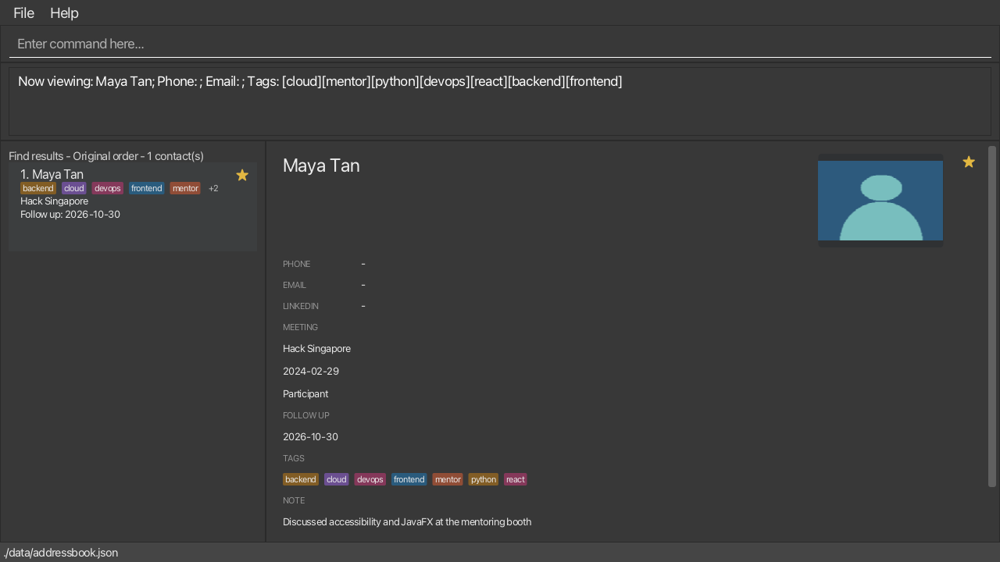
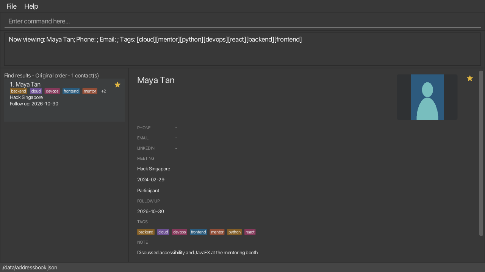

LarperBoard is a desktop app for keeping track of people you meet at hackathons. Add their contact details and LinkedIn handles, tag them by role or tech stack, and find them by name when it is time to reconnect. Its command-line-style input lets you work quickly from your laptop, while the graphical interface keeps the contact list and details visible.

* Table of Contents
{:toc}

--------------------------------------------------------------------------------------------------------------------

## Quick start

1. Ensure that Java `25` or later is installed on your computer.<br>
   **Mac users:** Ensure you have the precise JDK version prescribed [here](https://se-education.org/guides/tutorials/javaInstallationMac.html).

1. Download the latest `larperboard.jar` from the [LarperBoard releases page](https://github.com/AY2627S1-CS2103T-W12-2/tp/releases).

1. Copy the file to the folder you want to use as the _home folder_ for LarperBoard.

1. Open a terminal, `cd` to the folder containing the JAR file, and run `java -jar larperboard.jar`.<br>
   The LarperBoard window should appear in a few seconds with sample contacts.

1. Type a command in the command box and press Enter to execute it. For example, type **`help`** and press Enter to open the help window.<br>
   Some example commands you can try:

   * `list` : Lists all contacts.

   * `add n/Aisha Rahman p/98765432 e/aisha@example.com l/aisha-rahman t/frontend t/react` : Adds a hackathon contact with a LinkedIn handle and tech-stack tags.

   * `find Aisha` : Shows contacts whose names match `Aisha`.

   * `delete 1` : Deletes the 1st contact shown in the current list.

   * `clear` : Deletes all contacts.

   * `exit` : Exits the app.

   Two keyboard shortcuts save typing: press **Up** in the command box to bring back the command you typed before (see [Recalling previous commands](#recalling-previous-commands-up-and-down-arrows)), and press **F1** to open the help window.

1. Refer to the [Features](#features) section below for details of each command.

--------------------------------------------------------------------------------------------------------------------

## Features

This guide describes v1.4.1. `sort` supports `added`, `edited`, and `viewed`. Separate
`find`, `group`, and `filter` commands replace the previous filter; combined filters
and `sort name` / `sort starred` from [#128](https://github.com/AY2627S1-CS2103T-W12-2/tp/issues/128) are deferred.

<div markdown="block" class="alert alert-info">

**:information_source: Notes about the command format:**<br>

* Words in `UPPER_CASE` are the parameters to be supplied by the user.<br>
  For example, in `add n/NAME`, replace `NAME` with a value such as `John Doe`.

* Command words are not case-sensitive.<br>
  For example, `list`, `List` and `LIST` all work. Prefixes such as `n/` and `t/` must still be typed in lowercase.

* Items in square brackets are optional.<br>
  For example, `n/NAME [t/TAG]` can be used as `n/John Doe t/friend` or as `n/John Doe`.

* Items followed by `…`​ can appear zero or more times.<br>
  For example, `[t/TAG]…​` may be omitted, or written as `t/friend` or `t/friend t/family`.

* Put a required `INDEX` first; prefixed parameters can then be in any order.<br>
  For example, if the command specifies `n/NAME p/PHONE`, `p/PHONE n/NAME` is also acceptable.

* Spaces or tabs can separate prefixed parameters, including in pasted commands.
  The command box converts pasted tabs to spaces before running the command.

* Extraneous parameters for commands that take no parameters, such as `help`, `list`, `exit`, and `clear`, are ignored. The `undo` and `redo` commands reject arguments.<br>
  For example, `help 123` is interpreted as `help`.

* If you are using a PDF version of this document, be careful when copying and pasting commands that span multiple lines as space characters surrounding line-breaks may be omitted when copied over to the application.
</div>

### Viewing help: `help`

Opens the help window, which shows the web address of this User Guide and a **Copy URL** button. Use it when you want to look up how a command works. The help window does not explain the commands itself: open the address in your web browser to read this guide.

Format: `help`

* The result message is `Opened help window.`
* You can also open the help window from the **Help** menu, or by pressing **F1**.
* If the help window is already open, `help` brings it to the front. If you minimized it, see [Known issues](#known-issues).
* Reading this guide in your browser needs an internet connection. LarperBoard itself, and every command in it, works without one.
* Extra text after `help` is ignored, so `help 123` works like `help`.

**If you mistype a command:** when LarperBoard does not know the command, for example a typo such as `strar 1`, the result message is `Unknown command.` followed by every command you can use, in alphabetical order, for example `Unknown command. Available commands: add, clear, delete, …`. Check the spelling against that list, or use `help` to open this guide.


### Adding a contact: `add`

A successful add reports `New contact added:` followed by the contact details.

Adds a contact to LarperBoard.

Format: `add n/NAME [p/PHONE] [e/EMAIL] [l/LINKEDIN_HANDLE] [t/TAG]…​`

<div markdown="span" class="alert alert-primary">:bulb: **Tip:**
A contact can have any number of tags, including zero. Each tag is shown in one of several colours, chosen from its
name, so the same tag always looks the same in the contact list and detail panel.
</div>

* `LINKEDIN_HANDLE` is the last part of the contact's LinkedIn profile link (e.g. `john-doe` in `linkedin.com/in/john-doe`). It may contain only letters, digits and hyphens, and must be 3 to 50 characters long.
* `NAME` must contain 1 to 50 characters, and cannot be blank. It may contain letters of any language, digits, spaces, hyphens and apostrophes (straight `'` or curly `’`), for example `Mary-Jane`, `O'Brien`, `José` or `李明`, but must start with a letter or digit. Other symbols such as `.`, `/` and emoji are not accepted, so `John s/o Raj` must be written without the `/`, for example `John s o Raj`. Leading and trailing spaces are removed, and repeated whitespace is collapsed.
* `PHONE` is optional and must contain 3 to 20 digits when supplied.
* `EMAIL` is optional and must be a valid email address of at most 254 characters when supplied.
* A contact is a duplicate when its name matches an existing contact's name ignoring case and its phone number is the same. A different phone number permits the same name. Duplicate contacts cannot be added.
  LarperBoard reports `A contact with this name and phone number already exists. Edit that contact instead.`
* If a `find`, `group`, `filter starred` or `due` result is showing, `add` keeps it and updates the count. The new contact is listed only if it matches, otherwise it is saved but not shown, so use [`list`](#listing-all-contacts-list) to see every contact. A new contact has no follow-up date, so it never appears in a `due` result. When the new contact is not listed, the result message ends with `(hidden by the filter; use list to see all)`.
* In the contact list, a card shows its tags on a single row. If they do not all fit, the row ends with `+N`, where `N` is the number of tags left out. Use `view INDEX` to see all of a contact's tags.

Examples:
* `add n/Jane Tan`
* `add n/Betsy Crowe p/1234567 e/betsycrowe@example.com l/betsy-crowe t/friend t/criminal`

### Listing all contacts: `list`

Clears the active contact filter and sort, then shows all contacts in their original order.
The result message is `Listed all contacts.`, including when the list is empty.

Format: `list`

* Use `list` to return to the full, original-order list after `find`, `group`, `filter starred`, or `due`.
* `list` does not clear command history.
* No arguments are needed. Extra text, such as `list extra`, is ignored and has the same effect as `list`.

### Reading the list heading

The heading above the contact list keeps showing the active filter, order, and result count,
even after another command such as `view` replaces the command-result message.
When all contacts are shown in their original order, the heading is `Original order - N contact(s)`. For example, `group t/react` shows `Group: react - Original order - 6 contact(s)` when six contacts match.
`filter starred` shows `Starred only`, while plain and typed `find` show `Find results`.
The search heading identifies an active search but does not repeat the search terms.
`due` shows `Due on/before YYYY-MM-DD`, using the date when the command ran, and sets the order part to `Sorted by due`.

Changing the filter replaces its label; filters do not combine in this release.
Sorting sets the order part to `Sorted by added`, `Sorted by edited`, or `Sorted by viewed` while keeping the filter label, and the count updates when contacts change, including to zero.
`filter starred off` removes the filter label while keeping the sort.

### Sorting contacts by activity time: `sort`

Sorts the currently displayed contacts by a recorded activity time. The active order and result count are shown above
the contact list, and the result message is `Sorted by CRITERION (newest first).` followed by `N contact(s) listed!`.

Format: `sort added|edited|viewed`

* Sort keywords are case-insensitive: `sort Added`, `sort ADDED`, and `sort added` behave the same.
  So is the command word, so `SORT added` works too.
* `sort added` puts most recently added contacts first.
* `sort edited` puts most recently edited contacts first.
* `sort viewed` puts most recently viewed contacts first. Viewing a contact can therefore move it in this list.
* Contacts without the chosen recorded time appear last. Contacts with equal times keep their original list order.
* `sort` keeps the current filter (`find`, `group`, `filter starred`, or `due`) and the viewed contact. Later `find`, `group`, and `filter` commands keep the sort.
* The displayed indexes follow the order you see, so commands such as `view`, `edit`, `delete`, and `tag` use the
  sorted contact index.
* Use `list` to return to the full, original-order list.

Examples:

* `sort added` shows the newest contacts first.
* `sort viewed` followed by `view 2` records that view and may move that contact to the top.

Missing or unsupported criteria, such as `sort` or `sort name`, and extra arguments show:

```text
Invalid command format!
Use sort added, sort edited, or sort viewed (case-insensitive).
```

### Editing a contact: `edit`

A successful edit reports `Edited contact:` followed by the contact details. A duplicate edit reports `Another contact has this name and phone number. Choose a different name or phone number.`

Edits an existing contact in LarperBoard.

Format: `edit INDEX [n/NAME] [p/PHONE] [e/EMAIL] [l/LINKEDIN_HANDLE] [t/TAG]…​`

* Edits the contact at the specified `INDEX`. The index refers to the number shown in the displayed contact list. The index **must be a positive integer** 1, 2, 3, …​
* At least one of the optional fields must be provided.
* Existing values will be updated to the input values.
* When editing tags, all of the contact's existing tags are replaced; adding tags with `edit` is not cumulative.
* To remove all of a contact's tags, enter `t/` without a tag after it.
* To remove a contact's LinkedIn handle, enter `l/` without a handle after it.
* If the supplied values already match the contact, the command reports `Person unchanged:` followed by the
  contact's details. The displayed list, activity times, and undo history stay unchanged.
* If an edit would give two contacts the same name and phone number, choose a different name or phone number.

Examples:
* `edit 1 p/91234567 e/johndoe@example.com` changes the 1st contact's phone number and email address to `91234567` and `johndoe@example.com`.
* `edit 2 n/Betsy Crower t/` changes the 2nd contact's name to `Betsy Crower` and clears all existing tags.

### Adding tags to a contact: `tag`

Adds one or more tags to an existing contact without removing its current tags.

Format: `tag INDEX t/TAG [t/TAG]…​`

* `INDEX` refers to the contact's number in the currently displayed list and **must be a positive integer** 1, 2, 3, …​
* At least one nonempty `t/TAG` is required. A tag must be 1 to 20 characters long and contain only `A`–`Z`, `a`–`z`, digits, hyphens (`-`), or plus signs (`+`).
* Tags are stored in lowercase. Repeating a tag with different capitalization, or adding a tag the contact already has, keeps only one copy. If every requested tag is already present, the command reports `Tags unchanged:` followed by the contact's details. The last-edited time and undo history stay unchanged.
* When tags are added, the command reports `Updated contact:` followed by the contact's details.
* Use `edit INDEX t/TAG` to replace all tags, or `edit INDEX t/` to remove them all.

Examples:
* `tag 1 t/frontend t/React` adds `frontend` and `react` to the 1st displayed contact.
* `find Aisha` followed by `tag 1 t/mentor` adds `mentor` to the 1st contact in the search results.
* `tag 1 t/Java t/java` adds only one `java` tag.

### Adding a note to a contact: `note`

Keeps one free-form note on a contact, for example where you met them or what to follow up on. Use it for anything that does not fit the other fields. You can search notes later with [`find nt/TERM`](#locating-contacts-find).

Format: `note INDEX nt/NOTE` or `note INDEX clear`

* **To save a note**, type `nt/` followed by the text. A contact that already has a note gets the new text instead; the old note is replaced, not added to.
* **To remove a note**, type `clear` instead of `nt/NOTE`. `clear` can be in any letter case, so `CLEAR` works too.
* `INDEX` refers to the contact's number in the currently displayed list and **must be a positive integer** 1, 2, 3, …​
* `NOTE` can be up to **1000 characters**. It can contain spaces, punctuation and `/`. An emoji such as 😀 counts as one character, but an emoji made of several parts, such as a flag or a family, counts as several.
* Spaces at the start and end of `NOTE` are removed. A note that is empty or only spaces is not accepted: use `note INDEX clear` to remove a note.
* Use `nt/` only once in a command.
* The note is not shown in the contact list. [`view`](#viewing-a-contact-view) the contact to read it in full in the detail panel, and scroll the panel if the note is long.

The result message tells you what happened:

Situation | Message
----------|--------
Note saved | `Saved the note for NAME.`
Note removed | `Cleared the note for NAME.`
The new note is the same as the old one | `The note for NAME is already that text. Nothing was changed.`
`clear` on a contact with no note | `NAME has no note to clear. Nothing was changed.`

When nothing is changed, the contact's last edited time stays as it was.

Examples:
* `note 1 nt/Met at the AI track, wants a React teammate` sets the note of the 1st contact.
* `find Aisha` followed by `note 1 nt/Follow up after the demo` sets the note of the 1st contact in the search results.
* `note 2 clear` removes the note of the 2nd contact.

If the command cannot be carried out, LarperBoard shows one of these errors:

Input or situation | Message
-------------------|--------
`note` or `note nt/text` (no index) | `Invalid command format!` then `Add the contact's INDEX: note INDEX nt/NOTE or note INDEX clear.`
`note 1` (no note and no `clear`) | `Invalid command format!` then `Add nt/NOTE, or use: note INDEX clear.`
`note 1 some text` (text without `nt/`) | `Invalid command format!` then `Put the note after nt/: note INDEX nt/NOTE.`
`note 1 2 nt/text` or `note 1 clear extra` (too many parameters) | `Invalid command format!` then `Too many parameters. Use: note INDEX nt/NOTE or note INDEX clear.`
`note 1 clear nt/text` (both forms together) | `Invalid command format!` then `Use nt/NOTE or clear, not both.`
`note 1 nt/` (empty or only spaces) | `Note cannot be blank. Use 'note INDEX clear' to remove it.`
A note of more than 1000 characters | `Note must be at most 1000 characters.`
`note 1 nt/a nt/b` (`nt/` used twice) | `Multiple values specified for the following single-valued field(s): nt/`
`note 0 nt/text`, `note abc clear`, or an index larger than the number of contacts shown | `The person index provided is invalid.`
A valid `note` command when the displayed list is empty | `The person list is empty.`

### Locating contacts: `find`

Use plain name keywords or typed field prefixes. A valid search may return zero contacts.
Both forms report `N contact(s) listed!`, where `N` is the number of matches, including zero. `find` replaces the current `find`, `group`, `filter`, or `due` result while keeping any active sort and the viewed contact.

Aspect | Plain `find Han` | Typed `find n/Han`
-------|------------------|-------------------
Searches | Names only | Names `n/`, tags `t/`, notes `nt/`, event names `ev/`
Matching | Whole words: does **not** find `Hans Gruber` | Partial text: **does** find `Hans Gruber`
Several terms | Any keyword matches (OR) | OR within one field, AND across fields
Letter case | Ignored | Ignored
Cannot search | Phone, email, LinkedIn handle, meeting date or role, follow-up date, photo | Same

Plain format: `find KEYWORD [MORE_KEYWORDS]…​`

* Plain search is case-insensitive and considers only names.
* Plain keywords use full-word matching and OR semantics; for example, `find Hans Bo` finds `Hans Gruber` or `Bo Yang`, while `Han` does not match `Hans`.
* A name with a hyphen or apostrophe, such as `Mary-Jane`, counts as one word, so `find Mary` does not find it. Use `find Mary-Jane`, or `find n/Mary` to match part of the name.
* Accents count when you search: `find José` finds `José Tan`, but `find Jose` does not. Letter case is still ignored, so `find josé` works.

Typed format: `find [n/TERM] [t/TERM] [nt/TERM] [ev/TERM]…​`

* `n/` searches names, `t/` searches tags, `nt/` searches note text, and `ev/` searches meeting event names.
* Typed terms match partial text and ignore case.
* Repeated terms in one field use OR. Different fields use AND. For example, `find n/Alex n/Sam t/hackathon` finds an Alex or Sam contact that also has a `hackathon` tag.
* Do not mix plain keywords and typed prefixes. The message is `Use either plain keywords or field prefixes in one find command.`
  followed by `Example: find Alex or find n/Alex t/react.`
* Empty terms and malformed prefixes show the find syntax hint below, except a space inside a known prefix (such as `t /react`), which reports `Invalid command format!` followed by `Remove the space before '/': use n/Alice or t/react.`
* Other command fields (`e/`, `p/`, `l/`, `d/`, `md/`, `r/`, and `f/`) are not supported by `find`.
  At the start of the arguments or after whitespace, these prefixes give the same find syntax hint,
  even after a valid search field: for example, `find n/aisha e/p0@example.com` is invalid, not a zero-match search.
  Ordinary slash-containing text in typed terms, such as `find ev/ai/ml workshop` or `find nt/c/o NUS`, remains valid.
  This also means a note or event search cannot contain these reserved prefixes after whitespace:
  `find nt/likes r/java` is rejected even if `r/java` is intended as literal note text.
* Indexes always refer to the contacts currently displayed. Use `list` to return to the full, original-order list. A rejected `find` command leaves the list, the heading, and the viewed contact as they were.

Examples:
* `find Aisha Ben` finds contacts named `Aisha Rahman` or `Ben Tan` when both have been added.
* `find t/react nt/teammate` finds contacts tagged `react` whose note contains `teammate`.
* `find ev/hack singapore` finds contacts whose event name contains `hack singapore`.

Missing terms, empty fields (for example, `find n/`), or unsupported fields (for example,
`find n/Aisha e/private@example.com`) show the following hint without repeating your input:

```text
Invalid command format!
Use find KEYWORD [MORE_KEYWORDS] or find [n/TERM] [t/TERM] [nt/TERM] [ev/TERM].
Supply at least one non-empty term; typed fields may repeat.
```

An invalid search leaves the current results and viewed contact unchanged. A valid search with no matches
reports `0 contact(s) listed!`; it is not an error.

### Grouping contacts by tag: `group`

Shows contacts with the specified tag.

Format: `group t/TAG`

* Tag matching is case-insensitive and matches the whole tag name. A tag must follow the same rules as `tag` (1 to 20 letters, digits, hyphens, or plus signs).
* The result message is `Group: [TAG]` followed by a new line and `N contact(s) listed!`. No contact having the tag is a normal result: the list is empty and `N` is `0`.
* `group` replaces the current `find`, `group`, `filter`, or `due` result rather than combining with it, while keeping any active sort and the viewed contact.
* Use `list` to return to the full, original-order contact list.

Examples:
* `group t/react`
* `group t/UI-UX`

If `t/` is missing or preceded by extra text, the error is `Invalid command format!` followed by
`Use group t/TAG with one tag, e.g. group t/react.`
An empty, invalid, or overlong tag reports
`Tags should contain only letters, digits, hyphens, and plus signs, and be 1 to 20 characters long`.
Two `t/` fields report `Multiple values specified for the following single-valued field(s): t/`;
use just one tag. These errors leave the current list and viewed contact unchanged.
An accepted tag with no matches produces a normal zero-contact result, not an error.

### Starring important contacts: `star` and `unstar`

Marks a contact as important with a star so that you can find them quickly, or removes the star again. After you star some contacts, [`filter starred`](#showing-only-starred-contacts-filter) shows only those contacts.

Format: `star INDEX` or `unstar INDEX`

* `star` adds the star and `unstar` removes it.
* `INDEX` refers to the contact's number in the currently displayed list and **must be a positive integer** 1, 2, 3, …​
* A starred contact shows a ★ in the top right corner of its card in the contact list, and in the top right corner of the contact details.
* Stars are saved with your data, and you can reverse a change with [`undo`](#undoing-a-contact-change-undo).

The result message tells you what happened:

Situation | Message
----------|--------
`star` on a contact that is not starred | `Starred NAME.`
`unstar` on a starred contact | `Removed the star from NAME.`
`star` on a contact that is already starred | `NAME is already starred. Nothing was changed.`
`unstar` on a contact that is not starred | `NAME is not starred. Nothing was changed.`

Examples:
* `star 1` stars the first contact in the displayed list.
* `unstar 1` removes the star from it.

If the command cannot be carried out, LarperBoard shows one of these errors (`unstar` gives the same messages with `unstar` in place of `star`):

Input or situation | Message
-------------------|--------
`star` (no index) | `Invalid command format!` then `Add the contact's INDEX: star INDEX.`
`star 1 2` or `star 1 junk` (more than the index) | `Invalid command format!` then `Use one INDEX only: star INDEX.`
`star 0`, `star abc`, or an index larger than the number of contacts shown | `The person index provided is invalid.`
A valid `star` command when the displayed list is empty | `The person list is empty.`

### Showing only starred contacts: `filter`

Shows only the contacts you have starred with [`star`](#starring-important-contacts-star-and-unstar), or shows all contacts again. `starred` is the only thing you can filter by.

Format: `filter starred` or `filter starred off`

* `filter starred` hides every contact that is not starred. If you have not starred anyone, the list is empty.
* `filter starred off` shows every contact again. [`list`](#listing-all-contacts-list) does the same.
* The keywords are case-insensitive, so `filter Starred OFF` works.
* While the filter is on, the list heading shows `Starred only` (see [Reading the list heading](#reading-the-list-heading)).
* `filter` replaces the current `find`, `group` or `filter` result rather than combining with it.
* Indexes follow the filtered list, so `unstar 1` removes the star from the first contact you can see.

The result message is `Showing only starred contacts.` or `Showing all contacts.`, followed by `N contact(s) listed!`.

Examples:
* `filter starred` shows only the starred contacts.
* `filter starred off` shows every contact again.

If the command cannot be carried out, LarperBoard shows one of these errors:

Input | Message
------|--------
`filter` (nothing after it) | `Invalid command format!` then `Add starred: filter starred, or filter starred off.`
`filter foo`, `filter off`, or `filter starred extra` | `Invalid command format!` then `Use: filter starred, or filter starred off.`

### Deleting a contact: `delete`

A successful deletion reports `Deleted contact:` followed by the deleted contact details.

Deletes the specified contact from the displayed list.

Format: `delete INDEX`

* Deletes the contact at the specified `INDEX`.
* The index refers to the number shown in the displayed contact list.
* The index **must be a positive integer** 1, 2, 3, …​

Examples:
* `list` followed by `delete 2` deletes the 2nd contact in LarperBoard.
* `find Aisha` followed by `delete 1` deletes the 1st contact in the search results.

If deletion cannot be completed, LarperBoard shows these errors:

Input or situation | Message
-------------------|--------
A valid `delete INDEX` when the displayed list is empty | `The person list is empty.`
`delete 1 2` (more than one index) | `Only one index parameter is accepted.` (with the invalid-format message and usage)
`delete` (missing index) | `Invalid command format!` followed by the command usage
`delete 0`, `delete -1`, `delete abc`, or `delete 2147483648` (invalid or oversized index) | `The person index provided is invalid.`
`delete 99` when the displayed list is nonempty but has fewer than 99 contacts | `The person index provided is invalid.`

### Viewing a contact: `view`

Shows the selected contact's full details in the detail panel, next to the contact list. It does not change the contact's details, but it does record the time you last viewed the contact. This time is saved in the data file. The detail panel lists when the contact was created, last edited and last viewed in Singapore time, with `—` for a time that is not known.

Format: `view INDEX`

* `INDEX` refers to the contact's number in the currently displayed list and **must be a positive integer** 1, 2, 3, …​
* The detail panel shows the contact's name, a ★ when starred, their photo (or a `No photo` placeholder), phone number, email, LinkedIn handle, tags in alphabetical order, note, meeting event, meeting date, meeting role, follow-up date, and activity times. A field that the contact does not have is shown as `-` (`—` for an unknown activity time).
* The detail panel shows `No contact selected` until you view a contact. A successful command also reports `Now viewing:` followed by the contact's name, phone, email, LinkedIn handle (if present), and tags.
* The detail panel stays on the contact you viewed until you view someone else. It updates when you change that contact (`edit`, `tag`, `note`, `star`/`unstar`, `meeting`, `followup`, or `photo`), and goes back to `No contact selected` if you delete that contact, clear all entries, or run `edit`, `followup`, `meeting`, or `star`/`unstar` so that the viewed contact leaves the current filtered list (for example, `unstar` in the starred list, or clearing its follow-up date in the due list).
* `find`, `group`, `filter`, `due`, `sort`, and `list` change the contact list without clearing the detail panel, even if the viewed contact is hidden or there are no results. A later `view INDEX` selects from the currently displayed results, not from the retained detail panel. A rejected `view` command leaves the viewed contact and its last viewed time as they were.

Examples:
* `view 1` shows the 1st displayed contact.<br>
  
* `find Aisha` followed by `view 1` shows the 1st contact in the search results.

If the contact cannot be viewed, LarperBoard shows these errors:

Input or situation | Message
-------------------|--------
A valid `view INDEX` when the displayed list is empty | `The person list is empty.`
`view 1 2` (more than one index) | `Invalid command format!`, then `Only one index parameter is accepted.`, then the view hint below
`view` (missing index) | `Invalid command format!` followed by the view hint below
`view 0`, `view -1`, `view abc`, or `view 2147483648` (invalid or oversized index) | `The person index provided is invalid.`
`view 99` when the displayed list is nonempty but has fewer than 99 contacts | `The person index provided is invalid.`

For missing or extra arguments, the usage hint is
`Use view INDEX with one positive displayed index, e.g. view 1.`
For an invalid index, choose a number actually shown beside a contact, not the position of a hidden viewed contact.
If the displayed list is empty, run `list` to show all saved contacts before choosing an index.
Failed `view` commands do not replace the viewed contact or update its activity time.

### Clearing all entries: `clear`

Clearing a nonempty list reports `All contacts have been cleared!`.

Clears all contacts from LarperBoard.

Format: `clear`

If there are no contacts, LarperBoard reports `No contacts to clear.`

### Undoing a contact change: `undo`

Restores the contact list, displayed results, and viewed contact from before the most recent successful contact change. The restored contacts are saved to the data file. If there is no change to undo, LarperBoard reports `Nothing to undo.`

Format: `undo`

Up to 50 contact changes are available during the current app session. Adding, editing, tagging,
deleting, clearing, setting or clearing notes, starring or unstarring, changing follow-up dates,
changing meeting context, and attaching, replacing, or clearing photos can enter this history.
Each `undo` reverses one successful change. Failed commands, commands that leave contacts unchanged,
and commands such as `view`, `find`, and `list` do not add a step. Undo restores saved
contact details and their last-edited times without marking them as edited again. A later explicit
view time is kept for a contact that survives the undo; restoring a deleted contact does not count
as a new view. The history is not saved: after closing and reopening LarperBoard, restored contact
data remains in the JSON file, but no earlier undo steps are available.

For example, `add n/Jane Tan` followed by `undo` removes Jane. A second `undo` reports
`Nothing to undo.` if there were no earlier contact changes in this session.

### Redoing an undone contact change: `redo`

Reapplies the most recently undone contact change in the current app session and saves the restored
contacts to the data file. Format: `redo`. If there is no undone change, LarperBoard reports
`Nothing to redo.` You can redo several changes in reverse undo order, up to the 50-step history
limit. `redo` restores contact details, activity times, the displayed list and sort, and the viewed
contact without marking the contacts as edited again. Later explicit views of surviving contacts
are kept.

A new successful contact change after `undo` clears the redo steps. Failed commands, failed saves,
changes that leave contacts unchanged, and view or list commands keep them. Photo redo restores the
saved photo reference; imported image files are retained. Redo history is not available after the
app is closed and reopened, although the redone contacts remain in the data file.

For example, after `add n/Jane Tan` and `undo`, `redo` restores Jane. Adding a different contact
before `redo` instead removes that redo step.

### Exiting the program: `exit`

The exit message is `Exiting LarperBoard ...`.

Closes LarperBoard when you have finished. You do not need to save first: your contacts are already saved to the data file after every change.

Format: `exit`

* After `exit`, the window stays open for about one second so that you can read the message in the result box, then it closes. The command box does not accept input during that time.
* Choosing **Exit** from the **File** menu, or closing the window with its close button, closes LarperBoard at once.
* `undo`, `redo` and the [command history](#recalling-previous-commands-up-and-down-arrows) are cleared when the app closes. Your contacts are not.
* Extra text after `exit` is ignored, so `exit now` works like `exit`.

### Recalling previous commands: Up and Down arrows

Brings back commands that you submitted earlier in the same session, so that you can run or fix them without typing them again. This is useful after a typo: press **Up**, correct the command, and submit it again.

This is not Tab completion. LarperBoard does not complete a half-typed command when you press **Tab**.

* While the command box is selected, press the **Up** arrow to bring back the previous command, and press it again to go further back.
* Press the **Down** arrow to move forward again. After the newest command, the command box shows the text that you had typed before you started browsing.
* Every command you submit is remembered, including commands that fail, such as an unknown command or an invalid index. A command that is the same as the one just before it is remembered only once.
* LarperBoard remembers the latest 50 commands. The history is cleared when you close the app and is not saved in the data file.
* You can edit a recalled command before you submit it. Editing does not change the remembered command.
* The arrow keys only work in the command box, and only when no other key such as `Shift` or `Ctrl` is held down.
* Commands such as `list` and `clear` do not clear the history. They are remembered like any other command.

Examples:
* Submit `find Aisha` and then `view 1`. Press **Up** once to bring back `view 1`, and press **Up** again to bring back `find Aisha`.
* Type `tag 1 t/` without submitting it, press **Up** to bring back an earlier command, then press **Down** to get `tag 1 t/` back.

### Choosing between `meeting`, `followup` and `due`

Command | Use it to | Date prefix | Example
--------|-----------|-------------|--------
`meeting` | Record where, when and in what role you met a contact (looks back) | `md/` (meeting date) | `meeting 1 ev/Hack Singapore md/2026-10-20 r/Mentor`
`followup` | Set the date you plan to contact them again (looks ahead) | `d/` (follow-up date) | `followup 1 d/2026-10-27`
`due` | List contacts whose follow-up date is today or earlier | none | `due`

* The meeting date and the follow-up date are separate. Setting one never changes the other.
* `due` looks only at follow-up dates, so a meeting date alone never makes a contact due.
* `ev/` and `r/` belong to `meeting`. `ev/` also works in `find`.

### Recording meeting context: `meeting`

Record where, when, and in what role you met someone. To plan a later contact, use [`followup`](#setting-a-follow-up-date-followup); see [which command to use](#choosing-between-meeting-followup-and-due).



[View the simulated 150% layout](images/meeting-v1.4.1-150percent.png).

Format: `meeting INDEX [ev/EVENT] [md/YYYY-MM-DD] [r/ROLE]`

1. Record a meeting: `meeting 1 ev/Hack Singapore md/2026-10-20 r/Mentor`.
1. Change one field: `meeting 1 r/Participant`. Omitted fields stay unchanged.
1. Remove one field: `meeting 1 clear date`. Use `meeting 1 clear` to remove all context.
1. Find it later: `find ev/singapore`.

* Use the displayed index, including after a search.
* Clear one field with `clear event`, `clear date`, or `clear role`.
* Event/role: 1–80 UTF-16 code units, nonblank. Most letters count once; `😀` counts twice (40 fit). Notes use a different character count.
* Date: a real `YYYY-MM-DD` date, years 0001–9999, shown as a Singapore calendar date without conversion.
* Meeting fields never create tags.

An invalid event reports `Use 1–80 characters for the event (some emoji count twice).`; an invalid role
reports the same guidance for the role. Invalid dates report
`Enter a real meeting date as YYYY-MM-DD, e.g. 2026-10-29.` Invalid displayed indexes report
`The person index provided is invalid.` Failures leave the contact unchanged. Same-value updates
and clearing an already absent field are informational no-ops, with no timestamp or undo entry.

For an invalid command shape, `Invalid command format!` is followed by one hint:

Input | Hint
------|-----
`meeting` or `meeting ev/Event` | `Add the contact's INDEX: meeting INDEX ev/EVENT.`
`meeting 1` | `Add ev/, md/, or r/, or use: meeting INDEX clear.`
`meeting 1 Mentor` | `Put meeting details after ev/, md/, or r/.`
`meeting 1 clear ev/Event` | `Use meeting fields or clear, not both.`
`meeting 1 2 ev/Event` | `Use one INDEX, then ev/, md/, r/, or clear.`
`meeting 1 clear when` or `meeting 1 clear event extra` | `Use: meeting INDEX clear [event\|date\|role].`

Cards show up to 32 UTF-16 code units of the event; `view INDEX` shows full meeting details. Changing the viewed event so it leaves the current search clears selection.

`find ev/TERM [ev/TERM]...` matches partial event names, ignoring case, with OR between terms. No matches is valid; do not mix typed terms with plain name words.

JSON uses optional `meeting`, for example `"meeting": {"eventName": "Hack Singapore", "date": "2026-10-20", "role": "Mentor"}`. Missing/null fields mean absent values; clearing the final field omits the object. Invalid values reject loading with `Invalid contact data: 'meeting.<field>' <reason>.`; a non-object names `meeting`. [Back up before editing JSON](#editing-the-data-file).

Real changes update last-edited time and enter undo history only after saving.

### Setting a follow-up date: `followup`

Sets, replaces or removes the date by which you want to follow up with a contact, for example after a hackathon.

Format: `followup INDEX d/YYYY-MM-DD` or `followup INDEX clear`

* `INDEX` refers to the contact's number in the currently displayed list and **must be a positive integer** 1, 2, 3, …​
* `clear` can be typed in any letter case.
* The date must be a real calendar date in exactly `YYYY-MM-DD` format. Leap days such as `2028-02-29` are accepted; `2027-02-29` is not.
* A successful command reports `Follow-up date for NAME set to DATE.` or `Follow-up date cleared for NAME.`
* Setting the date a contact already has reports `NAME already has follow-up date DATE. Nothing was changed.`
* Clearing a date that is not set reports `NAME has no follow-up date to clear. Nothing was changed.`
* Neither case changes the last-edited time or adds an undo step.
* A real change counts as an edit of the contact and sets its last-edited time. You can reverse it with `undo`.
* The contact card shows `Follow up: DATE`. Once the date is before today (Singapore time), the card shows `Follow up: DATE (Overdue)` and the whole line turns red and bold. A date that is today is not overdue. The card is drawn when the list is shown, so it does not change at midnight until the list is next refreshed.
* `view INDEX` shows the full date in the detail panel.

Examples:
* `followup 1 d/2026-10-25` sets the follow-up date of the 1st displayed contact.
* `followup 1 clear` removes it.
* `due` followed by `followup 1 clear` removes the 1st contact of the due list from that list.

If the follow-up date cannot be set, LarperBoard shows these errors and leaves the contact unchanged:

Input or situation | Message
-------------------|--------
`followup 1 d/2026-02-30`, `followup 1 d/2027-02-29`, `followup 1 d/2026-1-5`, or `followup 1 d/` (date that is not real or not in `YYYY-MM-DD` format) | `Enter a real follow-up date as YYYY-MM-DD, e.g. 2026-10-25.`
`followup 0 d/2026-10-25`, `followup abc clear`, or `followup 2147483648 clear` (invalid or oversized index) | `The person index provided is invalid.`
`followup 99 d/2026-10-25` when the displayed list has fewer than 99 contacts, or any `followup` with an index when the displayed list is empty | `The person index provided is invalid.`
`followup`, `followup 1`, `followup 1 clear d/2026-10-25`, or `followup 1 2 d/2026-10-25` | `Invalid command format!` followed by the command usage
`followup 1 d/2026-10-25 d/2026-10-26` (`d/` used twice) | `Multiple values specified for the following single-valued field(s): d/`
The data file cannot be saved because it or its folder is not writable | `Could not save contacts. Nothing changed. Allow file/folder writes.`
The data file cannot be saved for another reason | `Could not save contacts. Nothing changed. Check file/folder access.`

The date is saved in the optional JSON field `followUpDate`, for example `"followUpDate": "2026-10-25"`. A missing or `null` value means no follow-up. A malformed value makes the data file invalid, so LarperBoard starts with an empty contact list and writes `Invalid contact data: 'followUpDate' must be a real date in YYYY-MM-DD format.` to its log. The next successful command other than `help` or `exit` (even `list`) saves the empty list over the file and the contacts in it are lost, so back up the file before editing it by hand. See [Editing the data file](#editing-the-data-file).

### Showing contacts due for follow-up: `due`

Shows the contacts that you planned to follow up with by today, so that you can see who to contact next.

Format: `due`

* Shows every contact whose follow-up date is today or earlier, with the earliest date first. Contacts with the same date stay in their original list order. Contacts with no follow-up date, or a date after today, are left out.
* "Today" is the Singapore date when you run the command. Nothing runs in the background, so run `due` again to refresh the list.
* A successful command reports `Due for follow-up on or before TODAY.` and then `N contact(s) listed!` on the next line, where `TODAY` is the date in `YYYY-MM-DD` format.
* `due` replaces any search, group, filter or sort that was active. A later `sort added|edited|viewed` can reorder the contacts it shows. `sort due` is not a valid sort.
* `due` does not clear the detail panel, even if the contact you are viewing is not due.
* The due-date order stays active for later `find`, `group` and `filter` commands, and the line above the list says `Sorted by due`, until you run `sort ...` or `list`.
* No contact being due is a normal result: the list is empty and the message ends with `0 contact(s) listed!`.
* Index commands such as `view 1` or `followup 1 clear` use the numbers shown in the due list. Clearing a date from the due list removes that contact from it. Setting a date after today does the same. If you were viewing that contact, the detail panel goes back to `No contact selected`. If you were viewing a different contact, the panel stays on it.
* `list` shows all contacts again in their original order.
* Any text typed after `due` is ignored.

Examples:
* `followup 2 d/2026-10-18` followed by `due` lists the second contact first if its date is the earliest.
* `due` when no contact has a date up to today reports `0 contact(s) listed!`.

### Contact photos: `photo`



[View the simulated 150% layout](images/photo-v1.4.1-150percent.png).

Format: `photo INDEX f/RELATIVE_PATH` or `photo INDEX clear`

1. Place a PNG/JPEG inside the folder containing `larperboard.jar`, for example `images/me.png`.
1. Check the contact's displayed index, then run `photo 1 f/images/me.png`.
1. Run `view 1` to see it. Repeat with another file to replace it, or run `photo 1 clear` to remove the reference.

* Paths may contain subfolders and spaces. Absolute paths, URLs, `..`, and symlinks escaping the JAR folder are rejected.
* Quote paths containing ` f/`: `photo 1 f/"my f/portrait.png"`. A space after `f/` is also allowed. Quoting does not bypass validation.
* Use readable PNG/JPEG files up to **5 MiB (5,242,880 bytes)** and **4096×4096 pixels**. The extension must match the image format.
* The JAR folder must be writable. Accepted images get unique names under `photos/`; JSON stores a relative reference, e.g. `"photoPath": "photos/contact-123.png"`.
* Photo paths stay relative to the JAR even when launched elsewhere. Gradle development uses the working folder.

Photo errors explain what to correct:

Problem | Error and recovery
--------|-------------------
Unsafe path (absolute path, `..`, or an escaping symlink) | `Use a relative path inside the JAR folder, e.g. images/me.png.`
Wrong type, mismatched extension, or damaged image | `Use a valid PNG or JPEG with a matching file extension.`
File too large or dimensions too big | `Choose a photo up to 5 MiB and 4096×4096 pixels.`
Missing or unreadable file | `Cannot read the photo. Check that the file exists and is readable.`
Cannot write the imported copy | `Cannot copy the photo. Check photos/ is writable inside the JAR folder.`
An unquoted path containing ` f/`, or multiple `f/` arguments | `Use one f/ path. Quote paths containing " f/": f/"my f/portrait.png"`
An unclosed quoted path without an embedded ` f/` | `Close both double quotes around the path: f/"portrait.png"`. An embedded ` f/` can produce the preceding quoting hint instead.
A closed quoted path followed by extra text, e.g. `photo 1 f/"portrait.png" extra` or `photo 1 f/"portrait.png"x` | `Put nothing after the closing quote: f/"portrait.png".`

An invalid displayed index reports `The person index provided is invalid.` Errors leave the contact unchanged.

For an invalid command shape, `Invalid command format!` is followed by one hint:

Input | Hint
------|-----
`photo` or `photo f/portrait.png` | `Add the contact's INDEX: photo INDEX f/PATH.`
`photo 1`, `photo 1 f/`, or `photo 1 f/" "` | `Add f/PATH, or use: photo INDEX clear.`
`photo 1 portrait.png` | `Put the photo path after f/: photo INDEX f/PATH.`
`photo 1 clear f/portrait.png` | `Use f/PATH or clear, not both.`
`photo 1 2 f/portrait.png` or `photo 1 clear extra` | `Use one INDEX before f/PATH or clear.`

Photos appear only in details (`view INDEX`), beside the name or below it on narrow panels. They preserve aspect ratio inside a 160×120 frame. Missing/invalid images show a same-size "No photo" placeholder and log a warning without blocking contacts. Unsafe paths are never opened; older JSON without `photoPath` loads without a photo.

**Imported images are retained** after replacement, clear, deletion, or failed saves so undo/redo can restore references. Keep `photos/` when transferring contacts; do not delete files still referenced by contacts or session history.

Reattaching the identical image or clearing an absent photo is a no-op. Real saved changes update last-edited time and enter undo history; failed saves restore contacts and history.


### Saving the data

Successful commands save automatically, except `help` and `exit`. You do not need a save command. If saving fails, contacts and history are restored; check file/folder access and retry. Technical details go to the log.

| Data | Default location |
|---|---|
| Contacts | `data/addressbook.json` under the **working folder** (where you launch the app). The status bar shows the path. |
| Imported photos | `photos/` beside the **JAR**, even when launched from another working folder. Gradle development uses the working folder. |

### Editing the data file

1. Close LarperBoard.
1. Back up `data/addressbook.json` and the managed `photos/` folder.
1. Edit the JSON, keeping the field rules below.
1. Reopen the app and confirm contacts loaded **before running another command**.

**Invalid JSON or contact values start the app with an empty list. A later successful command, even `list`, can overwrite the file.** If contacts are unexpectedly missing, close with `exit`, restore/repair the backup, and reopen. `help` and `exit` do not overwrite contact data.

Tags are saved as plain strings, for example `"tags": ["react"]`. This minimal contact file is valid:

```json
{
  "persons": [{"name": "Jane Tan", "tags": ["react"], "note": "Met at booth 4 😀"}]
}
```

Each contact in the data file can also have these optional time fields. A missing or `null` field means the time is not known.

Field | Meaning | Format
------|---------|-------
`createdAt` | When the contact was added | Whole-second UTC time written exactly like `"2026-10-17T04:12:33Z"`
`lastEditedAt` | When the contact's details last really changed | Same as `createdAt`
`lastViewedAt` | When the `view` command last showed the contact | Same as `createdAt`

Each contact can also have an optional `note` field: a string of at most 1000 characters. A missing or `null` field means the contact has no note. A note that is empty or only spaces, longer than 1000 characters, or not a string makes the data file invalid, so LarperBoard starts with an empty contact list and writes `Invalid contact data: 'note' must be a string of at most 1000 characters.` to its log.

Each contact can also have an optional `starred` field, which is `true` or `false`. A missing or `null` field means the contact is not starred. Any other value makes the data file invalid, so LarperBoard starts with an empty contact list and writes `Invalid contact data: 'starred' must be true or false.` to its log.

LarperBoard fills the time fields in for you. Contacts saved by an older version have no times and keep none until they are changed or viewed. A time with a fraction of a second, an offset such as `+08:00`, spaces, or any other format makes the data file invalid. LarperBoard then starts with an empty contact list and writes `Invalid contact data: 'createdAt' must be an ISO-8601 UTC timestamp.` (naming the field with the problem) to its log. The next successful command other than `help` or `exit` (even `list`) saves the empty list over the file and the contacts in it are lost, so back up the file before editing it. Times are shown in Singapore time (Asia/Singapore).

Each contact can also have an optional `followUpDate` field, a date written like `"2026-10-25"`. A missing or `null` field means the contact has no follow-up date. A value that is not a real date in `YYYY-MM-DD` format makes the data file invalid, with the same effect as above. See [Setting a follow-up date](#setting-a-follow-up-date-followup).

--------------------------------------------------------------------------------------------------------------------

## FAQ

**Q**: How do I transfer my data to another computer?<br>
**A**: Close both apps and back up destination files. Copy `data/addressbook.json` into the new working folder and `photos/` beside the new JAR, keeping relative paths. Copy `preferences.json` only for the same window settings. Session histories do not transfer.

--------------------------------------------------------------------------------------------------------------------

## Known issues

Meeting text counts supplementary characters twice, and an event preview can split a surrogate pair
when truncated. The pending [Unicode fix](https://github.com/AY2627S1-CS2103T-W12-2/tp/pull/181)
is not included in v1.4.1.

1. **When using multiple screens**, if you move the application to a secondary screen, and later switch to using only the primary screen, the GUI will open off-screen. The remedy is to delete the `preferences.json` file created by the application before running the application again.
2. **If you minimize the Help Window** and then run the `help` command (or use the `Help` menu, or the keyboard shortcut `F1`) again, the original Help Window will remain minimized, and no new Help Window will appear. The remedy is to manually restore the minimized Help Window.

--------------------------------------------------------------------------------------------------------------------

## Command summary

Action | Format, Examples
--------|------------------
**Add** | `add n/NAME [p/PHONE] [e/EMAIL] [l/LINKEDIN_HANDLE] [t/TAG]…​`<br> e.g., `add n/James Ho p/22224444 e/jamesho@example.com l/james-ho t/friend t/colleague`
**Clear** | `clear`
**Delete** | `delete INDEX`<br> e.g., `delete 3`
**Due** | `due`
**Edit** | `edit INDEX [n/NAME] [p/PHONE] [e/EMAIL] [l/LINKEDIN_HANDLE] [t/TAG]…​`<br> e.g., `edit 2 n/James Lee e/jameslee@example.com`
**Exit** | `exit`
**Filter** | `filter starred` or `filter starred off`
**Find** | `find KEYWORD [MORE_KEYWORDS]…​` or `find [n/TERM] [t/TERM] [nt/TERM] [ev/TERM]…​`<br> e.g., `find Aisha Ben`, `find n/James t/react`
**Follow-up** | `followup INDEX d/YYYY-MM-DD` or `followup INDEX clear`<br> e.g., `followup 1 d/2026-10-25`
**Group** | `group t/TAG`<br> e.g., `group t/react`
**Help** | `help`, or press **F1**
**List** | `list`
**Meeting** | `meeting INDEX [ev/EVENT] [md/YYYY-MM-DD] [r/ROLE]` or `meeting INDEX clear [event/date/role]`
**Photo** | `photo INDEX f/RELATIVE_PATH` or `photo INDEX clear`
**Note** | `note INDEX nt/NOTE` or `note INDEX clear`<br> e.g., `note 1 nt/Met at the AI track`
**Redo** | `redo`
**Sort** | `sort added|edited|viewed`<br> e.g., `sort viewed`
**Star** | `star INDEX`<br> e.g., `star 1`
**Tag** | `tag INDEX t/TAG [t/TAG]…​`<br> e.g., `tag 1 t/frontend t/react`
**Undo** | `undo`
**Unstar** | `unstar INDEX`<br> e.g., `unstar 1`
**View** | `view INDEX`<br> e.g., `view 1`
**Recall previous command** | Press **Up** or **Down** in the command box. See [Recalling previous commands](#recalling-previous-commands-up-and-down-arrows)

### Prefix cheat sheet

Prefix | Means | Used by
-------|-------|--------
`n/` | Name | `add`, `edit`, `find`
`p/` | Phone | `add`, `edit`
`e/` | Email | `add`, `edit`
`l/` | LinkedIn handle | `add`, `edit`
`t/` | Tag | `add`, `edit`, `tag`, `group`, `find`
`nt/` | Note | `note`, `find`
`ev/` | Meeting event | `meeting`, `find`
`md/` | Meeting date | `meeting`
`r/` | Meeting role | `meeting`
`d/` | Follow-up date | `followup`
`f/` | Photo file path | `photo`

`find` accepts only `n/`, `t/`, `nt/` and `ev/`. The other prefixes in this table give `Invalid command format!` when they start a word. See [Locating contacts](#locating-contacts-find).
