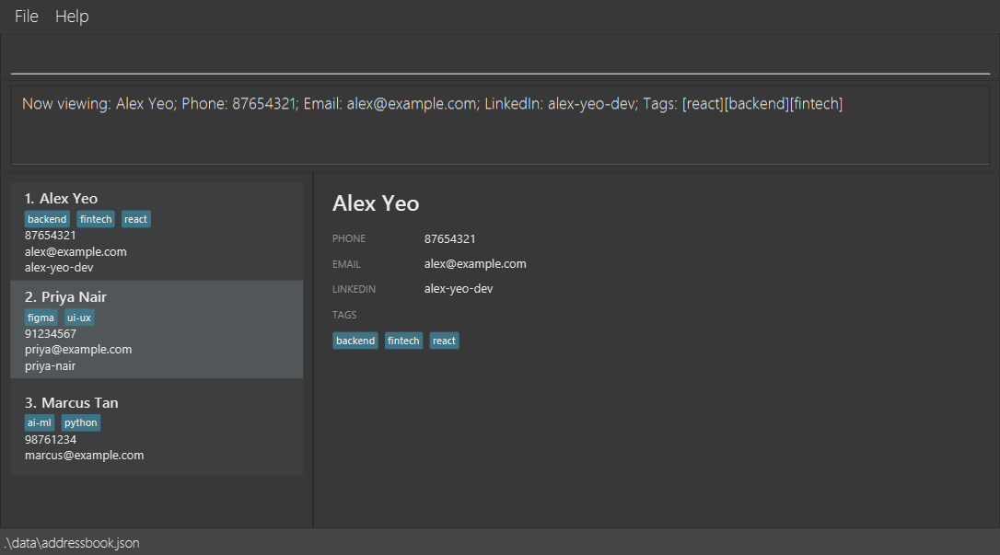
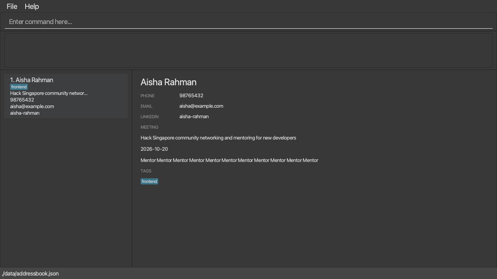
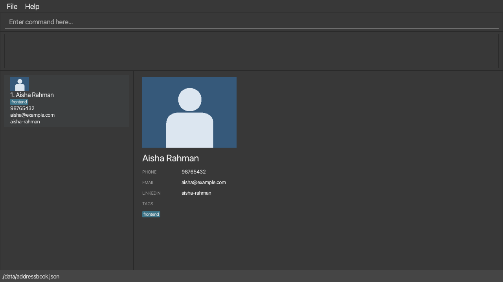

LarperBoard is a desktop app for keeping track of people you meet at hackathons. Add their contact details and LinkedIn handles, tag them by role or tech stack, and find them by name when it is time to reconnect. Its command-line-style input lets you work quickly from your laptop, while the graphical interface keeps the contact list and details visible.

* Table of Contents
{:toc}

--------------------------------------------------------------------------------------------------------------------

## Quick start

1. Ensure that Java `25` or later is installed on your computer.<br>
   **Mac users:** Ensure you have the precise JDK version prescribed [here](https://se-education.org/guides/tutorials/javaInstallationMac.html).

1. Download the latest `larperboard.jar` from the [LarperBoard releases page](https://github.com/AY2627S1-CS2103T-W12-2/tp/releases).

1. Copy the file to the folder you want to use as the _home folder_ for LarperBoard.

1. Open a terminal, `cd` to the folder containing the JAR file, and run `java -jar larperboard.jar`.<br>
   The LarperBoard window should appear in a few seconds with sample contacts.

1. Type a command in the command box and press Enter to execute it. For example, type **`help`** and press Enter to open the help window.<br>
   Some example commands you can try:

   * `list` : Lists all contacts.

   * `add n/Aisha Rahman p/98765432 e/aisha@example.com l/aisha-rahman t/frontend t/react` : Adds a hackathon contact with a LinkedIn handle and tech-stack tags.

   * `find Aisha` : Shows contacts whose names match `Aisha`.

   * `delete 1` : Deletes the 1st contact shown in the current list.

   * `clear` : Deletes all contacts.

   * `exit` : Exits the app.

1. Refer to the [Features](#features) section below for details of each command.

--------------------------------------------------------------------------------------------------------------------

## Features

<div markdown="block" class="alert alert-info">

**:information_source: Notes about the command format:**<br>

* Words in `UPPER_CASE` are the parameters to be supplied by the user.<br>
  For example, in `add n/NAME`, replace `NAME` with a value such as `John Doe`.

* Items in square brackets are optional.<br>
  For example, `n/NAME [t/TAG]` can be used as `n/John Doe t/friend` or as `n/John Doe`.

* Items followed by `…`​ can appear zero or more times.<br>
  For example, `[t/TAG]…​` may be omitted, or written as `t/friend` or `t/friend t/family`.

* Put a required `INDEX` first; prefixed parameters can then be in any order.<br>
  For example, if the command specifies `n/NAME p/PHONE`, `p/PHONE n/NAME` is also acceptable.

* Extraneous parameters for commands that take no parameters, such as `help`, `list`, `exit`, and `clear`, are ignored. The `undo` command rejects arguments.<br>
  For example, `help 123` is interpreted as `help`.

* If you are using a PDF version of this document, be careful when copying and pasting commands that span multiple lines as space characters surrounding line-breaks may be omitted when copied over to the application.
</div>

### Viewing help: `help`

Opens the help window with a link to this guide. The result message is `Opened help window.`

Format: `help`


### Adding a contact: `add`

Adds a contact to LarperBoard.

Format: `add n/NAME [p/PHONE] [e/EMAIL] [l/LINKEDIN_HANDLE] [t/TAG]…​`

<div markdown="span" class="alert alert-primary">:bulb: **Tip:**
A contact can have any number of tags, including zero.
</div>

* `LINKEDIN_HANDLE` is the last part of the contact's LinkedIn profile link (e.g. `john-doe` in `linkedin.com/in/john-doe`). It may contain only letters, digits and hyphens, and must be 3 to 50 characters long.
* `NAME` must contain only alphanumeric characters and spaces and cannot be blank. Leading and trailing spaces are removed.
* `PHONE` is optional and must contain 3 to 20 digits when supplied.
* `EMAIL` is optional and must be a valid email address when supplied.
* A contact is a duplicate when its name exactly matches an existing contact's name. Names are compared case-sensitively; a different phone number does not make the name unique. Duplicate contacts cannot be added.

Examples:
* `add n/Jane Tan`
* `add n/Betsy Crowe p/1234567 e/betsycrowe@example.com l/betsy-crowe t/friend t/criminal`

### Listing all contacts: `list`

Shows a list of all contacts in LarperBoard.

Format: `list`

* Use `list` to return to the full contact list after `find` or `group`.

### Editing a contact: `edit`

Edits an existing contact in LarperBoard.

Format: `edit INDEX [n/NAME] [p/PHONE] [e/EMAIL] [l/LINKEDIN_HANDLE] [t/TAG]…​`

* Edits the contact at the specified `INDEX`. The index refers to the number shown in the displayed contact list. The index **must be a positive integer** 1, 2, 3, …​
* At least one of the optional fields must be provided.
* Existing values will be updated to the input values.
* When editing tags, all of the contact's existing tags are replaced; adding tags with `edit` is not cumulative.
* To remove all of a contact's tags, enter `t/` without a tag after it.
* To remove a contact's LinkedIn handle, enter `l/` without a handle after it.

Examples:
* `edit 1 p/91234567 e/johndoe@example.com` changes the 1st contact's phone number and email address to `91234567` and `johndoe@example.com`.
* `edit 2 n/Betsy Crower t/` changes the 2nd contact's name to `Betsy Crower` and clears all existing tags.

### Adding tags to a contact: `tag`

Adds one or more tags to an existing contact without removing its current tags.

Format: `tag INDEX t/TAG [t/TAG]…​`

* `INDEX` refers to the contact's number in the currently displayed list and **must be a positive integer** 1, 2, 3, …​
* At least one nonempty `t/TAG` is required. A tag must be 1 to 20 characters long and contain only `A`–`Z`, `a`–`z`, digits, hyphens (`-`), or plus signs (`+`).
* Tags are stored in lowercase. Repeating a tag with different capitalization, or adding a tag the contact already has, keeps only one copy. The command still reports success if every requested tag is already present.
* A successful command reports `Updated Person:` followed by the contact's details.
* Use `edit INDEX t/TAG` to replace all tags, or `edit INDEX t/` to remove them all.

Examples:
* `tag 1 t/frontend t/React` adds `frontend` and `react` to the 1st displayed contact.
* `find Aisha` followed by `tag 1 t/mentor` adds `mentor` to the 1st contact in the search results.
* `tag 1 t/Java t/java` adds only one `java` tag.

### Adding a note to a contact: `note`

Sets, replaces or removes a free-form note on a contact, for example where you met them or what to follow up on.

Format: `note INDEX nt/NOTE` or `note INDEX clear`

* `INDEX` refers to the contact's number in the currently displayed list and **must be a positive integer** 1, 2, 3, …​
* `NOTE` can contain spaces and punctuation and can be up to 1000 characters long. Spaces at the start and end are removed. A note that is empty or only spaces is not accepted: use `note INDEX clear` to remove a note.
* Setting a note on a contact that already has one replaces the old note.
* The text after `nt/` is taken as typed, so it can contain `/`. Use `nt/` only once in a command.
* The note is shown in full in the detail panel when you [`view`](#viewing-a-contact-view) the contact, and it is not shown in the contact list. If the note is long, scroll the detail panel to read all of it.
* If the new note is the same as the old one, or you clear a contact that has no note, nothing is changed and the contact's last edited time stays as it was.

Examples:
* `note 1 nt/Met at the AI track, wants a React teammate` sets the note of the 1st contact.
* `find Aisha` followed by `note 1 nt/Follow up after the demo` sets the note of the 1st contact in the search results.
* `note 2 clear` removes the note of the 2nd contact.

If the note cannot be saved, LarperBoard shows these errors:

Input or situation | Message
-------------------|--------
`note`, `note 1`, or text without `nt/` such as `note 1 some text` | `Invalid command format!` followed by the command usage
`note 1 nt/` (empty or only spaces) | `Note cannot be blank. Use 'note INDEX clear' to remove it.`
A note of more than 1000 characters | `Note must be at most 1000 characters.`
`note 1 nt/a nt/b` (`nt/` used twice) | `Multiple values specified for the following single-valued field(s): nt/`
`note 0 nt/text`, `note abc clear`, or an index larger than the number of contacts shown | `The person index provided is invalid.`
A valid `note` command when the displayed list is empty | `The person list is empty.`

### Locating contacts by name: `find`

Finds contacts whose names contain any of the given keywords.

Format: `find KEYWORD [MORE_KEYWORDS]…​`

* The search is case-insensitive; for example, `hans` matches `Hans`.
* Keyword order does not matter; for example, `Hans Bo` matches `Bo Hans`.
* The search considers only names.
* Only full words match; for example, `Han` does not match `Hans`.
* Contacts matching at least one keyword are returned (an `OR` search); for example, `find Hans Bo` returns `Hans Gruber` and `Bo Yang`.

Examples:
* `find Aisha` returns the `Aisha Rahman` contact added in the quick start.
* `find Aisha Ben` returns contacts named `Aisha Rahman` or `Ben Tan` when both have been added.

### Grouping contacts by tag: `group`

Shows contacts with the specified tag.

Format: `group t/TAG`

* Tag matching is case-insensitive.
* The result message shows the selected tag and the number of matching contacts.
* `group` replaces the current `find` or `group` result rather than combining with it.
* Use `list` to return to the full contact list.

Examples:
* `group t/react`
* `group t/UI-UX`

### Deleting a contact: `delete`

Deletes the specified contact from the displayed list.

Format: `delete INDEX`

* Deletes the contact at the specified `INDEX`.
* The index refers to the number shown in the displayed contact list.
* The index **must be a positive integer** 1, 2, 3, …​

Examples:
* `list` followed by `delete 2` deletes the 2nd contact in LarperBoard.
* `find Aisha` followed by `delete 1` deletes the 1st contact in the search results.

If deletion cannot be completed, LarperBoard shows these errors:

Input or situation | Message
-------------------|--------
A valid `delete INDEX` when the displayed list is empty | `The person list is empty.`
`delete 1 2` (more than one index) | `Only one index parameter is accepted.` (with the invalid-format message and usage)
`delete` (missing index) | `Invalid command format!` followed by the command usage
`delete 0`, `delete -1`, `delete abc`, or `delete 2147483648` (invalid or oversized index) | `The person index provided is invalid.`
`delete 99` when the displayed list is nonempty but has fewer than 99 contacts | `The person index provided is invalid.`

### Viewing a contact: `view`

Shows the selected contact's full details in the detail panel, next to the contact list. It does not change the contact's details, but it does record the time you last viewed the contact. This time is saved in the data file. The detail panel lists when the contact was created, last edited and last viewed in Singapore time, with `—` for a time that is not known.

Format: `view INDEX`

* `INDEX` refers to the contact's number in the currently displayed list and **must be a positive integer** 1, 2, 3, …​
* The detail panel shows the contact's name, phone number, email, LinkedIn handle and all of their tags. A field that the contact does not have is shown as `-`.
* The detail panel shows `No contact selected` until you view a contact. A successful command also reports `Now viewing:` followed by the contact's details.
* The detail panel stays on the contact you viewed until you view someone else. It is updated if you edit or tag that contact, and goes back to `No contact selected` if you delete that contact or clear all entries.

Examples:
* `view 1` shows the 1st displayed contact.<br>
  
* `find Aisha` followed by `view 1` shows the 1st contact in the search results.

If the contact cannot be viewed, LarperBoard shows these errors:

Input or situation | Message
-------------------|--------
A valid `view INDEX` when the displayed list is empty | `The person list is empty.`
`view 1 2` (more than one index) | `Only one index parameter is accepted.` (with the invalid-format message and usage)
`view` (missing index) | `Invalid command format!` followed by the command usage
`view 0`, `view -1`, `view abc`, or `view 2147483648` (invalid or oversized index) | `The person index provided is invalid.`
`view 99` when the displayed list is nonempty but has fewer than 99 contacts | `The person index provided is invalid.`

### Clearing all entries: `clear`

Clears all contacts from LarperBoard.

Format: `clear`

### Undoing a contact change: `undo`

Restores the contact list, displayed results, and viewed contact from before the most recent successful contact change. The restored contacts are saved to the data file. If there is no change to undo, LarperBoard reports `Nothing to undo.`

Format: `undo`

Up to 50 contact changes are available during the current app session. Adding, editing, tagging, deleting, and clearing contacts can enter this history. Failed commands, commands that leave contacts unchanged, and `view`, `find`, and `list` do not. A later explicit view time is kept for a contact that survives the undo; restoring a deleted contact does not count as a new view.

### Exiting the program: `exit`

Exits the program.

Format: `exit`

### Recalling previous commands: Up and Down arrows

Brings back commands that you submitted earlier in the same session, so that you can run or fix them without typing them again.

* While the command box is selected, press the **Up** arrow to bring back the previous command, and press it again to go further back.
* Press the **Down** arrow to move forward again. After the newest command, the command box shows the text that you had typed before you started browsing.
* Every command you submit is remembered, including commands that fail, such as an unknown command or an invalid index. A command that is the same as the one just before it is remembered only once.
* LarperBoard remembers the latest 50 commands. The history is cleared when you close the app and is not saved in the data file.
* You can edit a recalled command before you submit it. Editing does not change the remembered command.
* The arrow keys only work in the command box, and only when no other key such as `Shift` or `Ctrl` is held down.
* Commands such as `list` and `clear` do not affect the history.

Examples:
* Submit `find Aisha` and then `view 1`. Press **Up** once to bring back `view 1`, and press **Up** again to bring back `find Aisha`.
* Type `tag 1 t/` without submitting it, press **Up** to bring back an earlier command, then press **Down** to get `tag 1 t/` back.

### Recording meeting context: `meeting`



[View the simulated 150% layout](images/meeting-feature-150percent.png).

Use `meeting INDEX [ev/EVENT] [md/YYYY-MM-DD] [r/ROLE]` to set or replace one or more fields.
Omitted fields keep their existing values. For example:

```text
meeting 1 ev/Hack Singapore md/2026-10-20 r/Mentor
meeting 1 r/Participant
meeting 1 clear date
meeting 1 clear
find ev/singapore
```

`meeting INDEX clear` removes all context. Add `event`, `date`, or `role` to clear only that field.
Indexes refer to the displayed list, including after a search. Event and role each accept 1–80
characters and cannot be blank. Dates must be real calendar dates in exactly YYYY-MM-DD format
(years 0001–9999); they are displayed as Singapore calendar dates without time-zone conversion.
Tags are independent and are never generated from meeting fields.

Invalid text reports `Event and role must each contain 1 to 80 characters.` Invalid dates report
`Date must be a real date in YYYY-MM-DD format.` A command with no fields reports
`Specify a meeting field or use 'meeting INDEX clear'.` Invalid displayed indexes report
`The person index provided is invalid.` Failures leave the contact unchanged. Same-value updates
and clearing an already absent field are informational no-ops, with no timestamp or undo entry.

The list shows an event cue of at most 32 characters; `view INDEX` shows full event, date, and role
in a vertically scrolling detail panel. Editing a viewed contact refreshes the panel. If changing
its event excludes it from the current event search, its selection is cleared.

`find ev/TERM [ev/TERM]...` matches partial event names without case sensitivity, using OR across
repeated terms. No match is a valid empty list. Do not mix event terms with plain name keywords.

Meeting context is saved in optional JSON `meeting`, for example
`"meeting": {"eventName": "Hack Singapore", "date": "2026-10-20", "role": "Mentor"}`.
Missing/null context and fields mean absent values. Clearing the final field omits the object.
Malformed present values reject loading with `Invalid contact data: 'meeting.<field>' <reason>.`;
a non-object context names `meeting`. Back up JSON before editing it manually.
Successful real changes update last-edited time and are saved before entering session undo history.

### Contact photos: `photo`



[View the simulated 150% layout](images/photo-feature-150percent.png).

Use `photo INDEX f/RELATIVE_PATH` to attach or replace one PNG/JPEG, or `photo INDEX clear` to
remove its reference. INDEX always refers to the displayed list. Place the source image inside the
folder containing `larperboard.jar`, for example:

```text
LarperBoard/
  larperboard.jar
  portrait.png
  photos/          (created and managed by the app)
```

```text
photo 1 f/portrait.png
photo 1 f/images/new-portrait.jpg
photo 1 clear
```

Subfolders and spaces in paths are allowed. Absolute paths, URLs, `..` traversal, and symlinks that
escape the JAR folder are rejected. Sources must be readable PNG/JPEG files, at most **5 MiB**
(5,242,880 bytes) and **4096×4096 pixels**. Both filename extension and decoded image format
must agree. The JAR folder must be writable. The application copies accepted images to `photos/`
with generated collision-safe names and saves a relative reference such as
`"photoPath": "photos/contact-123.png"` in the editable JSON. The root is the JAR folder even when
launched from another working directory. During development with Gradle it is the working folder.

Errors are `Photo file must be a PNG or JPEG inside the application folder.` for unsafe paths,
wrong types, or undecodable content; `Photo must be at most 5 MiB and 4096×4096 pixels.` for
size/dimension limits; and `Photo file could not be read.` for file-access failures.
An invalid displayed index reports `The person index provided is invalid.`

The list uses a 48×48 thumbnail and the scrolling detail panel fits the image within 240×180,
preserving its aspect ratio. Absent, missing, malformed, or unreadable references show a placeholder;
unavailable images also produce a log warning and do not prevent other contacts loading.
Unsafe saved paths are never opened. Old JSON without `photoPath` loads with no photo.

Clearing/replacing a photo or deleting/clearing contacts **does not delete imported images**.
Unused files may remain, including after a failed save, so undo/redo references remain usable.
An identical current image and clearing an absent photo are no-ops. Only real successful changes
update last-edited time and enter undo history; failed saves restore the contact and history.
Keep the `photos/` folder when transferring contacts to another installation. Do not delete images
that may still be referenced by a contact or session history.


### Saving the data

LarperBoard automatically saves data after every successful command. You do not need to save manually.

### Editing the data file

LarperBoard data is saved automatically as a JSON file `[JAR file location]/data/addressbook.json`. Advanced users are welcome to update data directly by editing that data file.

<div markdown="span" class="alert alert-warning">:exclamation: **Caution:**
If your changes make the data file invalid, LarperBoard starts with an empty contact list at the next run. The invalid file remains on disk until you run a successful command. We recommend backing up the file before editing it.<br>
Furthermore, certain edits can cause LarperBoard to behave in unexpected ways (e.g., if a value entered is outside of the acceptable range). Therefore, edit the data file only if you are confident that you can update it correctly.
</div>

Each contact in the data file can also have these optional time fields. A missing or `null` field means the time is not known.

Field | Meaning | Format
------|---------|-------
`createdAt` | When the contact was added | Whole-second UTC time written exactly like `"2026-10-17T04:12:33Z"`
`lastEditedAt` | When the contact's details last really changed | Same as `createdAt`
`lastViewedAt` | When the `view` command last showed the contact | Same as `createdAt`

Each contact can also have an optional `note` field: a string of at most 1000 characters. A missing or `null` field means the contact has no note. A note that is empty or only spaces, longer than 1000 characters, or not a string makes the data file invalid, and LarperBoard reports `Invalid contact data: 'note' must be a string of at most 1000 characters.`

LarperBoard fills the time fields in for you. Contacts saved by an older version have no times and keep none until they are changed or viewed. A time with a fraction of a second, an offset such as `+08:00`, spaces, or any other format makes the data file invalid, and LarperBoard reports `Invalid contact data: 'createdAt' must be an ISO-8601 UTC timestamp.` (naming the field with the problem). Times are shown in Singapore time (Asia/Singapore).

### Archiving data files `[coming in v2.0]`

_Details coming soon ..._

--------------------------------------------------------------------------------------------------------------------

## FAQ

**Q**: How do I transfer my data to another computer?<br>
**A**: Install the app on the other computer and overwrite the data file it creates with the data file from your previous LarperBoard home folder.

--------------------------------------------------------------------------------------------------------------------

## Known issues

1. **When using multiple screens**, if you move the application to a secondary screen, and later switch to using only the primary screen, the GUI will open off-screen. The remedy is to delete the `preferences.json` file created by the application before running the application again.
2. **If you minimize the Help Window** and then run the `help` command (or use the `Help` menu, or the keyboard shortcut `F1`) again, the original Help Window will remain minimized, and no new Help Window will appear. The remedy is to manually restore the minimized Help Window.

--------------------------------------------------------------------------------------------------------------------

## Command summary

Action | Format, Examples
--------|------------------
**Add** | `add n/NAME [p/PHONE] [e/EMAIL] [l/LINKEDIN_HANDLE] [t/TAG]…​`<br> e.g., `add n/James Ho p/22224444 e/jamesho@example.com l/james-ho t/friend t/colleague`
**Clear** | `clear`
**Delete** | `delete INDEX`<br> e.g., `delete 3`
**Edit** | `edit INDEX [n/NAME] [p/PHONE] [e/EMAIL] [l/LINKEDIN_HANDLE] [t/TAG]…​`<br> e.g., `edit 2 n/James Lee e/jameslee@example.com`
**Exit** | `exit`
**Find** | `find KEYWORD [MORE_KEYWORDS]…​`<br> e.g., `find James Jake`
**Group** | `group t/TAG`<br> e.g., `group t/react`
**Help** | `help`
**List** | `list`
**Meeting** | `meeting INDEX [ev/EVENT] [md/YYYY-MM-DD] [r/ROLE]` or `meeting INDEX clear [event/date/role]`

**Photo** | `photo INDEX f/RELATIVE_PATH` or `photo INDEX clear`
**Note** | `note INDEX nt/NOTE` or `note INDEX clear`<br> e.g., `note 1 nt/Met at the AI track`
**Tag** | `tag INDEX t/TAG [t/TAG]…​`<br> e.g., `tag 1 t/frontend t/react`
**Undo** | `undo`
**View** | `view INDEX`<br> e.g., `view 1`
