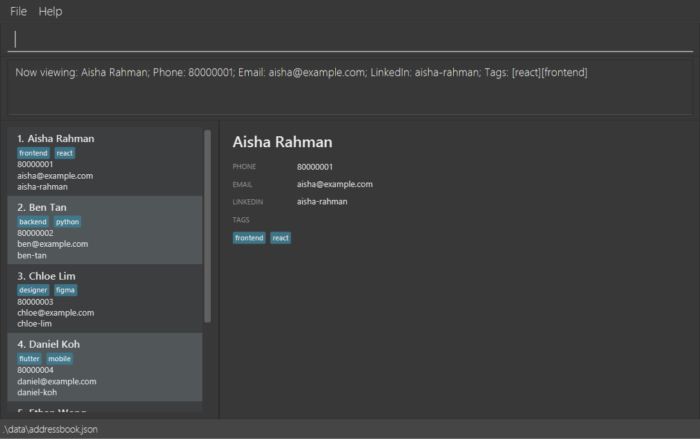

**LarperBoard is a desktop app for keeping track of people you meet at hackathons.** Add contact details, LinkedIn handles, and role or tech-stack tags with short commands, then find people by name when it is time to reconnect. The graphical interface keeps your contact list and details visible.

* To get started, download the JAR from the [team releases page](https://github.com/AY2627S1-CS2103T-W12-2/tp/releases) and follow the [**User Guide quick start**](UserGuide.html#quick-start).
* To contribute, see the [**Developer Guide**](DeveloperGuide.html).

**Acknowledgements**

* LarperBoard is based on the AddressBook-Level3 project created by the [SE-EDU initiative](https://se-education.org).
* Libraries used: [JavaFX](https://openjfx.io/), [Jackson](https://github.com/FasterXML/jackson), [JUnit5](https://github.com/junit-team/junit5)
